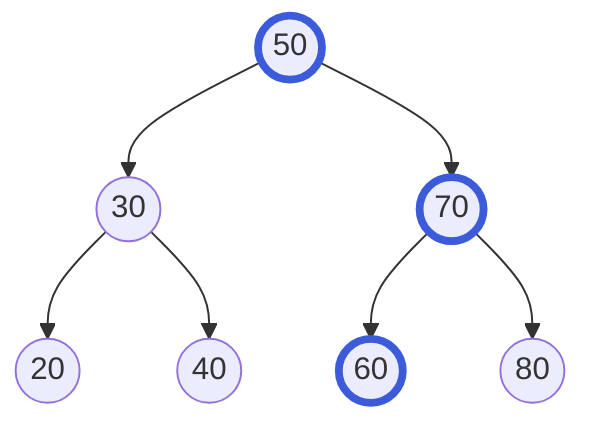
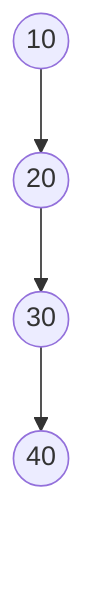

import Tabs from '@theme/Tabs';
import TabItem from '@theme/TabItem';

# Binary Search Tree

A **binary search tree** (BST) is a [binary tree](./tree.mdx) that keeps its values in order, so you can find any value by asking "smaller or bigger?" again and again.

## Idea

Remember the "higher or lower" guessing game. A friend thinks of a number from 1 to 100. You guess 50. They say "higher". Now you know the number is above 50, so you never guess below it again. You guess 75, they say "lower", and so on. Every answer throws away a big chunk of the possibilities.

A binary search tree is that game written down as a tree. Every node holds a value, and it follows one rule:

> Everything in a node's **left** subtree is **smaller** than the node. Everything in its **right** subtree is **bigger**.



To look for `60`, start at the root. `60` is bigger than `50`, so go right. `60` is smaller than `70`, so go left. You are at `60`. Found it, in 3 steps (the highlighted path), without looking at the other 4 values.

Notice that the rule is about **whole subtrees**, not just the direct children. Every value below `30`'s side of the tree is smaller than `50`, and everything on `70`'s side is bigger than `50`.

## How it works

### Search: go left or right

Start at the root and compare:

- If the value you want equals the node's value, you found it.
- If it is smaller, go to the left child.
- If it is bigger, go to the right child.
- If there is no child to go to, the value is not in the tree.

Each step moves one level down, so you take at most as many steps as the tree is tall.

### Insert: find the empty spot

To add `65`, search for it exactly as above. You go right at `50`, left at `70`, right at `60`, and there is nothing there. That empty spot is exactly where `65` belongs, so you attach a new node there. New values always become new leaves, and nothing else in the tree moves.

### Delete: three cases

Removing a node depends on how many children it has:

1. **No children (a leaf).** Just remove it.
2. **One child.** The child takes the removed node's place.
3. **Two children.** You cannot give both children to the parent, so use a trick: find the node's **successor**, the next bigger value, which is the smallest value in its right subtree (go right once, then left as far as possible). Copy that value into the node, then delete the successor from the right subtree. The successor never has a left child, so this deletion is the easy case 1 or 2.

For example, removing `50` from the tree above: its successor is `60` (go right to `70`, then left to `60`). Put `60` where `50` was, and remove the old `60` node. The order of the values is still correct.

### Sorted order for free

Walk the tree in-order (left subtree, node, right subtree, see the [Tree](./tree.mdx) page) and you get the values from smallest to biggest: `20 30 40 50 60 70 80`. Finding the smallest value means going left until you cannot, and the biggest means going right until you cannot.

### The shape matters

A BST is only fast if it is **balanced**: roughly the same number of nodes on the left and the right. Then each step throws away about half of what is left, like the guessing game.

But the shape depends on the **order** in which values were inserted. If values arrive already sorted, such as `10, 20, 30, 40`, every new value goes to the right of the previous one:



This is a [linked list](./linked-list.mdx) in disguise, and finding `40` takes 4 steps, one per value. With a million sorted values it would take a million steps.

The fix is a **self-balancing** binary search tree, such as an AVL tree or a red-black tree. After every insert or delete, it rearranges a few nodes to keep the tree from getting lopsided, so it stays fast no matter what order the values come in. They are tricky to write, and you rarely need to: C++ `std::set` and `std::map` are usually built from red-black trees, and Java's `TreeSet` and `TreeMap` are red-black trees.

## Code

The first example builds a plain BST by hand, with the three operations above. It keeps no duplicates, and it does not balance itself. It also shows the sorted-input problem at the end. To keep it short, the C and C++ versions do not check whether memory allocation worked.

The second example uses the ready-made sorted sets of each language.

### Build a binary search tree

<Tabs groupId="language">
  <TabItem value="c" label="C" default>

```c title="basics.c"
#include <stdio.h>
#include <stdlib.h>

typedef struct Node {
    int key;
    struct Node *left;
    struct Node *right;
} Node;

// Add key (no duplicates). Returns the root of the changed tree.
Node *insert(Node *root, int key) {
    if (root == NULL) {  // the empty spot: a new leaf goes here
        Node *node = malloc(sizeof(Node));
        node->key = key;
        node->left = NULL;
        node->right = NULL;
        return node;
    }
    if (key < root->key) root->left = insert(root->left, key);
    else if (key > root->key) root->right = insert(root->right, key);
    return root;  // an equal key is already there: do nothing
}

int contains(const Node *root, int key) {
    while (root != NULL) {
        if (key == root->key) return 1;  // found it
        // go left or right
        root = key < root->key ? root->left : root->right;
    }
    return 0;  // fell off the tree: not there
}

Node *smallest(Node *root) {  // keep going left
    while (root->left != NULL) root = root->left;
    return root;
}

// Remove key. Returns the root of the changed tree.
Node *remove_key(Node *root, int key) {
    if (root == NULL) return NULL;  // not found: nothing to do
    if (key < root->key) {
        root->left = remove_key(root->left, key);
    } else if (key > root->key) {
        root->right = remove_key(root->right, key);
    } else if (root->left == NULL || root->right == NULL) {
        // 0 or 1 child: the child (or NULL) takes its place
        Node *child = root->left != NULL ? root->left : root->right;
        free(root);
        return child;
    } else {
        // two children: copy the successor here, then delete it
        Node *next = smallest(root->right);
        root->key = next->key;
        root->right = remove_key(root->right, next->key);
    }
    return root;
}

int height(const Node *n) {
    if (n == NULL) return -1;  // an empty tree
    int left = height(n->left);
    int right = height(n->right);
    return 1 + (left > right ? left : right);
}

void print_inorder(const Node *n) {  // left, node, right
    if (n == NULL) return;
    print_inorder(n->left);
    printf(" %d", n->key);
    print_inorder(n->right);
}

void free_tree(Node *n) {
    if (n == NULL) return;
    free_tree(n->left);
    free_tree(n->right);
    free(n);
}

int main(void) {
    Node *root = NULL;
    int keys[] = {50, 30, 70, 20, 40, 60, 80};
    for (int i = 0; i < 7; i++) root = insert(root, keys[i]);

    printf("inorder:"); print_inorder(root); printf("\n");
    printf("has 60: %s\n", contains(root, 60) ? "yes" : "no");
    printf("has 65: %s\n", contains(root, 65) ? "yes" : "no");
    printf("height: %d\n", height(root));  // height: 2

    root = remove_key(root, 50);  // a node with two children
    printf("inorder:"); print_inorder(root); printf("\n");

    Node *chain = NULL;
    for (int key = 10; key <= 40; key += 10) {  // keys arrive sorted
        chain = insert(chain, key);
    }
    printf("chain height: %d\n", height(chain));  // chain height: 3

    free_tree(root);
    free_tree(chain);
    return 0;
}
```

  </TabItem>
  <TabItem value="cpp" label="C++">

```cpp title="basics.cpp"
#include <algorithm>
#include <iostream>

struct Node {
    int key;
    Node *left = nullptr;
    Node *right = nullptr;
};

// Add key (no duplicates). Returns the root of the changed tree.
Node *insert(Node *root, int key) {
    if (root == nullptr) return new Node{key};  // new leaf goes here
    if (key < root->key) root->left = insert(root->left, key);
    else if (key > root->key) root->right = insert(root->right, key);
    return root;  // an equal key is already there: do nothing
}

bool contains(const Node *root, int key) {
    while (root != nullptr) {
        if (key == root->key) return true;  // found it
        // go left or right
        root = key < root->key ? root->left : root->right;
    }
    return false;  // fell off the tree: not there
}

Node *smallest(Node *root) {  // keep going left
    while (root->left != nullptr) root = root->left;
    return root;
}

// Remove key. Returns the root of the changed tree.
Node *remove_key(Node *root, int key) {
    if (root == nullptr) return nullptr;  // not found: nothing to do
    if (key < root->key) {
        root->left = remove_key(root->left, key);
    } else if (key > root->key) {
        root->right = remove_key(root->right, key);
    } else if (root->left == nullptr || root->right == nullptr) {
        // 0 or 1 child: the child (or nullptr) takes its place
        Node *child = root->left != nullptr ? root->left : root->right;
        delete root;
        return child;
    } else {
        // two children: copy the successor here, then delete it
        Node *next = smallest(root->right);
        root->key = next->key;
        root->right = remove_key(root->right, next->key);
    }
    return root;
}

int height(const Node *n) {
    if (n == nullptr) return -1;  // an empty tree
    return 1 + std::max(height(n->left), height(n->right));
}

void print_inorder(const Node *n) {  // left, node, right
    if (n == nullptr) return;
    print_inorder(n->left);
    std::cout << " " << n->key;
    print_inorder(n->right);
}

void free_tree(Node *n) {
    if (n == nullptr) return;
    free_tree(n->left);
    free_tree(n->right);
    delete n;
}

const char *yn(bool b) { return b ? "yes" : "no"; }

int main() {
    Node *root = nullptr;
    for (int key : {50, 30, 70, 20, 40, 60, 80}) {
        root = insert(root, key);
    }

    std::cout << "inorder:"; print_inorder(root); std::cout << "\n";
    std::cout << "has 60: " << yn(contains(root, 60)) << "\n";
    std::cout << "has 65: " << yn(contains(root, 65)) << "\n";
    std::cout << "height: " << height(root) << "\n";  // height: 2

    root = remove_key(root, 50);  // a node with two children
    std::cout << "inorder:"; print_inorder(root); std::cout << "\n";

    Node *chain = nullptr;
    for (int key : {10, 20, 30, 40}) {  // keys arrive sorted
        chain = insert(chain, key);
    }
    std::cout << "chain height: " << height(chain) << "\n";  // 3

    free_tree(root);
    free_tree(chain);
}
```

  </TabItem>
  <TabItem value="python" label="Python">

```python title="basics.py"
class Node:
    def __init__(self, key):
        self.key = key
        self.left = None
        self.right = None


def insert(root, key):
    """Add key (no duplicates). Returns the new root."""
    if root is None:  # the empty spot: a new leaf goes here
        return Node(key)
    if key < root.key:
        root.left = insert(root.left, key)
    elif key > root.key:
        root.right = insert(root.right, key)
    return root  # an equal key is already there: do nothing


def contains(root, key):
    while root is not None:
        if key == root.key:
            return True  # found it
        # go left or right
        root = root.left if key < root.key else root.right
    return False  # fell off the tree: not there


def smallest(root):  # keep going left
    while root.left is not None:
        root = root.left
    return root


def remove(root, key):
    """Remove key. Returns the new root."""
    if root is None:
        return None  # not found: nothing to do
    if key < root.key:
        root.left = remove(root.left, key)
    elif key > root.key:
        root.right = remove(root.right, key)
    elif root.left is None or root.right is None:
        # 0 or 1 child: the child (or None) takes its place
        return root.left or root.right
    else:
        # two children: copy the successor here, then delete it
        nxt = smallest(root.right)
        root.key = nxt.key
        root.right = remove(root.right, nxt.key)
    return root


def height(n):
    if n is None:
        return -1  # an empty tree
    return 1 + max(height(n.left), height(n.right))


def inorder(n):  # left, node, right
    if n is None:
        return []
    return inorder(n.left) + [n.key] + inorder(n.right)


root = None
for key in [50, 30, 70, 20, 40, 60, 80]:
    root = insert(root, key)

print("inorder:", *inorder(root))
print("has 60:", "yes" if contains(root, 60) else "no")
print("has 65:", "yes" if contains(root, 65) else "no")
print("height:", height(root))  # height: 2

root = remove(root, 50)  # a node with two children
print("inorder:", *inorder(root))

chain = None
for key in [10, 20, 30, 40]:  # keys arrive sorted
    chain = insert(chain, key)
print("chain height:", height(chain))  # chain height: 3
```

  </TabItem>
  <TabItem value="java" label="Java">

```java title="Basics.java"
public class Basics {
    static class Node {
        int key;
        Node left;
        Node right;

        Node(int key) {
            this.key = key;
        }
    }

    // Add key (no duplicates). Returns the root of the changed tree.
    static Node insert(Node root, int key) {
        if (root == null) return new Node(key);  // the empty spot
        if (key < root.key) root.left = insert(root.left, key);
        else if (key > root.key) root.right = insert(root.right, key);
        return root;  // an equal key is already there: do nothing
    }

    static boolean contains(Node root, int key) {
        while (root != null) {
            if (key == root.key) return true;  // found it
            // go left or right
            root = key < root.key ? root.left : root.right;
        }
        return false;  // fell off the tree: not there
    }

    static Node smallest(Node root) {  // keep going left
        while (root.left != null) root = root.left;
        return root;
    }

    // Remove key. Returns the root of the changed tree.
    static Node remove(Node root, int key) {
        if (root == null) return null;  // not found: nothing to do
        if (key < root.key) {
            root.left = remove(root.left, key);
        } else if (key > root.key) {
            root.right = remove(root.right, key);
        } else if (root.left == null || root.right == null) {
            // 0 or 1 child: the child (or null) takes its place
            return root.left != null ? root.left : root.right;
        } else {
            // two children: copy the successor here, then delete it
            Node next = smallest(root.right);
            root.key = next.key;
            root.right = remove(root.right, next.key);
        }
        return root;
    }

    static int height(Node n) {
        if (n == null) return -1;  // an empty tree
        return 1 + Math.max(height(n.left), height(n.right));
    }

    static void printInorder(Node n) {  // left, node, right
        if (n == null) return;
        printInorder(n.left);
        System.out.print(" " + n.key);
        printInorder(n.right);
    }

    static void show(Node root) {
        System.out.print("inorder:");
        printInorder(root);
        System.out.println();
    }

    static String yn(boolean b) {
        return b ? "yes" : "no";
    }

    public static void main(String[] args) {
        Node root = null;
        for (int key : new int[] {50, 30, 70, 20, 40, 60, 80}) {
            root = insert(root, key);
        }

        show(root);
        System.out.println("has 60: " + yn(contains(root, 60)));
        System.out.println("has 65: " + yn(contains(root, 65)));
        System.out.println("height: " + height(root));  // height: 2

        root = remove(root, 50);  // a node with two children
        show(root);

        Node chain = null;
        for (int key = 10; key <= 40; key += 10) {  // already sorted
            chain = insert(chain, key);
        }
        System.out.println("chain height: " + height(chain));  // 3
    }
}
```

  </TabItem>
</Tabs>

### Use a ready-made sorted set

<Tabs groupId="language">
  <TabItem value="c" label="C" default>

The C standard library has no search tree. Build one, as above, or use a library.

  </TabItem>
  <TabItem value="cpp" label="C++">

```cpp title="ready_made.cpp"
#include <iostream>
#include <set>

int main() {
    std::set<int> keys = {50, 30, 70, 20, 40, 60, 80};  // kept sorted

    std::cout << "sorted:";
    for (int key : keys) std::cout << " " << key;  // 20 30 ... 80
    std::cout << "\n";

    std::cout << "has 60: " << (keys.count(60) ? "yes" : "no") << "\n";
    std::cout << "has 65: " << (keys.count(65) ? "yes" : "no") << "\n";

    // the smallest key that is 65 or bigger
    std::cout << "next: " << *keys.lower_bound(65) << "\n";  // next: 70
}
```

  </TabItem>
  <TabItem value="python" label="Python">

Python's standard library has no search tree. A common substitute is a list that you keep sorted with the `bisect` module. A third-party package can give you a real sorted container.

  </TabItem>
  <TabItem value="java" label="Java">

```java title="ReadyMade.java"
import java.util.List;
import java.util.TreeSet;

public class ReadyMade {
    static String yn(boolean b) {
        return b ? "yes" : "no";
    }

    public static void main(String[] args) {
        // a TreeSet keeps its values sorted
        TreeSet<Integer> keys =
            new TreeSet<>(List.of(50, 30, 70, 20, 40, 60, 80));

        StringBuilder line = new StringBuilder("sorted:");
        for (int key : keys) line.append(" ").append(key);
        System.out.println(line);  // sorted: 20 30 ... 80

        System.out.println("has 60: " + yn(keys.contains(60)));
        System.out.println("has 65: " + yn(keys.contains(65)));

        // the smallest key that is 65 or bigger
        System.out.println("next: " + keys.ceiling(65));  // next: 70
    }
}
```

  </TabItem>
</Tabs>

## Complexity

If O(1) and O(n) are new to you, see the [Array](./array.mdx) page. Here $n$ is the number of values and $h$ is the height of the tree.

| Operation                    | Balanced tree | Worst case (a chain) | In plain words                                                  |
| ---------------------------- | ------------- | -------------------- | --------------------------------------------------------------- |
| Search                       | $O(\log n)$   | $O(n)$               | One step per level. A balanced tree has few levels.             |
| Insert                       | $O(\log n)$   | $O(n)$               | Search for the spot, then attach a leaf.                        |
| Delete                       | $O(\log n)$   | $O(n)$               | Search for the node, then fix up at most one more path.         |
| Smallest or biggest value    | $O(\log n)$   | $O(n)$               | Keep going left (or right).                                     |
| All values in sorted order   | $O(n)$        | $O(n)$               | One in-order walk.                                              |
| Memory used                  | $O(n)$        | $O(n)$               | One node per value, with two links.                             |

All three main operations take time proportional to the **height** $h$. A balanced tree has $h \approx \log_2 n$, and a chain has $h = n - 1$. A self-balancing tree (red-black, AVL) keeps the tree balanced for you, so you always get the first column. Java's `TreeMap` guarantees $O(\log n)$ for its main operations.

## When to use it

A binary search tree is a good fit when you need to keep values **sorted** while you add and remove them:

- You need the values in order at any moment, or the smallest and biggest.
- You need "the next bigger value than 65" or "everything between 30 and 60". A [hash table](./hash-table.mdx) cannot do that.
- Values come and go all the time. A sorted [array](./array.mdx) finds values fast, but inserting into the middle means shifting everything.

Look at another structure when:

- You only look values up by exact key. A hash table is faster on average.
- You only ever need the smallest (or biggest) value. A [heap](./heap.mdx) is simpler and cheaper.
- Your data never changes after you load it. A sorted array with binary search is smaller and simpler.

In practice you will almost always use your language's ready-made sorted set or map (the self-balancing kind) instead of writing a plain BST.

:::warning[Common mistakes]
- **Checking only the children.** A tree where `30`'s right child is `60` below a root of `50` looks fine node by node, but it is **not** a BST, because `60` is bigger than `50` and sits on `50`'s left side. The rule covers whole subtrees.
- **Inserting sorted data into a plain BST.** The tree becomes a chain and every operation becomes slow. Use a self-balancing tree, or shuffle the data first.
- **Mishandling a node with two children.** You must replace it with its successor (or predecessor), not just remove it.
- **Forgetting the empty tree.** Every recursive function needs its `null` check first.
- **Changing a value that is stored in the tree.** The tree no longer knows where to find it. Remove it and insert the new value instead.
:::

## Sources

The facts on this page were checked against:

- [Binary search tree, Wikipedia](https://en.wikipedia.org/wiki/Binary_search_tree)
- [TreeMap, Java SE 21 API](https://docs.oracle.com/en/java/javase/21/docs/api/java.base/java/util/TreeMap.html)
- [std::set, cppreference](https://en.cppreference.com/w/cpp/container/set)
