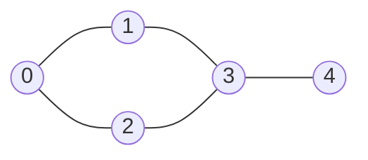
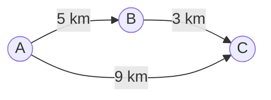

import Tabs from '@theme/Tabs';
import TabItem from '@theme/TabItem';
import ChainDiagram from '@site/src/components/ChainDiagram';

# Graph

A **graph** is a set of dots connected by lines. It describes anything that is linked to other things, like cities and the roads between them, or people and their friendships.

## Idea

Open a map of a subway system. You see stations (the dots) and the tracks between them (the lines). It does not matter exactly where each station is drawn. What matters is **which stations are connected to which**. That is a graph.

The words you need:

- A **vertex** (also called a **node**) is a dot. A subway station, a city, a person.
- An **edge** is a line between two vertices. A track, a road, a friendship.
- Two vertices joined by an edge are **neighbors** (or **adjacent**).

This is the graph used for the rest of this page, with 5 vertices and 5 edges:



Graphs come in a few flavors:

- **Undirected**: an edge works both ways, like a friendship or a two-way road. The graph above is undirected.
- **Directed**: an edge has a direction, like a one-way street, or "follows" on a social network. It is drawn as an arrow.
- **Weighted**: every edge has a number on it, like a distance, a price or a travel time.



This one is directed and weighted. You can go from `A` to `B`, but not back.

A [tree](./tree.mdx) is a special graph: one that has no loops, where every vertex except the root has exactly one parent. A general graph has no such limits. A vertex can have any number of neighbors, and you can walk around in circles (this is called a **cycle**).

## How it works

### Two ways to store a graph

You have to store which vertices are connected. There are two classic ways. Say the vertices are numbered 0, 1, 2, ... so that you can use them as indexes.

**Adjacency list.** Every vertex keeps a list of its neighbors. This is like each station having a small signboard that lists the stations it connects to. Here is the graph from above:

<ChainDiagram emptyText="no neighbors" rows={[
  {label: 0, items: [1, 2]},
  {label: 1, items: [0, 3]},
  {label: 2, items: [0, 3]},
  {label: 3, items: [1, 2, 4]},
  {label: 4, items: [3]},
]} />

**Adjacency matrix.** A square table with one row and one column per vertex. A `1` in row `a` and column `b` means "there is an edge from `a` to `b`":

| from \ to | 0 | 1 | 2 | 3 | 4 |
| --------- | - | - | - | - | - |
| **0**     | 0 | 1 | 1 | 0 | 0 |
| **1**     | 1 | 0 | 0 | 1 | 0 |
| **2**     | 1 | 0 | 0 | 1 | 0 |
| **3**     | 0 | 1 | 1 | 0 | 1 |
| **4**     | 0 | 0 | 0 | 1 | 0 |

An undirected graph gives a matrix that is a mirror image of itself, because every edge works both ways.

Which one should you use? The matrix answers "is there an edge between `a` and `b`?" instantly, but it always uses a table of $V \times V$ cells, where $V$ is the number of vertices, even if there are very few edges. The list only stores the edges that exist. Most real graphs have few edges compared to the number of possible ones (a person has a few hundred friends, not a few billion), so the **adjacency list is the usual choice**. The matrix is better for small graphs where almost every pair is connected.

### Walking through a graph

Many questions about graphs start with "visit every vertex that I can reach from here". There are two classic ways to do it. Both need to remember which vertices they have **already visited**. A graph can contain cycles, and without that memory you would walk around the same loop forever.

**Breadth-first search (BFS)** visits the vertices in rings: first the start, then all its neighbors, then all the neighbors of those neighbors, and so on. It uses a [queue](./queue.mdx) to remember who is waiting to be visited. From vertex 0:

```text
visit 0   waiting: 1 2
visit 1   waiting: 2 3
visit 2   waiting: 3
visit 3   waiting: 4
visit 4   waiting: (nobody)
```

The visit order is `0 1 2 3 4`. Vertex 3 is only added once, even though both 1 and 2 are its neighbors, because it is marked as seen the first time it is found.

A nice bonus: BFS visits vertices in order of how many edges away from the start they are. So the first time it reaches a vertex, it did so by a path with the **fewest edges**. For an unweighted graph, that is the shortest path. From vertex 0, the distances are `0 1 1 2 3`.

**Depth-first search (DFS)** goes as deep as it can along one path, and backs up only when it hits a dead end. It uses a [stack](./stack.mdx), usually the call stack through recursion. From vertex 0, visiting neighbors in the order of the lists above:

```text
0 -> 1 -> 3 -> 2   (2's neighbors 0 and 3 are already visited, so back up)
          3 -> 4   (back at 3, the next unvisited neighbor is 4)
```

The visit order is `0 1 3 2 4`. DFS does not find shortest paths in general, but it is good at exploring everything: finding the connected parts of a graph, solving a maze, or putting tasks in a valid order.

The order of the visit depends on the order in which neighbors are listed. A different list order gives a different (but equally valid) traversal.

## Code

The example stores the graph above as an adjacency list, then runs BFS and DFS from vertex 0. The BFS also records the distance from the start to every vertex. In C the lists are stored in a plain table: `adj[v]` holds the neighbors of `v`, and `degree[v]` says how many there are. To keep the code short, the C version does not check for too many vertices or neighbors.

### Build a graph and walk through it

<Tabs groupId="language">
  <TabItem value="c" label="C" default>

```c title="basics.c"
#include <stdio.h>

#define MAX 8  // up to 8 vertices, each with up to 8 neighbors

int adj[MAX][MAX];  // adj[v] lists the neighbors of v...
int degree[MAX];    // ...and degree[v] says how many there are

void add_edge(int a, int b) {  // an undirected edge goes both ways
    adj[a][degree[a]++] = b;
    adj[b][degree[b]++] = a;
}

void bfs(int start, int n) {
    int visited[MAX] = {0};
    int dist[MAX] = {0};
    int queue[MAX], head = 0, tail = 0;

    visited[start] = 1;  // mark it when it joins the queue
    queue[tail++] = start;
    printf("bfs:");
    while (head < tail) {
        int v = queue[head++];  // the next vertex in line
        printf(" %d", v);
        for (int i = 0; i < degree[v]; i++) {
            int next = adj[v][i];
            if (!visited[next]) {  // not seen yet
                visited[next] = 1;
                dist[next] = dist[v] + 1;  // one more edge from start
                queue[tail++] = next;
            }
        }
    }
    printf("\ndistance from %d:", start);
    for (int v = 0; v < n; v++) printf(" %d", dist[v]);
    printf("\n");
}

void dfs(int v, int visited[]) {
    visited[v] = 1;
    printf(" %d", v);
    for (int i = 0; i < degree[v]; i++) {
        int next = adj[v][i];
        if (!visited[next]) dfs(next, visited);  // go deeper
    }
}

int main(void) {
    add_edge(0, 1);
    add_edge(0, 2);
    add_edge(1, 3);
    add_edge(2, 3);
    add_edge(3, 4);

    printf("neighbors of 3:");
    for (int i = 0; i < degree[3]; i++) printf(" %d", adj[3][i]);
    printf("\n");

    bfs(0, 5);

    int visited[MAX] = {0};
    printf("dfs:");
    dfs(0, visited);
    printf("\n");
    return 0;
}
```

  </TabItem>
  <TabItem value="cpp" label="C++">

```cpp title="basics.cpp"
#include <iostream>
#include <queue>
#include <vector>

// adj[v] lists the neighbors of v
std::vector<std::vector<int>> adj(5);

void add_edge(int a, int b) {  // an undirected edge goes both ways
    adj[a].push_back(b);
    adj[b].push_back(a);
}

void bfs(int start) {
    std::vector<bool> visited(adj.size(), false);
    std::vector<int> dist(adj.size(), 0);
    std::queue<int> line;

    visited[start] = true;  // mark it when it joins the queue
    line.push(start);
    std::cout << "bfs:";
    while (!line.empty()) {
        int v = line.front();  // the next vertex in line
        line.pop();
        std::cout << " " << v;
        for (int next : adj[v]) {
            if (!visited[next]) {  // not seen yet
                visited[next] = true;
                dist[next] = dist[v] + 1;  // one more edge from start
                line.push(next);
            }
        }
    }
    std::cout << "\ndistance from " << start << ":";
    for (int d : dist) std::cout << " " << d;
    std::cout << "\n";
}

void dfs(int v, std::vector<bool> &visited) {
    visited[v] = true;
    std::cout << " " << v;
    for (int next : adj[v]) {
        if (!visited[next]) dfs(next, visited);  // go deeper
    }
}

int main() {
    add_edge(0, 1);
    add_edge(0, 2);
    add_edge(1, 3);
    add_edge(2, 3);
    add_edge(3, 4);

    std::cout << "neighbors of 3:";
    for (int next : adj[3]) std::cout << " " << next;
    std::cout << "\n";

    bfs(0);

    std::vector<bool> visited(adj.size(), false);
    std::cout << "dfs:";
    dfs(0, visited);
    std::cout << "\n";
}
```

  </TabItem>
  <TabItem value="python" label="Python">

```python title="basics.py"
from collections import deque

n = 5
adj = [[] for _ in range(n)]  # adj[v] lists the neighbors of v


def add_edge(a, b):  # an undirected edge goes both ways
    adj[a].append(b)
    adj[b].append(a)


def bfs(start):
    visited = {start}  # mark it when it joins the queue
    dist = {start: 0}
    line = deque([start])
    order = []
    while line:
        v = line.popleft()  # the next vertex in line
        order.append(v)
        for nxt in adj[v]:
            if nxt not in visited:  # not seen yet
                visited.add(nxt)
                dist[nxt] = dist[v] + 1  # one more edge from start
                line.append(nxt)
    print("bfs:", *order)
    print(f"distance from {start}:", *[dist[v] for v in range(n)])


def dfs(v, visited, order):
    visited.add(v)
    order.append(v)
    for nxt in adj[v]:
        if nxt not in visited:
            dfs(nxt, visited, order)  # go deeper


add_edge(0, 1)
add_edge(0, 2)
add_edge(1, 3)
add_edge(2, 3)
add_edge(3, 4)

print("neighbors of 3:", *adj[3])

bfs(0)

order = []
dfs(0, set(), order)
print("dfs:", *order)
```

  </TabItem>
  <TabItem value="java" label="Java">

```java title="Basics.java"
import java.util.ArrayDeque;
import java.util.ArrayList;
import java.util.List;
import java.util.Queue;

public class Basics {
    // adj.get(v) lists the neighbors of v
    static List<List<Integer>> adj = new ArrayList<>();

    static void addEdge(int a, int b) {  // both ways
        adj.get(a).add(b);
        adj.get(b).add(a);
    }

    static void bfs(int start) {
        int n = adj.size();
        boolean[] visited = new boolean[n];
        int[] dist = new int[n];
        Queue<Integer> line = new ArrayDeque<>();
        StringBuilder order = new StringBuilder("bfs:");

        visited[start] = true;  // mark it when it joins the queue
        line.offer(start);
        while (!line.isEmpty()) {
            int v = line.poll();  // the next vertex in line
            order.append(" ").append(v);
            for (int next : adj.get(v)) {
                if (!visited[next]) {  // not seen yet
                    visited[next] = true;
                    dist[next] = dist[v] + 1;  // one more edge
                    line.offer(next);
                }
            }
        }
        System.out.println(order);
        StringBuilder far = new StringBuilder("distance from ");
        far.append(start).append(":");
        for (int d : dist) far.append(" ").append(d);
        System.out.println(far);
    }

    static void dfs(int v, boolean[] visited, StringBuilder order) {
        visited[v] = true;
        order.append(" ").append(v);
        for (int next : adj.get(v)) {
            if (!visited[next]) dfs(next, visited, order);  // go deeper
        }
    }

    public static void main(String[] args) {
        for (int i = 0; i < 5; i++) adj.add(new ArrayList<>());
        addEdge(0, 1);
        addEdge(0, 2);
        addEdge(1, 3);
        addEdge(2, 3);
        addEdge(3, 4);

        StringBuilder near = new StringBuilder("neighbors of 3:");
        for (int next : adj.get(3)) near.append(" ").append(next);
        System.out.println(near);

        bfs(0);

        StringBuilder order = new StringBuilder("dfs:");
        dfs(0, new boolean[5], order);
        System.out.println(order);
    }
}
```

  </TabItem>
</Tabs>

## Complexity

If O(1) and O(n) are new to you, see the [Array](./array.mdx) page. Here $V$ is the number of vertices and $E$ is the number of edges.

| Operation                                  | Adjacency list      | Adjacency matrix | In plain words                                                        |
| ------------------------------------------ | ------------------- | ---------------- | --------------------------------------------------------------------- |
| Memory used                                | $O(V + E)$          | $O(V^2)$         | The list stores only the edges that exist. The matrix stores every pair. |
| Add an edge                                | $O(1)$              | $O(1)$           | Append to a list, or set one cell.                                    |
| Is there an edge between `a` and `b`?      | $O(\text{neighbors of } a)$ | $O(1)$   | The list must scan `a`'s neighbors. The matrix looks at one cell.     |
| List all neighbors of a vertex             | $O(\text{neighbors})$ | $O(V)$         | The list has them ready. The matrix scans a whole row.                |
| BFS or DFS over the whole graph            | $O(V + E)$          | $O(V^2)$         | Each vertex and each edge is looked at a constant number of times.    |

## When to use it

A graph is a good fit when **connections** matter as much as the items themselves:

- **Maps and routes.** Cities and roads, subway stations and tracks. Finding a route is a graph problem.
- **Social networks.** People are vertices, friendships or "follows" are edges.
- **The web.** Pages are vertices and links are directed edges.
- **Dependencies.** Task B cannot start until task A is done. These form a directed graph.

Choose how to store it:

- **Adjacency list** for most graphs, especially large ones with relatively few edges.
- **Adjacency matrix** for small graphs with many edges, or when you constantly ask "are these two connected?".

Look at another structure when:

- Your data is a plain hierarchy with one parent per item. A [tree](./tree.mdx) is simpler.
- Your data is simply a row of items. An [array](./array.mdx) or a [linked list](./linked-list.mdx) is enough.

:::warning[Common mistakes]
- **Forgetting to mark visited vertices.** In a graph with a cycle, the search walks around the loop forever.
- **Marking too late in BFS.** Mark a vertex when you put it in the queue, not when you take it out. Otherwise the same vertex can be added several times.
- **Forgetting that an undirected edge goes both ways.** Add it to both lists (or set both matrix cells).
- **Expecting BFS to find the cheapest path in a weighted graph.** BFS finds the path with the fewest **edges**, not the lowest total weight. Weighted graphs need other algorithms, such as Dijkstra's, which uses a [heap](./heap.mdx).
- **Expecting DFS to find shortest paths.** It does not, in general.
- **Starting from only one vertex.** If the graph is in several separate pieces, one search only reaches the piece the start belongs to. Start again from any vertex that has not been visited.
:::

## Sources

The facts on this page were checked against:

- [Graph (abstract data type), Wikipedia](https://en.wikipedia.org/wiki/Graph_%28abstract_data_type%29)
- [Breadth-first search, Wikipedia](https://en.wikipedia.org/wiki/Breadth-first_search)
- [Depth-first search, Wikipedia](https://en.wikipedia.org/wiki/Depth-first_search)
