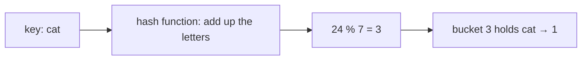

import Tabs from '@theme/Tabs';
import TabItem from '@theme/TabItem';
import ChainDiagram from '@site/src/components/ChainDiagram';

# Hash Table

A **hash table** stores pairs of a **key** and a **value**, and finds the value for any key almost instantly, without searching through everything.

## Idea

Picture the mailboxes in an apartment building. Every box has a number. A clerk files each letter by turning the recipient's name into a box number, using the same fixed recipe every time. To find the letter for "cat", the clerk does not look through all the boxes. They apply the recipe to "cat", get a number, and walk straight to that box.

A hash table works the same way:

- The **key** is the name on the letter, like `"cat"`.
- The **value** is what you want to store with it, like `1`.
- The **hash function** is the recipe. It turns a key into a number.
- The **buckets** are the mailboxes. They are the seats of an [array](./array.mdx), so you can jump straight to any of them.

Here is one example of a recipe: add up the letters (a=1, b=2, c=3, ...), then take the remainder after dividing by the number of buckets. With 7 buckets, `cat` is 3 + 1 + 20 = 24, and 24 divided by 7 is 3 with remainder 3. In code the remainder operator is `%`, so this is `24 % 7`.



Putting something in and getting it back both start with the same step: compute the bucket number from the key. That takes the same tiny effort whether the table holds 10 pairs or 10 million.

This letter-adding recipe is only for teaching. It is a weak recipe, as you will see in a moment. Real hash functions are much better at spreading keys around.

## How it works

### Put and get

- **Put** (store a pair): hash the key to find the bucket, then put the pair in it.
- **Get** (look up a key): hash the key to find the same bucket, then take the value from it.
- **Remove**: find the bucket the same way, then take the pair out.

### Collisions: two keys, one bucket

There are only 7 buckets, and many possible keys. Sooner or later two different keys land in the same bucket. This is called a **collision**. For example, `act` has the same letters as `cat`, so it also adds up to 24, and it also lands in bucket 3.

A hash table must handle this. There are two common ways:

- **Chaining.** Each bucket holds a small chain of pairs (often a [linked list](./linked-list.mdx)). A new pair joins the chain. To look up a key, you go to its bucket and check the pairs in the chain one by one.
- **Open addressing.** Each bucket holds one pair. If a pair's bucket is taken, you try the next bucket, and the next, until you find a free one. To look up a key, you follow the same path.

This page uses chaining. Here is the table after storing `cat`, `dog`, `cow`, `act` and `hen`:

<ChainDiagram rows={[
  {label: 0, items: []},
  {label: 1, items: []},
  {label: 2, items: []},
  {label: 3, items: ['act', 'cat']},
  {label: 4, items: []},
  {label: 5, items: ['dog']},
  {label: 6, items: ['hen', 'cow']},
]} />

Two buckets hold two keys each. Looking up `cat` means going to bucket 3 and checking `act`, then `cat`. The chains are short, so it is still quick.

### When the table gets crowded

The more pairs share buckets, the longer the chains, and the slower the lookups. A table measures how crowded it is with its **load factor**: the number of pairs divided by the number of buckets. When the load factor gets too high (the default limit in Java's `HashMap` is 0.75), the table builds a new array with about twice as many buckets and files every pair again. This is called **rehashing**. It is slow, but it happens rarely, just like a growable array growing, so on average adding a pair stays fast.

### Order is not guaranteed

The buckets are filled according to the hash, not according to the order you added things. C++ `unordered_map` and Java `HashMap` do not promise any order when you walk through them. Python's `dict` is different: since Python 3.7 it remembers the order in which keys were added. Do not count on an order unless your language promises it.

### Which keys are allowed

A key must give the **same** hash every time, so it must not change while it is in the table. This is why Python only accepts keys that are "hashable", such as strings and numbers, and rejects lists: a list can change, so its hash could change too.

## Code

C has no hash table in its standard library, so the first example builds one by hand, with chaining. It uses the teaching recipe from above and 7 buckets. To keep the code short, it does not grow the table, it does not check that `malloc` worked, and the C keys are limited to 15 letters. The second example uses the ready-made hash tables of each language.

### Build a small hash table

<Tabs groupId="language">
  <TabItem value="c" label="C" default>

```c title="basics.c"
#include <stdio.h>
#include <stdlib.h>
#include <string.h>

#define BUCKETS 7

typedef struct Entry {
    char key[16];
    int value;
    struct Entry *next;  // the next entry in the same bucket
} Entry;

Entry *table[BUCKETS];  // all buckets start empty (NULL)

// Add up the letters (a=1, b=2, ...) to get a bucket number.
int hash_of(const char *key) {
    int sum = 0;
    for (const char *c = key; *c != '\0'; c++) sum += *c - 'a' + 1;
    return sum % BUCKETS;
}

void put(const char *key, int value) {
    int b = hash_of(key);
    for (Entry *e = table[b]; e != NULL; e = e->next) {
        if (strcmp(e->key, key) == 0) {  // the key is already here
            e->value = value;            // so just replace its value
            return;
        }
    }
    Entry *e = malloc(sizeof(Entry));
    snprintf(e->key, sizeof(e->key), "%s", key);
    e->value = value;
    e->next = table[b];  // join the front of the chain
    table[b] = e;
}

int get(const char *key, int missing) {
    for (Entry *e = table[hash_of(key)]; e != NULL; e = e->next) {
        if (strcmp(e->key, key) == 0) return e->value;
    }
    return missing;  // the key is not in the table
}

int main(void) {
    put("cat", 1);
    put("dog", 2);
    put("cow", 3);
    put("act", 4);  // same bucket as "cat"
    put("hen", 5);  // same bucket as "cow"

    printf("cat %d\n", get("cat", -1));  // cat 1
    printf("act %d\n", get("act", -1));  // act 4
    printf("pig %d\n", get("pig", -1));  // pig -1

    for (int b = 0; b < BUCKETS; b++) {  // show every bucket
        printf("%d:", b);
        for (Entry *e = table[b]; e != NULL; e = e->next) {
            printf(" %s", e->key);
        }
        printf("\n");
    }

    for (int b = 0; b < BUCKETS; b++) {  // give the memory back
        while (table[b] != NULL) {
            Entry *next = table[b]->next;
            free(table[b]);
            table[b] = next;
        }
    }
    return 0;
}
```

  </TabItem>
  <TabItem value="cpp" label="C++">

```cpp title="basics.cpp"
#include <iostream>
#include <list>
#include <string>
#include <utility>
#include <vector>

const int BUCKETS = 7;

// Add up the letters (a=1, b=2, ...) to get a bucket number.
int hash_of(const std::string &key) {
    int sum = 0;
    for (char c : key) sum += c - 'a' + 1;
    return sum % BUCKETS;
}

using Chain = std::list<std::pair<std::string, int>>;  // one bucket

struct HashTable {
    std::vector<Chain> buckets = std::vector<Chain>(BUCKETS);

    void put(const std::string &key, int value) {
        Chain &chain = buckets[hash_of(key)];
        for (auto &entry : chain) {
            if (entry.first == key) {  // the key is already here
                entry.second = value;  // so just replace its value
                return;
            }
        }
        chain.push_front({key, value});  // join the front of the chain
    }

    int get(const std::string &key, int missing) const {
        for (const auto &entry : buckets[hash_of(key)]) {
            if (entry.first == key) return entry.second;
        }
        return missing;  // the key is not in the table
    }
};

int main() {
    HashTable table;
    table.put("cat", 1);
    table.put("dog", 2);
    table.put("cow", 3);
    table.put("act", 4);  // same bucket as "cat"
    table.put("hen", 5);  // same bucket as "cow"

    std::cout << "cat " << table.get("cat", -1) << "\n";  // cat 1
    std::cout << "act " << table.get("act", -1) << "\n";  // act 4
    std::cout << "pig " << table.get("pig", -1) << "\n";  // pig -1

    for (int b = 0; b < BUCKETS; b++) {  // show every bucket
        std::cout << b << ":";
        for (const auto &entry : table.buckets[b]) {
            std::cout << " " << entry.first;
        }
        std::cout << "\n";
    }
}
```

  </TabItem>
  <TabItem value="python" label="Python">

```python title="basics.py"
BUCKETS = 7


def hash_of(key):
    """Add up the letters (a=1, b=2, ...) to get a bucket number."""
    return sum(ord(c) - ord("a") + 1 for c in key) % BUCKETS


class HashTable:
    def __init__(self):
        # one list per bucket
        self.buckets = [[] for _ in range(BUCKETS)]

    def put(self, key, value):
        bucket = self.buckets[hash_of(key)]
        for i, (k, _) in enumerate(bucket):
            if k == key:  # the key is already here
                bucket[i] = (key, value)  # so just replace its value
                return
        bucket.insert(0, (key, value))  # join the front of the chain

    def get(self, key, missing=None):
        for k, v in self.buckets[hash_of(key)]:
            if k == key:
                return v
        return missing  # the key is not in the table


table = HashTable()
table.put("cat", 1)
table.put("dog", 2)
table.put("cow", 3)
table.put("act", 4)  # same bucket as "cat"
table.put("hen", 5)  # same bucket as "cow"

print("cat", table.get("cat", -1))  # cat 1
print("act", table.get("act", -1))  # act 4
print("pig", table.get("pig", -1))  # pig -1

for b, bucket in enumerate(table.buckets):  # show every bucket
    print(f"{b}:", *[k for k, _ in bucket])
```

  </TabItem>
  <TabItem value="java" label="Java">

```java title="Basics.java"
import java.util.ArrayList;
import java.util.LinkedList;
import java.util.List;

public class Basics {
    static final int BUCKETS = 7;

    static class Entry {
        final String key;
        int value;

        Entry(String key, int value) {
            this.key = key;
            this.value = value;
        }
    }

    // Add up the letters (a=1, b=2, ...) to get a bucket number.
    static int hashOf(String key) {
        int sum = 0;
        for (char c : key.toCharArray()) sum += c - 'a' + 1;
        return sum % BUCKETS;
    }

    static class HashTable {
        final List<LinkedList<Entry>> buckets = new ArrayList<>();

        HashTable() {
            for (int i = 0; i < BUCKETS; i++) {
                buckets.add(new LinkedList<>());
            }
        }

        void put(String key, int value) {
            LinkedList<Entry> chain = buckets.get(hashOf(key));
            for (Entry e : chain) {
                if (e.key.equals(key)) {  // the key is already here
                    e.value = value;      // so just replace its value
                    return;
                }
            }
            chain.addFirst(new Entry(key, value));  // join the front
        }

        int get(String key, int missing) {
            for (Entry e : buckets.get(hashOf(key))) {
                if (e.key.equals(key)) return e.value;
            }
            return missing;  // the key is not in the table
        }
    }

    public static void main(String[] args) {
        HashTable table = new HashTable();
        table.put("cat", 1);
        table.put("dog", 2);
        table.put("cow", 3);
        table.put("act", 4);  // same bucket as "cat"
        table.put("hen", 5);  // same bucket as "cow"

        System.out.println("cat " + table.get("cat", -1));  // cat 1
        System.out.println("act " + table.get("act", -1));  // act 4
        System.out.println("pig " + table.get("pig", -1));  // pig -1

        for (int b = 0; b < BUCKETS; b++) {  // show every bucket
            StringBuilder line = new StringBuilder(b + ":");
            for (Entry e : table.buckets.get(b)) {
                line.append(" ").append(e.key);
            }
            System.out.println(line);
        }
    }
}
```

  </TabItem>
</Tabs>

### Use a ready-made hash table: count words

<Tabs groupId="language">
  <TabItem value="c" label="C" default>

The C standard library has no hash table. Use the one above, or a library.

  </TabItem>
  <TabItem value="cpp" label="C++">

```cpp title="builtin.cpp"
#include <iostream>
#include <string>
#include <unordered_map>
#include <vector>

int main() {
    std::vector<std::string> words =
        {"cat", "dog", "cat", "cow", "cat"};

    std::unordered_map<std::string, int> counts;  // word -> how many
    for (const std::string &word : words) {
        counts[word]++;  // a missing key starts at 0, then goes up by 1
    }

    std::cout << "cat " << counts["cat"] << "\n";  // cat 3
    std::cout << "dog " << counts["dog"] << "\n";  // dog 1

    auto found = counts.find("pig");  // find() does not add anything
    int pigs = (found == counts.end()) ? 0 : found->second;
    std::cout << "pig " << pigs << "\n";  // pig 0
    std::cout << "size " << counts.size() << "\n";  // size 3
}
```

  </TabItem>
  <TabItem value="python" label="Python">

```python title="builtin.py"
words = ["cat", "dog", "cat", "cow", "cat"]

counts = {}  # word -> how many
for word in words:
    counts[word] = counts.get(word, 0) + 1  # a missing key counts as 0

print("cat", counts["cat"])          # cat 3
print("dog", counts["dog"])          # dog 1
print("pig", counts.get("pig", 0))   # pig 0
print("size", len(counts))           # size 3
```

  </TabItem>
  <TabItem value="java" label="Java">

```java title="BuiltIn.java"
import java.util.HashMap;
import java.util.List;
import java.util.Map;

public class BuiltIn {
    public static void main(String[] args) {
        List<String> words = List.of("cat", "dog", "cat", "cow", "cat");

        Map<String, Integer> counts = new HashMap<>();  // word -> count
        for (String word : words) {
            counts.merge(word, 1, Integer::sum);  // add 1 to the count
        }

        System.out.println("cat " + counts.get("cat"));  // cat 3
        System.out.println("dog " + counts.get("dog"));  // dog 1
        System.out.println("pig " + counts.getOrDefault("pig", 0));
        System.out.println("size " + counts.size());  // size 3
    }
}
```

  </TabItem>
</Tabs>

## Complexity

If O(1) and O(n) are new to you, see the [Array](./array.mdx) page.

| Operation                         | Cost                | In plain words                                                        |
| --------------------------------- | ------------------- | --------------------------------------------------------------------- |
| Put, get or remove by key         | $O(1)$ on average   | Compute the bucket and go there. Short chains cost almost nothing.    |
| Put, get or remove, worst case    | $O(n)$              | If every key lands in the same bucket, the table is one long chain.   |
| Find a **value** (not a key)      | $O(n)$              | The table is organized by key. Looking for a value means checking every pair. |
| Walk through everything           | $O(n)$              | In no particular order in most languages.                             |
| Memory used                       | $O(n)$              | One slot per pair, plus some empty buckets kept in reserve.           |

The worst case is very unlikely with a good hash function and a table that grows when it gets crowded, which is why we say hash tables are "O(1) on average".

## When to use it

A hash table is a good fit when you look things up **by key**:

- **Counting.** How many times does each word appear? Key: the word. Value: the count.
- **Checking membership.** Have I seen this value before? A set is a hash table with only keys.
- **Records by ID.** Find the user with ID 4821 immediately.
- **Caching.** Remember the answer to a question you already worked out.

Look at another structure when:

- You need the keys **in sorted order**, or "the next larger key". A hash table scatters its keys on purpose. A sorted structure such as a [binary search tree](./binary-search-tree.mdx) keeps them in order.
- You look things up by **position**, like "the third item". An [array](./array.mdx) is simpler and uses less memory.
- You need a hard guarantee on every single lookup. A hash table is fast on average, but one unlucky lookup can be slow.

:::warning[Common mistakes]
- **Expecting an order.** C++ `unordered_map` and Java `HashMap` give no order guarantee, and the order can change as the table grows.
- **Reading a missing key by accident in C++.** `counts["pig"]` does not just look. If `pig` is missing, it **adds** it with a value of 0. Use `find()` or `count()` to check without adding.
- **Missing keys in Python.** `d["pig"]` raises a `KeyError` if the key is missing. Use `d.get("pig", 0)` for a default.
- **Using a key that can change.** A list cannot be a Python dict key. If a key could change while it is in the table, the table could no longer find it.
- **A weak hash function.** If many keys land in the same bucket, the table slows down to a plain list. Use the hash functions your language provides.
:::

## Sources

The facts on this page were checked against:

- [Hash table, Wikipedia](https://en.wikipedia.org/wiki/Hash_table)
- [TimeComplexity, Python Wiki](https://wiki.python.org/moin/TimeComplexity)
- [Mapping types: dict, The Python Standard Library](https://docs.python.org/3/library/stdtypes.html#dict)
- [hashable, Python glossary](https://docs.python.org/3/glossary.html#term-hashable)
- [HashMap, Java SE 21 API](https://docs.oracle.com/en/java/javase/21/docs/api/java.base/java/util/HashMap.html)
- [std::unordered_map, cppreference](https://en.cppreference.com/w/cpp/container/unordered_map)
