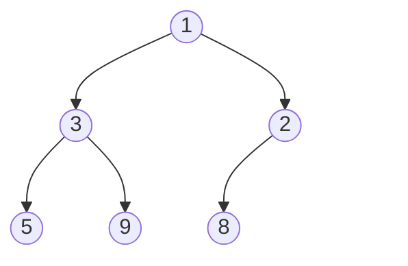

import Tabs from '@theme/Tabs';
import TabItem from '@theme/TabItem';
import ArrayDiagram from '@site/src/components/ArrayDiagram';

# Heap

A **heap** is a tree-shaped structure that always keeps the **smallest** item (or the biggest, if you prefer) right at the top, ready to grab.

## Idea

Picture the emergency room of a hospital. Patients are not seen in the order they arrive. The most urgent patient is seen first, even if they arrived last. A [queue](./queue.mdx) serves the oldest first. This line serves the **most important** first. It is called a **priority queue**, and a **heap** is the usual way to build one.

A heap is a [binary tree](./tree.mdx) with two rules:

1. **Order rule.** Every parent is smaller than or equal to its children. (This kind is called a **min-heap**. In a **max-heap** the rule is reversed: every parent is bigger than or equal to its children.) This page uses the min-heap.
2. **Shape rule.** The tree is filled level by level, from left to right, with no gaps.



Because every parent is no bigger than its children, the smallest value of the whole heap is always at the top: here, `1`.

**A heap is not a sorted list.** Only the top is guaranteed. Look at the second level: `3` is on the left of `2`, even though `2` is smaller. The rule only compares a parent with its own children, never one sibling with another.

## How it works

### Stored in an array

The shape rule leaves no gaps, so the whole tree fits neatly in an array, level by level, starting with the top at index 0:

<ArrayDiagram name="heap" items={[1, 3, 2, 5, 9, 8]} />

You can find any relative of an item with simple arithmetic, so no links are needed:

- The children of the item at index `i` are at `2i + 1` and `2i + 2`.
- The parent of the item at index `i` is at `(i - 1) / 2`, rounded down.

For example, `3` is at index 1. Its children are at indexes 3 and 4 (`5` and `9`), and its parent is at index 0 (`1`). (Some books start counting at 1 and use slightly different formulas. Check which one your book uses.)

### Peek: instant

The smallest item is always at index 0, so looking at it costs nothing.

### Insert: add at the end, then swap upward

To add a new item, put it in the first free spot at the very end of the array. That keeps the shape rule. But the new item might be smaller than its parent, which breaks the order rule, so you **swap it up**: while it is smaller than its parent, swap the two. Here `2` is added to a heap:

<ArrayDiagram name="start" labelWidth="15rem" items={[1, 3, 8, 5, 9]} />

<ArrayDiagram name="add 2 at the end" labelWidth="15rem" items={[1, 3, 8, 5, 9, 2]} hideIndex highlight={[5]} />

<ArrayDiagram name="swap with its parent, 8" labelWidth="15rem" items={[1, 3, 2, 5, 9, 8]} hideIndex highlight={[2, 5]} />

The parent of index 5 is at index 2, and it holds `8`. Since `2` is smaller than `8`, they swap. Now `2` is at index 2, and its parent is at index 0, holding `1`. `2` is not smaller than `1`, so it stays. Done.

### Remove the top: bring the last item up, then swap downward

The top is the item you want to take out. You cannot just leave a hole at index 0. So you move the **last** item of the array to the top. That keeps the shape rule. But it is probably too big for that spot, so you **swap it down**: compare it with its two children, and swap it with the **smaller** child. Repeat until it is no bigger than its children.

<ArrayDiagram name="start" labelWidth="15rem" items={[1, 3, 2, 5, 9, 8]} />

<ArrayDiagram name="last item goes to the top" labelWidth="15rem" items={[8, 3, 2, 5, 9]} hideIndex highlight={[0]} />

<ArrayDiagram name="swap with the smaller child" labelWidth="15rem" items={[2, 3, 8, 5, 9]} hideIndex highlight={[0, 2]} />

The `1` was taken out. `8` came up to the top, and its children were `3` and `2`. The smaller one is `2`, so `8` swapped with it. Now `8` is at index 2, where its children would be at indexes 5 and 6. The array has no such items, so `8` is a leaf, and it stays.

### Why this is fast

Each swap moves an item one level up or down, and a tree with $n$ items has only about $\log_2 n$ levels. So an insert or a removal makes at most that many swaps. A heap with a million items has about 20 levels.

### Building a heap from a list

You can build a heap by inserting items one by one, which costs $O(n \log n)$ in total. There is a cleverer way: put all the items in an array and fix the order rule from the bottom up, swapping each item down as needed. It costs only $O(n)$. Python's `heapify` does this.

### Heap sort

If you remove the top again and again, the items come out in order, smallest first. That is the idea of **heap sort**.

## Code

The first example builds a min-heap on an array by hand, with the swapping described above. The second example uses the ready-made priority queues of each language. To keep the code short, the hand-made heap has room for 16 items and does not check for an empty or a full heap. Real code should.

### Build a min-heap

<Tabs groupId="language">
  <TabItem value="c" label="C" default>

```c title="basics.c"
#include <stdio.h>

#define CAPACITY 16

typedef struct {
    int items[CAPACITY];
    int size;
} Heap;

void swap(int *a, int *b) {
    int tmp = *a;
    *a = *b;
    *b = tmp;
}

void push(Heap *h, int value) {
    int i = h->size++;
    h->items[i] = value;  // 1. add it at the end
    // 2. swap up while it is smaller than its parent
    while (i > 0) {
        int parent = (i - 1) / 2;
        if (h->items[parent] <= h->items[i]) break;
        swap(&h->items[parent], &h->items[i]);
        i = parent;
    }
}

int pop(Heap *h) {
    int top = h->items[0];
    // 1. the last item goes to the top
    h->items[0] = h->items[--h->size];
    int i = 0;
    while (2 * i + 1 < h->size) {  // 2. while it has a child, swap down
        int child = 2 * i + 1;  // the left child...
        if (child + 1 < h->size &&
            h->items[child + 1] < h->items[child]) {
            child++;  // ...or the right child, if it is smaller
        }
        if (h->items[i] <= h->items[child]) break;  // in place: done
        swap(&h->items[i], &h->items[child]);
        i = child;
    }
    return top;
}

int main(void) {
    Heap h = {.size = 0};
    int values[] = {5, 3, 8, 1, 9, 2};
    for (int i = 0; i < 6; i++) push(&h, values[i]);

    // the array: only the top is sure to be the smallest
    printf("heap:");
    for (int i = 0; i < h.size; i++) printf(" %d", h.items[i]);
    printf("\n");  // heap: 1 3 2 5 9 8

    printf("pop order:");
    while (h.size > 0) printf(" %d", pop(&h));
    printf("\n");  // pop order: 1 2 3 5 8 9
    return 0;
}
```

  </TabItem>
  <TabItem value="cpp" label="C++">

```cpp title="basics.cpp"
#include <iostream>
#include <utility>
#include <vector>

struct Heap {
    std::vector<int> items;

    void push(int value) {
        items.push_back(value);  // 1. add it at the end
        size_t i = items.size() - 1;
        // 2. swap up while it is smaller than its parent
        while (i > 0) {
            size_t parent = (i - 1) / 2;
            if (items[parent] <= items[i]) break;
            std::swap(items[parent], items[i]);
            i = parent;
        }
    }

    int pop() {
        int top = items[0];
        items[0] = items.back();  // 1. the last item goes to the top
        items.pop_back();
        size_t i = 0;
        // 2. while it has a child, swap down
        while (2 * i + 1 < items.size()) {
            size_t child = 2 * i + 1;  // the left child...
            if (child + 1 < items.size() &&
                items[child + 1] < items[child]) {
                child++;  // ...or the right child, if it is smaller
            }
            if (items[i] <= items[child]) break;  // in place: done
            std::swap(items[i], items[child]);
            i = child;
        }
        return top;
    }
};

int main() {
    Heap h;
    for (int value : {5, 3, 8, 1, 9, 2}) h.push(value);

    // the array: only the top is sure to be the smallest
    std::cout << "heap:";
    for (int item : h.items) std::cout << " " << item;
    std::cout << "\n";  // heap: 1 3 2 5 9 8

    std::cout << "pop order:";
    while (!h.items.empty()) std::cout << " " << h.pop();
    std::cout << "\n";  // pop order: 1 2 3 5 8 9
}
```

  </TabItem>
  <TabItem value="python" label="Python">

```python title="basics.py"
class Heap:
    def __init__(self):
        self.items = []

    def swap(self, a, b):
        self.items[a], self.items[b] = self.items[b], self.items[a]

    def push(self, value):
        self.items.append(value)  # 1. add it at the end
        i = len(self.items) - 1
        while i > 0:  # 2. swap up while it is smaller than its parent
            parent = (i - 1) // 2
            if self.items[parent] <= self.items[i]:
                break
            self.swap(parent, i)
            i = parent

    def pop(self):
        top = self.items[0]
        last = self.items.pop()
        if self.items:
            self.items[0] = last  # 1. the last item goes to the top
        i = 0
        while 2 * i + 1 < len(self.items):  # 2. while it has a child...
            child = 2 * i + 1  # the left child...
            if (child + 1 < len(self.items)
                    and self.items[child + 1] < self.items[child]):
                child += 1  # ...or the right child, if it is smaller
            if self.items[i] <= self.items[child]:
                break  # in place: done
            self.swap(i, child)
            i = child
        return top


h = Heap()
for value in [5, 3, 8, 1, 9, 2]:
    h.push(value)

print("heap:", *h.items)  # heap: 1 3 2 5 9 8
print("pop order:", *[h.pop() for _ in range(6)])  # 1 2 3 5 8 9
```

  </TabItem>
  <TabItem value="java" label="Java">

```java title="Basics.java"
public class Basics {
    static class Heap {
        int[] items = new int[16];
        int size = 0;

        void swap(int a, int b) {
            int tmp = items[a];
            items[a] = items[b];
            items[b] = tmp;
        }

        void push(int value) {
            int i = size++;
            items[i] = value;  // 1. add it at the end
            // 2. swap up while it is smaller than its parent
            while (i > 0) {
                int parent = (i - 1) / 2;
                if (items[parent] <= items[i]) break;
                swap(parent, i);
                i = parent;
            }
        }

        int pop() {
            int top = items[0];
            // 1. the last item goes to the top
            items[0] = items[--size];
            int i = 0;
            while (2 * i + 1 < size) {  // 2. while it has a child...
                int child = 2 * i + 1;  // the left child...
                if (child + 1 < size
                        && items[child + 1] < items[child]) {
                    child++;  // ...or the right child, if it is smaller
                }
                if (items[i] <= items[child]) break;  // in place: done
                swap(i, child);
                i = child;
            }
            return top;
        }
    }

    public static void main(String[] args) {
        Heap h = new Heap();
        for (int value : new int[] {5, 3, 8, 1, 9, 2}) h.push(value);

        StringBuilder line = new StringBuilder("heap:");
        for (int i = 0; i < h.size; i++) {
            line.append(" ").append(h.items[i]);
        }
        System.out.println(line);  // heap: 1 3 2 5 9 8

        line = new StringBuilder("pop order:");
        while (h.size > 0) line.append(" ").append(h.pop());
        System.out.println(line);  // pop order: 1 2 3 5 8 9
    }
}
```

  </TabItem>
</Tabs>

### Use a ready-made priority queue

C++ `priority_queue` puts the **biggest** item on top by default, and `std::greater` turns it into a min-heap. Python's `heapq` and Java's `PriorityQueue` put the **smallest** item on top by default. For a max-heap in Python, a common trick is to store negative numbers (Python 3.14 also added `heappush_max` and friends).

<Tabs groupId="language">
  <TabItem value="c" label="C" default>

The C standard library has no priority queue. Build one, as above, or use a library.

  </TabItem>
  <TabItem value="cpp" label="C++">

```cpp title="ready_made.cpp"
#include <functional>
#include <iostream>
#include <queue>
#include <vector>

int main() {
    std::vector<int> values = {5, 3, 8, 1, 9, 2};

    // by default the biggest item is on top (a max-heap)
    std::priority_queue<int> biggest(values.begin(), values.end());

    // std::greater turns it into a min-heap: the smallest is on top
    std::priority_queue<int, std::vector<int>, std::greater<int>>
        smallest(values.begin(), values.end());

    std::cout << "smallest first:";
    while (!smallest.empty()) {
        std::cout << " " << smallest.top();
        smallest.pop();
    }
    std::cout << "\n";  // smallest first: 1 2 3 5 8 9

    std::cout << "biggest first:";
    while (!biggest.empty()) {
        std::cout << " " << biggest.top();
        biggest.pop();
    }
    std::cout << "\n";  // biggest first: 9 8 5 3 2 1
}
```

  </TabItem>
  <TabItem value="python" label="Python">

```python title="ready_made.py"
import heapq

values = [5, 3, 8, 1, 9, 2]

smallest = list(values)
heapq.heapify(smallest)  # a min-heap, built in O(n)
print("smallest first:", *[heapq.heappop(smallest) for _ in values])

# heapq is a min-heap: store negatives to get the biggest first
biggest = [-v for v in values]
heapq.heapify(biggest)
print("biggest first:", *[-heapq.heappop(biggest) for _ in values])
```

  </TabItem>
  <TabItem value="java" label="Java">

```java title="ReadyMade.java"
import java.util.Collections;
import java.util.List;
import java.util.PriorityQueue;

public class ReadyMade {
    static String drain(PriorityQueue<Integer> queue) {
        StringBuilder line = new StringBuilder();
        while (!queue.isEmpty()) line.append(" ").append(queue.poll());
        return line.toString();
    }

    public static void main(String[] args) {
        List<Integer> values = List.of(5, 3, 8, 1, 9, 2);

        // by default the smallest item is on top (a min-heap)
        PriorityQueue<Integer> smallest = new PriorityQueue<>(values);

        // a reversed order puts the biggest item on top
        PriorityQueue<Integer> biggest =
            new PriorityQueue<>(Collections.reverseOrder());
        biggest.addAll(values);

        System.out.println("smallest first:" + drain(smallest));
        System.out.println("biggest first:" + drain(biggest));
    }
}
```

  </TabItem>
</Tabs>

## Complexity

If O(1) and O(n) are new to you, see the [Array](./array.mdx) page. Here $n$ is the number of items in the heap.

| Operation                       | Cost        | In plain words                                                          |
| ------------------------------- | ----------- | ----------------------------------------------------------------------- |
| Look at the top (peek)          | $O(1)$      | It is always at index 0.                                                |
| Insert                          | $O(\log n)$ | At most one swap per level of the tree.                                 |
| Remove the top                  | $O(\log n)$ | At most one swap per level of the tree.                                 |
| Build a heap from $n$ items     | $O(n)$      | Cheaper than inserting them one by one ($O(n \log n)$).                 |
| Find an arbitrary value         | $O(n)$      | A heap is not sorted, so you may have to check every item.              |
| Memory used                     | $O(n)$      | One array slot per item. No links are needed.                           |

## When to use it

A heap is a good fit when you repeatedly need the **smallest** or the **biggest** (or the most important) item next, while new items keep arriving:

- **Priority queues.** Urgent tasks first, whatever order they were added in.
- **Top K.** Keep only the K biggest items you have seen so far, without sorting everything.
- **Graph algorithms.** Dijkstra's shortest path and Prim's minimum spanning tree algorithms use a heap to pick the next vertex. (See the [Graph](./graph.mdx) page.)
- **Sorting.** Heap sort removes the top again and again.

Look at another structure when:

- You need the items **fully sorted** at any time, or "the next bigger value than 65". A [binary search tree](./binary-search-tree.mdx) keeps everything in order.
- You need to find a particular value quickly. A [hash table](./hash-table.mdx) does that.
- You serve items in the order they arrived. That is a plain [queue](./queue.mdx).

:::warning[Common mistakes]
- **Thinking a heap is sorted.** Only the top is guaranteed. Reading the array from left to right does not give sorted order. Java's documentation says the iterator of a `PriorityQueue` does not traverse in any particular order.
- **Mixing up min and max.** C++ `priority_queue` is a max-heap by default, while Python `heapq` and Java `PriorityQueue` are min-heaps.
- **Taking from an empty heap.** Python's `heappop` raises an error, Java's `poll()` returns `null`, and C++ `top()` or `pop()` on an empty queue is undefined behavior. Check first.
- **Changing an item's value inside the heap.** The item may now be in the wrong place. Remove it and insert the new value, or rebuild the heap.
- **Off-by-one in the index formulas.** With the top at index 0 the children are `2i + 1` and `2i + 2`. With the top at index 1 they are `2i` and `2i + 1`.
:::

## Sources

The facts on this page were checked against:

- [Binary heap, Wikipedia](https://en.wikipedia.org/wiki/Binary_heap)
- [Heap (data structure), Wikipedia](https://en.wikipedia.org/wiki/Heap_%28data_structure%29)
- [heapq, The Python Standard Library](https://docs.python.org/3/library/heapq.html)
- [PriorityQueue, Java SE 21 API](https://docs.oracle.com/en/java/javase/21/docs/api/java.base/java/util/PriorityQueue.html)
- [std::priority_queue, cppreference](https://en.cppreference.com/w/cpp/container/priority_queue)
