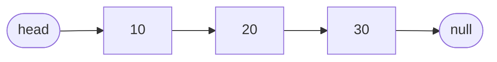
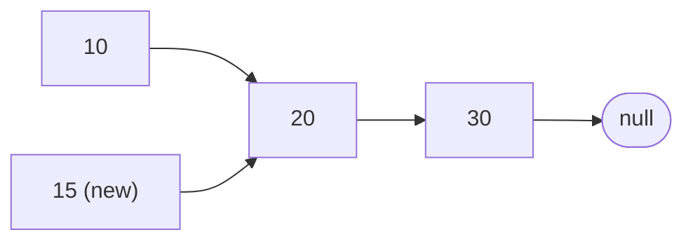
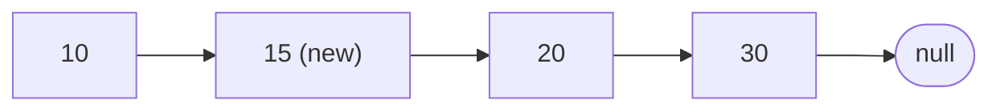
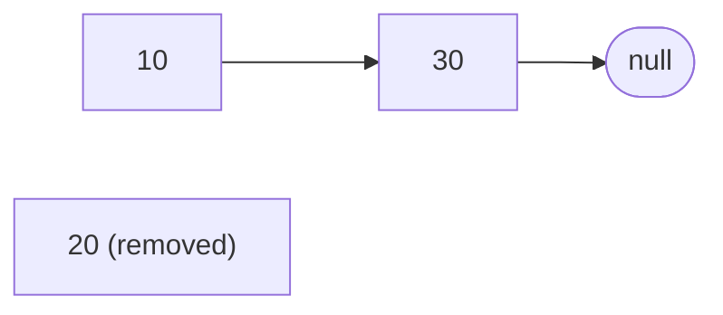
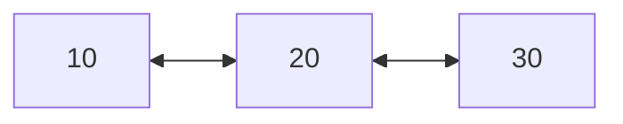

import Tabs from '@theme/Tabs';
import TabItem from '@theme/TabItem';

# Linked List

A **linked list** keeps items in order like a treasure hunt: each clue tells you where to find the next one.

## Idea

Picture a treasure hunt. You are handed the first clue. It holds a small prize and says "the next clue is under the bench". Under the bench you find the second clue, which holds another prize and tells you where the third one is. The last clue says "that's all". Nobody gives you the whole map up front. You only ever hold the first clue.

A linked list works the same way:

- Each clue is a **node**. It holds one **value** and one **link** to the next node (the address where the next node lives in memory).
- The first node is called the **head**. It is the only node you keep hold of.
- The last node links to nothing. This is written `null` (`NULL` in C, `nullptr` in C++, `None` in Python).
- Nodes can sit **anywhere** in memory. Unlike the seats of an [array](./array.mdx), they do not have to be side by side.



Compare it with an array. An array lets you jump straight to any seat. A linked list does not: to reach the third node you must start at the head and follow the links one by one. In exchange, adding and removing is easy. You change a link or two, and nobody has to move.

## How it works

### Reading: follow the chain

To read the item at index 2, start at the head and follow 2 links. The longer the list, the longer the walk, so reading by index takes time that grows with the number of items. Searching for a value works the same way: check node by node until you find it, just like an unsorted array.

### Inserting: change two links

Say you want to put `15` right after `10`. You do it in two steps.

**Step 1:** make the new node point at what comes after `10`, the node `20`. The new node is not part of the list yet, because nothing points at it.



**Step 2:** make `10` point at the new node.



After step 2, the list is `10 → 15 → 20 → 30`. Only two links changed. The nodes `20` and `30` did not move.

The order matters. If you did step 2 first, `10` would no longer point at `20`, and nothing would remember where `20` and everything after it live. You would lose the rest of the list.

Inserting at the **front** is even simpler: the new node points at the old head, and the head variable now points at the new node. No walking at all.

Finding the spot still costs a walk. If you already hold the node you want to insert after (for example, you are in the middle of walking through the list), the insert is instant. If you only know "insert at index 7", you must walk 7 links first.

### Deleting: skip over the node

To remove `20`, make the node before it point past it, straight to `30`:



In C and C++, you must also give the removed node's memory back (`free` or `delete`). Python and Java clean it up for you.

There is a catch: you need the node **before** the one you are removing, and in a basic list nodes only know the next node, not the previous one. So you find it while walking: you keep track of the previous node as you go.

### Variations

- **Doubly linked list.** Every node has two links, one to the next node and one to the previous node. You can walk in both directions, and you can remove a node you already hold without looking for the one before it. The price is more memory for every node.
- **Tail pointer.** Keep a second variable that points at the last node. Then adding to the end is instant, instead of walking the whole chain to find the end.
- **Circular list.** The last node links back to the first one. This fits things that go around in circles, like players taking turns.



## Code

In C and C++, a **pointer** is a variable that holds the address of something else. `cur->value` means "follow the pointer `cur` to its node and read the value there". In Python and Java, a variable holding a node is already a reference to it, so the code looks simpler.

To keep the code short, the C version does not check whether `malloc` succeeded. Real code should.

### Build a list and walk through it

<Tabs groupId="language">
  <TabItem value="c" label="C" default>

```c title="basics.c"
#include <stdio.h>
#include <stdlib.h>

typedef struct Node {
    int value;
    struct Node *next;  // the link to the next node
} Node;

// Make a node and put it at the front. Returns the new head.
Node *push_front(Node *head, int value) {
    Node *node = malloc(sizeof(Node));
    node->value = value;
    node->next = head;  // the new node points at the old first node
    return node;        // the new node is now the head
}

int main(void) {
    Node *head = NULL;  // an empty list
    head = push_front(head, 30);
    head = push_front(head, 20);
    head = push_front(head, 10);  // the list is 10 -> 20 -> 30

    for (Node *cur = head; cur != NULL; cur = cur->next) {
        printf("%d ", cur->value);  // 10 20 30
    }
    printf("\n");

    while (head != NULL) {  // give every node back
        Node *next = head->next;
        free(head);
        head = next;
    }
    return 0;
}
```

  </TabItem>
  <TabItem value="cpp" label="C++">

```cpp title="basics.cpp"
#include <iostream>

struct Node {
    int value;
    Node *next;  // the link to the next node
};

// Make a node and put it at the front. Returns the new head.
Node *push_front(Node *head, int value) {
    return new Node{value, head};  // points at the old head
}

int main() {
    Node *head = nullptr;  // an empty list
    head = push_front(head, 30);
    head = push_front(head, 20);
    head = push_front(head, 10);  // the list is 10 -> 20 -> 30

    for (Node *cur = head; cur != nullptr; cur = cur->next) {
        std::cout << cur->value << " ";  // 10 20 30
    }
    std::cout << "\n";

    while (head != nullptr) {  // give every node back
        Node *next = head->next;
        delete head;
        head = next;
    }
}
```

  </TabItem>
  <TabItem value="python" label="Python">

```python title="basics.py"
class Node:
    def __init__(self, value, next_node=None):
        self.value = value
        self.next = next_node  # the link to the next node


def push_front(head, value):
    """Make a node and put it at the front. Returns the new head."""
    return Node(value, head)  # the new node points at the old head


head = None  # an empty list
head = push_front(head, 30)
head = push_front(head, 20)
head = push_front(head, 10)  # the list is 10 -> 20 -> 30

cur = head
while cur is not None:
    print(cur.value, end=" ")  # 10 20 30
    cur = cur.next
print()
```

  </TabItem>
  <TabItem value="java" label="Java">

```java title="Basics.java"
public class Basics {
    static class Node {
        int value;
        Node next;  // the link to the next node

        Node(int value, Node next) {
            this.value = value;
            this.next = next;
        }
    }

    // Make a node and put it at the front. Returns the new head.
    static Node pushFront(Node head, int value) {
        return new Node(value, head);  // points at the old head
    }

    public static void main(String[] args) {
        Node head = null;  // an empty list
        head = pushFront(head, 30);
        head = pushFront(head, 20);
        head = pushFront(head, 10);  // the list is 10 -> 20 -> 30

        for (Node cur = head; cur != null; cur = cur.next) {
            System.out.print(cur.value + " ");  // 10 20 30
        }
        System.out.println();
    }
}
```

  </TabItem>
</Tabs>

### Insert after a node, remove a value

`insert_after` does the two-step link change from the pictures above. `remove_value` walks the list while remembering the previous node, then skips over the node it found.

<Tabs groupId="language">
  <TabItem value="c" label="C" default>

```c title="insert_remove.c"
#include <stdio.h>
#include <stdlib.h>

typedef struct Node {
    int value;
    struct Node *next;
} Node;

Node *push_front(Node *head, int value) {
    Node *node = malloc(sizeof(Node));
    node->value = value;
    node->next = head;
    return node;
}

// Put a new node with `value` right after `node`.
void insert_after(Node *node, int value) {
    Node *fresh = malloc(sizeof(Node));
    fresh->value = value;
    // 1. the new node points at what comes next
    fresh->next = node->next;
    // 2. then the old node points at the new one
    node->next = fresh;
}

// Remove the first node holding `value`. Returns the new head.
Node *remove_value(Node *head, int value) {
    Node *prev = NULL;
    Node *cur = head;
    while (cur != NULL && cur->value != value) {  // walk to the node
        prev = cur;
        cur = cur->next;
    }
    if (cur == NULL) return head;  // not found
    if (prev == NULL) head = cur->next;  // removing the head itself
    else prev->next = cur->next;         // skip over the node
    free(cur);
    return head;
}

int main(void) {
    Node *head = NULL;
    head = push_front(head, 30);
    head = push_front(head, 20);
    head = push_front(head, 10);  // 10 -> 20 -> 30

    insert_after(head, 15);         // 10 -> 15 -> 20 -> 30
    head = remove_value(head, 20);  // 10 -> 15 -> 30
    head = remove_value(head, 10);  // 15 -> 30

    for (Node *cur = head; cur != NULL; cur = cur->next) {
        printf("%d ", cur->value);  // 15 30
    }
    printf("\n");

    while (head != NULL) {
        Node *next = head->next;
        free(head);
        head = next;
    }
    return 0;
}
```

  </TabItem>
  <TabItem value="cpp" label="C++">

```cpp title="insert_remove.cpp"
#include <iostream>

struct Node {
    int value;
    Node *next;
};

Node *push_front(Node *head, int value) {
    return new Node{value, head};
}

// Put a new node with `value` right after `node`.
void insert_after(Node *node, int value) {
    // 1. the new node points at what comes next
    // 2. then the old node points at the new one
    node->next = new Node{value, node->next};
}

// Remove the first node holding `value`. Returns the new head.
Node *remove_value(Node *head, int value) {
    Node *prev = nullptr;
    Node *cur = head;
    while (cur != nullptr && cur->value != value) {  // walk to the node
        prev = cur;
        cur = cur->next;
    }
    if (cur == nullptr) return head;  // not found
    if (prev == nullptr) head = cur->next;  // removing the head itself
    else prev->next = cur->next;            // skip over the node
    delete cur;
    return head;
}

int main() {
    Node *head = nullptr;
    head = push_front(head, 30);
    head = push_front(head, 20);
    head = push_front(head, 10);  // 10 -> 20 -> 30

    insert_after(head, 15);         // 10 -> 15 -> 20 -> 30
    head = remove_value(head, 20);  // 10 -> 15 -> 30
    head = remove_value(head, 10);  // 15 -> 30

    for (Node *cur = head; cur != nullptr; cur = cur->next) {
        std::cout << cur->value << " ";  // 15 30
    }
    std::cout << "\n";

    while (head != nullptr) {
        Node *next = head->next;
        delete head;
        head = next;
    }
}
```

  </TabItem>
  <TabItem value="python" label="Python">

```python title="insert_remove.py"
class Node:
    def __init__(self, value, next_node=None):
        self.value = value
        self.next = next_node


def push_front(head, value):
    return Node(value, head)


def insert_after(node, value):
    """Put a new node with value right after node."""
    # 1. the new node points at what comes next
    # 2. then the old node points at the new one
    node.next = Node(value, node.next)


def remove_value(head, value):
    """Remove the first node holding value. Returns the new head."""
    prev, cur = None, head
    while cur is not None and cur.value != value:  # walk to the node
        prev, cur = cur, cur.next
    if cur is None:
        return head  # not found
    if prev is None:
        return cur.next  # removing the head itself
    prev.next = cur.next  # skip over the node
    return head


head = None
head = push_front(head, 30)
head = push_front(head, 20)
head = push_front(head, 10)  # 10 -> 20 -> 30

insert_after(head, 15)         # 10 -> 15 -> 20 -> 30
head = remove_value(head, 20)  # 10 -> 15 -> 30
head = remove_value(head, 10)  # 15 -> 30

cur = head
while cur is not None:
    print(cur.value, end=" ")  # 15 30
    cur = cur.next
print()
```

  </TabItem>
  <TabItem value="java" label="Java">

```java title="InsertRemove.java"
public class InsertRemove {
    static class Node {
        int value;
        Node next;

        Node(int value, Node next) {
            this.value = value;
            this.next = next;
        }
    }

    static Node pushFront(Node head, int value) {
        return new Node(value, head);
    }

    // Put a new node with value right after node.
    static void insertAfter(Node node, int value) {
        // 1. the new node points at what comes next
        // 2. then the old node points at the new one
        node.next = new Node(value, node.next);
    }

    // Remove the first node holding value. Returns the new head.
    static Node removeValue(Node head, int value) {
        Node prev = null;
        Node cur = head;
        while (cur != null && cur.value != value) {  // walk to the node
            prev = cur;
            cur = cur.next;
        }
        if (cur == null) return head;  // not found
        if (prev == null) return cur.next;  // removing the head itself
        prev.next = cur.next;  // skip over the node
        return head;
    }

    public static void main(String[] args) {
        Node head = null;
        head = pushFront(head, 30);
        head = pushFront(head, 20);
        head = pushFront(head, 10);  // 10 -> 20 -> 30

        insertAfter(head, 15);         // 10 -> 15 -> 20 -> 30
        head = removeValue(head, 20);  // 10 -> 15 -> 30
        head = removeValue(head, 10);  // 15 -> 30

        for (Node cur = head; cur != null; cur = cur.next) {
            System.out.print(cur.value + " ");  // 15 30
        }
        System.out.println();
    }
}
```

  </TabItem>
</Tabs>

### Ready-made linked lists

Some languages ship a linked list, so you do not have to write the nodes yourself.

<Tabs groupId="language">
  <TabItem value="c" label="C" default>

The C standard library has no linked list. Write your own, as above, or use a library.

  </TabItem>
  <TabItem value="cpp" label="C++">

```cpp title="ready_made.cpp"
#include <iostream>
#include <list>

int main() {
    std::list<int> items = {10, 20, 30};  // a doubly linked list

    items.push_front(5);  // add at the front: fast
    items.push_back(40);  // add at the back: fast
    items.pop_front();    // remove the first: fast

    for (int item : items) std::cout << item << " ";  // 10 20 30 40
    std::cout << "\n";
}
```

`std::forward_list` is the singly linked version. It uses less memory per node.

  </TabItem>
  <TabItem value="python" label="Python">

Python has no built-in linked list type. Write your own, as above. If you only need fast adds and removes at both ends, `collections.deque` is usually what you want.

  </TabItem>
  <TabItem value="java" label="Java">

```java title="ReadyMade.java"
import java.util.LinkedList;
import java.util.List;

public class ReadyMade {
    public static void main(String[] args) {
        LinkedList<Integer> items =
            new LinkedList<>(List.of(10, 20, 30));

        items.addFirst(5);   // add at the front: fast
        items.addLast(40);   // add at the back: fast
        items.removeFirst(); // remove the first: fast

        // prints: 10 20 30 40
        for (int item : items) System.out.print(item + " ");
        System.out.println();
    }
}
```

Java's `LinkedList` is a doubly linked list.

  </TabItem>
</Tabs>

## Complexity

If you have not met O(1) and O(n) yet, see the [Array](./array.mdx) page: O(1) means instant, O(n) means the work grows in step with the number of items.

| Operation                                    | Cost                       | In plain words                                                 |
| -------------------------------------------- | -------------------------- | -------------------------------------------------------------- |
| Read the item at an index                    | $O(n)$                     | Follow the chain from the head.                                |
| Find a value                                 | $O(n)$                     | Check node by node.                                            |
| Insert or remove at the front                | $O(1)$                     | Change the head. Nobody moves.                                 |
| Insert or remove after a node you hold       | $O(1)$                     | Change one or two links.                                       |
| Insert or remove at some index               | $O(n)$                     | Walk there first, then change the links.                       |
| Add at the end                               | $O(1)$ with a tail pointer | Without a tail pointer you walk the whole chain: $O(n)$.       |
| Remove the last node                         | $O(n)$, or $O(1)$ if doubly linked with a tail pointer | You need the node before it. |
| Memory used                                  | $O(n)$                     | One node per item, and each node also stores a link.           |

## When to use it

A linked list is a good fit when:

- You often add or remove at the **front**, or at spots you are already holding while you walk through the list.
- You cannot predict how many items you will have, and you do not want to copy everything each time the list grows.
- You are building something else out of it. Stacks, queues, the chains inside a [hash table](./hash-table.mdx), and the neighbor lists of a [graph](./graph.mdx) are often linked lists.

Look at another structure when:

- You need to jump to the item at a given index. An [array](./array.mdx) does that instantly.
- You mostly walk through all the items. Arrays keep items side by side in memory, which computers handle better (this is called good cache locality), so an array is often faster in practice even when a linked list looks as good on paper.
- Memory is tight. Every node carries a link, and for small items like single numbers or characters the link can take more space than the data.

:::warning[Common mistakes]
- **Losing the rest of the list.** Change links in the right order. Make the new node point at the next node first, and only then change the old node's link.
- **Forgetting the head.** Inserting or removing the first node changes what `head` points at. If you forget to update it, the list looks unchanged or broken.
- **Walking past the end.** The last link is `null`. Following it (`cur->next->value` when `cur->next` is null) crashes the program.
- **Leaks and dangling pointers in C and C++.** Free every node you stop using, and never touch a node after you freed it.
- **Accidental loops.** If a node ends up linking back to an earlier node, walking the list never ends.
:::

## Sources

The facts on this page were checked against:

- [Linked list, Wikipedia](https://en.wikipedia.org/wiki/Linked_list)
- [LinkedList, Java SE 21 API](https://docs.oracle.com/en/java/javase/21/docs/api/java.base/java/util/LinkedList.html)
- [std::list, cppreference](https://en.cppreference.com/w/cpp/container/list)
- [std::forward_list, cppreference](https://en.cppreference.com/w/cpp/container/forward_list)
