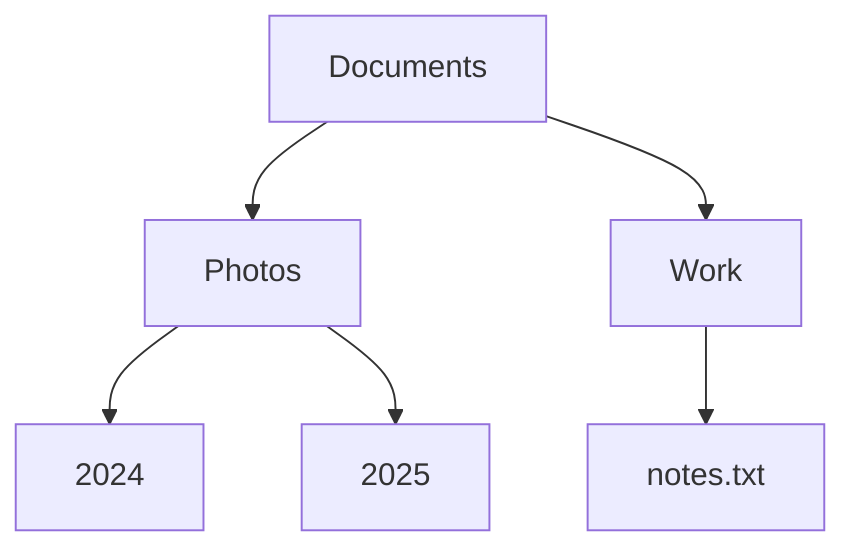
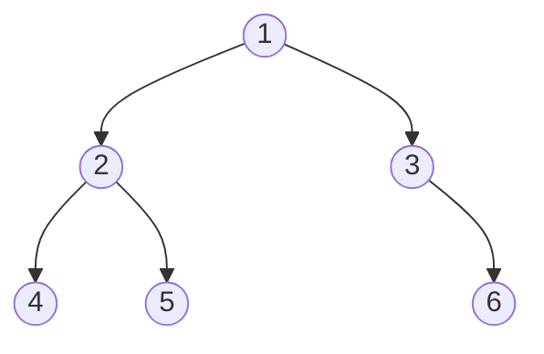

import Tabs from '@theme/Tabs';
import TabItem from '@theme/TabItem';

# Tree

A **tree** keeps items in a hierarchy: one item at the top, each item having smaller items hanging below it, like folders inside folders.

## Idea

Think about the folders on your computer. There is one top folder. Inside it are files and other folders. Inside those folders there are more files and more folders. Every folder sits inside exactly one other folder, except the top one, which sits inside nothing.

A tree is exactly that shape:



Each item is called a **node**, and each line between two nodes is an **edge**. Here are the words people use:

- The **root** is the node at the very top: `Documents`. It is the only node with no parent.
- A **parent** is the node directly above another node. `Photos` is the parent of `2024` and `2025`.
- The nodes directly below a node are its **children**. Children of the same parent are **siblings**: `2024` and `2025` are siblings.
- A **leaf** is a node with no children: `2024`, `2025` and `notes.txt`.
- A **subtree** is a node together with everything below it. `Photos`, `2024` and `2025` form a subtree.
- The **depth** of a node is how many steps down from the root it is. The root has depth 0, `Photos` has depth 1, and `2024` has depth 2.
- The **height** of a node is how many steps down the longest path from it to a leaf is. The height of the whole tree is the height of its root, which is 2 here.

Two rules make it a tree: every node except the root has **exactly one parent**, and you can never walk down and end up back where you started (**no loops**).

A tree is made of smaller trees: every child is the root of its own subtree. This is why many tree tasks can be solved with a simple idea: "do something for this node, then do the same thing for each child."

## How it works

### Binary trees

A **binary tree** is a tree where every node has **at most two children**, called the **left child** and the **right child**. Binary trees are the most common kind, and many famous structures are built from them, such as the [binary search tree](./binary-search-tree.mdx) and the [heap](./heap.mdx).

This is the binary tree used for the rest of this page:



Node `3` has no left child, only a right child (`6`). In code, each node stores its value and two links, `left` and `right`, which are `null` when there is no child. It is the [linked list](./linked-list.mdx) idea again, with two links instead of one.

### Walking through a tree: traversals

To visit every node, you need a rule for the order. There are four classic rules. The first three use the "do the same for each child" idea. They differ only in **when** you visit the node itself:

- **Pre-order:** the node first, then its left subtree, then its right subtree.
- **In-order:** the left subtree first, then the node, then the right subtree.
- **Post-order:** the left subtree, then the right subtree, and the node last.
- **Level-order:** one level at a time, from the top, left to right.

For the tree above they give:

```text
pre-order:    1 2 4 5 3 6
in-order:     4 2 5 1 3 6
post-order:   4 5 2 6 3 1
level-order:  1 2 3 4 5 6
```

Pre-order, in-order and post-order go **deep** first: they follow one branch all the way down before coming back. They are easy to write with recursion, because the computer's call stack (see the [Stack](./stack.mdx) page) remembers where to come back to. Level-order goes **wide** first, and uses a [queue](./queue.mdx) to remember which nodes are waiting.

Each order is good for something. Pre-order visits a parent before its children, which is how a folder listing is usually printed. Post-order visits children before their parent, which is the right order for deleting a whole tree. In-order is most useful for the [binary search tree](./binary-search-tree.mdx), where it produces the values in sorted order.

### How tall is a tree?

The height matters a lot, because many tree operations take time proportional to the height. A tree with $n$ nodes can be short and bushy or tall and thin:

- A **perfect** binary tree (every level completely full) is as short as possible. Its height is about $\log_2 n$. For example, a million nodes fit in about 20 levels.
- A **degenerate** tree, where every node has only one child, is a [linked list](./linked-list.mdx) in disguise. Its height is $n - 1$.

<details>
<summary>Optional: the math behind "about 20 levels"</summary>

A perfect binary tree of height $h$ has $1$ node at level 0, $2$ at level 1, $4$ at level 2, and so on, so its total number of nodes is:

$$
n = 1 + 2 + 4 + \dots + 2^h = 2^{h+1} - 1
$$

For $h = 19$ this is $2^{20} - 1 = 1{,}048{,}575$ nodes. So a tree with about a million nodes needs only 20 levels if it is perfect.

</details>

### Other kinds of binary trees

You will meet these names. They describe the shape of a binary tree:

- **Full:** every node has either 0 or 2 children.
- **Complete:** every level is full except possibly the last, and the last level is filled from the left. The heap uses this shape.
- **Perfect:** every level is completely full.
- **Balanced:** the left and right sides of every node are roughly the same height.

## Code

A node holds a value and two links. Because a tree is made of smaller trees, the traversals, the height and the node count are all short recursive functions. A recursive function that receives an empty tree (`null`) must stop right away, otherwise it would crash. That check is the first line of every function below.

The height here counts **steps** (edges): a single node has height 0, and an empty tree has height -1. Some books count nodes instead, so a single node would have height 1. Always check which convention a book or an exam uses.

To keep the code short, the C and C++ versions do not check whether memory allocation worked, and the level-order queue has room for 16 nodes.

### Build a tree and walk through it

<Tabs groupId="language">
  <TabItem value="c" label="C" default>

```c title="basics.c"
#include <stdio.h>
#include <stdlib.h>

typedef struct Node {
    int value;
    struct Node *left;   // the left child (NULL if none)
    struct Node *right;  // the right child (NULL if none)
} Node;

Node *new_node(int value, Node *left, Node *right) {
    Node *node = malloc(sizeof(Node));
    node->value = value;
    node->left = left;
    node->right = right;
    return node;
}

void preorder(const Node *n) {
    if (n == NULL) return;    // an empty tree: nothing to visit
    printf("%d ", n->value);  // 1. the node itself
    preorder(n->left);        // 2. then the whole left subtree
    preorder(n->right);       // 3. then the whole right subtree
}

void inorder(const Node *n) {
    if (n == NULL) return;
    inorder(n->left);         // 1. the left subtree
    printf("%d ", n->value);  // 2. the node itself
    inorder(n->right);        // 3. the right subtree
}

void postorder(const Node *n) {
    if (n == NULL) return;
    postorder(n->left);       // 1. the left subtree
    postorder(n->right);      // 2. the right subtree
    printf("%d ", n->value);  // 3. the node itself
}

void levelorder(Node *root) {
    Node *queue[16];  // nodes waiting to be visited
    int head = 0, tail = 0;
    queue[tail++] = root;
    while (head < tail) {
        Node *n = queue[head++];  // take the next one in line
        printf("%d ", n->value);
        if (n->left != NULL) queue[tail++] = n->left;
        if (n->right != NULL) queue[tail++] = n->right;
    }
}

int height(const Node *n) {
    if (n == NULL) return -1;  // an empty tree
    int left = height(n->left);
    int right = height(n->right);
    return 1 + (left > right ? left : right);  // the taller side + 1
}

int count(const Node *n) {
    if (n == NULL) return 0;
    return 1 + count(n->left) + count(n->right);
}

void free_tree(Node *n) {
    if (n == NULL) return;
    free_tree(n->left);   // children first...
    free_tree(n->right);
    free(n);              // ...then the node itself
}

int main(void) {
    /*       1
     *     /   \
     *    2     3
     *   / \     \
     *  4   5     6
     */
    Node *root = new_node(1,
        new_node(2, new_node(4, NULL, NULL), new_node(5, NULL, NULL)),
        new_node(3, NULL, new_node(6, NULL, NULL)));

    printf("preorder: ");   preorder(root);    printf("\n");
    printf("inorder: ");    inorder(root);     printf("\n");
    printf("postorder: ");  postorder(root);   printf("\n");
    printf("levelorder: "); levelorder(root);  printf("\n");
    printf("height %d\n", height(root));  // height 2
    printf("count %d\n", count(root));    // count 6

    free_tree(root);
    return 0;
}
```

  </TabItem>
  <TabItem value="cpp" label="C++">

```cpp title="basics.cpp"
#include <algorithm>
#include <iostream>
#include <queue>

struct Node {
    int value;
    Node *left = nullptr;   // the left child (nullptr if none)
    Node *right = nullptr;  // the right child (nullptr if none)
};

Node *new_node(int value, Node *left, Node *right) {
    return new Node{value, left, right};
}

void preorder(const Node *n) {
    if (n == nullptr) return;       // an empty tree: nothing to visit
    std::cout << n->value << " ";   // 1. the node itself
    preorder(n->left);              // 2. then the whole left subtree
    preorder(n->right);             // 3. then the whole right subtree
}

void inorder(const Node *n) {
    if (n == nullptr) return;
    inorder(n->left);               // 1. the left subtree
    std::cout << n->value << " ";   // 2. the node itself
    inorder(n->right);              // 3. the right subtree
}

void postorder(const Node *n) {
    if (n == nullptr) return;
    postorder(n->left);             // 1. the left subtree
    postorder(n->right);            // 2. the right subtree
    std::cout << n->value << " ";   // 3. the node itself
}

void levelorder(Node *root) {
    std::queue<Node *> waiting;  // nodes waiting to be visited
    waiting.push(root);
    while (!waiting.empty()) {
        Node *n = waiting.front();  // take the next one in line
        waiting.pop();
        std::cout << n->value << " ";
        if (n->left != nullptr) waiting.push(n->left);
        if (n->right != nullptr) waiting.push(n->right);
    }
}

int height(const Node *n) {
    if (n == nullptr) return -1;  // an empty tree
    // the taller side + 1
    return 1 + std::max(height(n->left), height(n->right));
}

int count(const Node *n) {
    if (n == nullptr) return 0;
    return 1 + count(n->left) + count(n->right);
}

void free_tree(Node *n) {
    if (n == nullptr) return;
    free_tree(n->left);   // children first...
    free_tree(n->right);
    delete n;             // ...then the node itself
}

int main() {
    /*       1
     *     /   \
     *    2     3
     *   / \     \
     *  4   5     6
     */
    Node *root = new_node(1,
        new_node(2, new_node(4, nullptr, nullptr),
                    new_node(5, nullptr, nullptr)),
        new_node(3, nullptr, new_node(6, nullptr, nullptr)));

    std::cout << "preorder: ";   preorder(root);    std::cout << "\n";
    std::cout << "inorder: ";    inorder(root);     std::cout << "\n";
    std::cout << "postorder: ";  postorder(root);   std::cout << "\n";
    std::cout << "levelorder: "; levelorder(root);  std::cout << "\n";
    std::cout << "height " << height(root) << "\n";  // height 2
    std::cout << "count " << count(root) << "\n";    // count 6

    free_tree(root);
}
```

  </TabItem>
  <TabItem value="python" label="Python">

```python title="basics.py"
from collections import deque


class Node:
    def __init__(self, value, left=None, right=None):
        self.value = value
        self.left = left    # the left child (None if none)
        self.right = right  # the right child (None if none)


def preorder(n):
    if n is None:  # an empty tree: nothing to visit
        return
    print(n.value, end=" ")  # 1. the node itself
    preorder(n.left)         # 2. then the whole left subtree
    preorder(n.right)        # 3. then the whole right subtree


def inorder(n):
    if n is None:
        return
    inorder(n.left)          # 1. the left subtree
    print(n.value, end=" ")  # 2. the node itself
    inorder(n.right)         # 3. the right subtree


def postorder(n):
    if n is None:
        return
    postorder(n.left)        # 1. the left subtree
    postorder(n.right)       # 2. the right subtree
    print(n.value, end=" ")  # 3. the node itself


def levelorder(root):
    waiting = deque([root])  # nodes waiting to be visited
    while waiting:
        n = waiting.popleft()  # take the next one in line
        print(n.value, end=" ")
        if n.left is not None:
            waiting.append(n.left)
        if n.right is not None:
            waiting.append(n.right)


def height(n):
    if n is None:
        return -1  # an empty tree
    return 1 + max(height(n.left), height(n.right))  # taller side + 1


def count(n):
    if n is None:
        return 0
    return 1 + count(n.left) + count(n.right)


#       1
#     /   \
#    2     3
#   / \     \
#  4   5     6
root = Node(1, Node(2, Node(4), Node(5)), Node(3, None, Node(6)))

print("preorder:", end=" ");   preorder(root);    print()
print("inorder:", end=" ");    inorder(root);     print()
print("postorder:", end=" ");  postorder(root);   print()
print("levelorder:", end=" "); levelorder(root);  print()
print("height", height(root))  # height 2
print("count", count(root))    # count 6
```

  </TabItem>
  <TabItem value="java" label="Java">

```java title="Basics.java"
import java.util.ArrayDeque;
import java.util.Queue;

public class Basics {
    static class Node {
        int value;
        Node left;   // the left child (null if none)
        Node right;  // the right child (null if none)

        Node(int value, Node left, Node right) {
            this.value = value;
            this.left = left;
            this.right = right;
        }
    }

    static void preorder(Node n) {
        if (n == null) return;  // an empty tree: nothing to visit
        System.out.print(n.value + " ");  // 1. the node itself
        preorder(n.left);                 // 2. then the left subtree
        preorder(n.right);                // 3. then the right subtree
    }

    static void inorder(Node n) {
        if (n == null) return;
        inorder(n.left);                  // 1. the left subtree
        System.out.print(n.value + " ");  // 2. the node itself
        inorder(n.right);                 // 3. the right subtree
    }

    static void postorder(Node n) {
        if (n == null) return;
        postorder(n.left);                // 1. the left subtree
        postorder(n.right);               // 2. the right subtree
        System.out.print(n.value + " ");  // 3. the node itself
    }

    static void levelorder(Node root) {
        Queue<Node> waiting = new ArrayDeque<>();  // waiting in line
        waiting.offer(root);
        while (!waiting.isEmpty()) {
            Node n = waiting.poll();  // take the next one in line
            System.out.print(n.value + " ");
            if (n.left != null) waiting.offer(n.left);
            if (n.right != null) waiting.offer(n.right);
        }
    }

    static int height(Node n) {
        if (n == null) return -1;  // an empty tree
        // the taller side + 1
        return 1 + Math.max(height(n.left), height(n.right));
    }

    static int count(Node n) {
        if (n == null) return 0;
        return 1 + count(n.left) + count(n.right);
    }

    static void label(String name) {
        System.out.print(name + ": ");
    }

    public static void main(String[] args) {
        //       1
        //     /   \
        //    2     3
        //   / \     \
        //  4   5     6
        Node left = new Node(2, new Node(4, null, null),
                                new Node(5, null, null));
        Node right = new Node(3, null, new Node(6, null, null));
        Node root = new Node(1, left, right);

        label("preorder");   preorder(root);    System.out.println();
        label("inorder");    inorder(root);     System.out.println();
        label("postorder");  postorder(root);   System.out.println();
        label("levelorder"); levelorder(root);  System.out.println();
        System.out.println("height " + height(root));  // height 2
        System.out.println("count " + count(root));    // count 6
    }
}
```

  </TabItem>
</Tabs>

## Complexity

If O(1) and O(n) are new to you, see the [Array](./array.mdx) page. Here $n$ is the number of nodes and $h$ is the height of the tree.

| Operation                              | Cost    | In plain words                                                           |
| -------------------------------------- | ------- | ------------------------------------------------------------------------ |
| Visit every node (any traversal)       | $O(n)$  | Each node is visited once.                                               |
| Find a value in a tree with no order   | $O(n)$  | You may have to look at every node.                                      |
| Height of a balanced tree              | $O(\log n)$ | Short and bushy: a million nodes need about 20 levels.               |
| Height of a degenerate tree            | $O(n)$  | A tall, thin chain, just like a linked list.                             |
| Extra memory for a recursive traversal | $O(h)$  | The call stack remembers one step per level.                             |
| Memory for the tree itself             | $O(n)$  | One node per item, with its links.                                       |

A plain tree has no particular order, so searching it is slow. The trees that are fast to search ([binary search tree](./binary-search-tree.mdx)) and fast for "give me the biggest" ([heap](./heap.mdx)) add rules on top of this basic shape.

## When to use it

A tree is a good fit when your data is naturally **hierarchical**:

- **Folders and files.** A file system is a tree.
- **Web pages.** The HTML of a page is a tree of elements inside elements.
- **Nested choices.** A game that branches into "if you do this, then that" is a tree of possibilities.
- **Building blocks.** Search trees, heaps and tries are all trees with extra rules.

Look at another structure when:

- Your items are simply in a row. An [array](./array.mdx) or a [linked list](./linked-list.mdx) is simpler.
- Items can connect to **many** others, including loops, such as roads between cities or friends in a social network. That is a [graph](./graph.mdx). A tree is a graph with no loops where every node has one parent.

:::warning[Common mistakes]
- **Forgetting the empty case.** Every recursive function must handle `null` first. Without that check, it crashes as soon as it reaches a leaf's missing child.
- **Mixing up depth and height.** Depth counts steps **down from the root** to a node. Height counts steps **down from a node** to its deepest leaf.
- **Mixing up the traversal names.** "Pre", "in" and "post" tell you **when the node itself** is visited: before, between, or after its two subtrees.
- **Freeing a node before its children in C and C++.** Then you can no longer reach the children, and their memory leaks. Free the children first.
- **Very deep trees.** Recursion uses one step of the call stack per level. A degenerate tree with a million nodes can make the call stack overflow.
:::

## Sources

The facts on this page were checked against:

- [Tree (abstract data type), Wikipedia](https://en.wikipedia.org/wiki/Tree_%28abstract_data_type%29)
- [Binary tree, Wikipedia](https://en.wikipedia.org/wiki/Binary_tree)
- [Tree traversal, Wikipedia](https://en.wikipedia.org/wiki/Tree_traversal)
