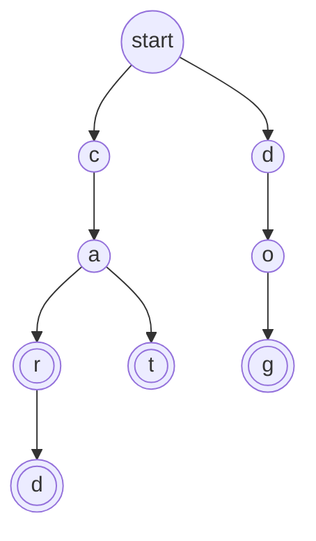

import Tabs from '@theme/Tabs';
import TabItem from '@theme/TabItem';

# Trie

A **trie** (say "try") is a [tree](./tree.mdx) for storing words, one letter per step. It is the structure behind autocomplete: you type a few letters and it instantly knows which words start that way.

## Idea

Think about how autocomplete works on your phone. You type `c`, and the phone narrows things down to words starting with `c`. You type `a`, and it narrows to words starting with `ca`. Every letter you type cuts the choices down.

A trie stores words in exactly that way. Imagine a walk where every junction has signposts, one for each letter that could come next. You start at the entrance. To check whether `cat` is stored, you follow the sign `c`, then the sign `a`, then the sign `t`. Every junction you pass is a **node**, and the path you took spells out the letters so far.

There is one more thing: a word can end at a junction that has roads leading further on. `car` is a word, and so is `card`, and they share the same road for `c`, `a` and `r`. So each node also carries a flag that says "a word ends here". In the picture, those nodes have a double circle.



This trie stores four words: `car`, `card`, `cat` and `dog`. The words `car`, `card` and `cat` share the start of their path (`c`, then `a`), so those nodes are stored only once.

## How it works

### Insert a word

Start at the root. For each letter of the word, follow the road for that letter. If the road does not exist yet, build it: create a new node. After the last letter, set the flag on the node you stopped at: a word ends here.

To insert `card` into the trie above, you follow `c`, `a` and `r`, which already exist, then build a new node for `d` and flag it. If you had inserted `card` before `car`, you would have built all four nodes first, and `car` would only need to flag the existing node for `r`.

### Search for a word

Follow the letters of the word from the root. If at some letter the road does not exist, the word is not stored. If you reach the end of the word, check the flag. The flag matters: the letters `ca` lead to a node, but `ca` is not a stored word, so the answer for `ca` is no.

### Search for a prefix

This is what makes a trie special. To find out whether **any** stored word starts with some letters, follow those letters. If you can walk the whole way, the answer is yes. You do not look at the flag, because the prefix does not need to be a word itself. To list all the words with that prefix, walk to the node and then visit every node below it.

### Why this is fast

Every step of a search follows one letter, so the number of steps is the **length of the word**, no matter whether the trie holds 10 words or 10 million. A trie never has to compare whole words with each other.

A basic trie can use a lot of memory, because each node usually has room for every possible letter, even though most of that room stays empty. There are tricks to save space. For example, a compressed trie (also called a **radix tree**) merges a chain of nodes that have only one child into a single node.

## Code

Each node holds its children and the "a word ends here" flag. In C, C++ and Java the children are stored in an array with one slot per letter from `a` to `z`, and the code assumes lowercase letters only. In Python they are stored in a dictionary, which also works for any other characters. To keep the code short, the C version does not check whether `calloc` succeeded.

### Build a trie

<Tabs groupId="language">
  <TabItem value="c" label="C" default>

```c title="basics.c"
#include <stdio.h>
#include <stdlib.h>

typedef struct Node {
    struct Node *children[26];  // one slot per letter, a to z
    int is_word;                // 1 if a word ends at this node
} Node;

Node *new_node(void) {
    return calloc(1, sizeof(Node));  // all slots NULL, is_word 0
}

void insert(Node *root, const char *word) {
    Node *node = root;
    for (const char *c = word; *c != '\0'; c++) {
        int i = *c - 'a';
        if (node->children[i] == NULL) {  // no road for this letter yet
            node->children[i] = new_node();
        }
        node = node->children[i];  // follow the letter
    }
    node->is_word = 1;  // a word ends here
}

// Follow the letters of text. Returns the node reached, or NULL.
Node *walk(Node *root, const char *text) {
    Node *node = root;
    for (const char *c = text; *c != '\0'; c++) {
        node = node->children[*c - 'a'];
        if (node == NULL) return NULL;  // no road for this letter
    }
    return node;
}

int has(Node *root, const char *word) {
    Node *node = walk(root, word);
    return node != NULL && node->is_word;  // reached, and a word ends
}

int starts(Node *root, const char *prefix) {
    return walk(root, prefix) != NULL;  // reaching the end is enough
}

void free_trie(Node *node) {
    if (node == NULL) return;
    for (int i = 0; i < 26; i++) free_trie(node->children[i]);
    free(node);
}

const char *yn(int b) { return b ? "yes" : "no"; }

int main(void) {
    Node *root = new_node();
    insert(root, "car");
    insert(root, "card");
    insert(root, "cat");
    insert(root, "dog");

    printf("has car: %s\n", yn(has(root, "car")));
    printf("has ca: %s\n", yn(has(root, "ca")));
    printf("has card: %s\n", yn(has(root, "card")));
    printf("has cow: %s\n", yn(has(root, "cow")));
    printf("starts ca: %s\n", yn(starts(root, "ca")));
    printf("starts do: %s\n", yn(starts(root, "do")));
    printf("starts cu: %s\n", yn(starts(root, "cu")));

    free_trie(root);
    return 0;
}
```

  </TabItem>
  <TabItem value="cpp" label="C++">

```cpp title="basics.cpp"
#include <iostream>
#include <memory>
#include <string>

struct Node {
    std::unique_ptr<Node> children[26];  // one slot per letter, a to z
    bool is_word = false;                // true if a word ends here
};

void insert(Node &root, const std::string &word) {
    Node *node = &root;
    for (char c : word) {
        int i = c - 'a';
        if (!node->children[i]) {  // no road for this letter yet
            node->children[i] = std::make_unique<Node>();
        }
        node = node->children[i].get();  // follow the letter
    }
    node->is_word = true;  // a word ends here
}

// Follow the letters of text. Returns the node reached, or nullptr.
const Node *walk(const Node &root, const std::string &text) {
    const Node *node = &root;
    for (char c : text) {
        node = node->children[c - 'a'].get();
        if (node == nullptr) return nullptr;  // no road for this letter
    }
    return node;
}

bool has(const Node &root, const std::string &word) {
    const Node *node = walk(root, word);
    return node != nullptr && node->is_word;  // check the flag
}

bool starts(const Node &root, const std::string &prefix) {
    return walk(root, prefix) != nullptr;  // reaching the end is enough
}

const char *yn(bool b) { return b ? "yes" : "no"; }

int main() {
    Node root;
    insert(root, "car");
    insert(root, "card");
    insert(root, "cat");
    insert(root, "dog");

    std::cout << "has car: " << yn(has(root, "car")) << "\n";
    std::cout << "has ca: " << yn(has(root, "ca")) << "\n";
    std::cout << "has card: " << yn(has(root, "card")) << "\n";
    std::cout << "has cow: " << yn(has(root, "cow")) << "\n";
    std::cout << "starts ca: " << yn(starts(root, "ca")) << "\n";
    std::cout << "starts do: " << yn(starts(root, "do")) << "\n";
    std::cout << "starts cu: " << yn(starts(root, "cu")) << "\n";
}
```

  </TabItem>
  <TabItem value="python" label="Python">

```python title="basics.py"
class Node:
    def __init__(self):
        self.children = {}  # letter -> the node that letter leads to
        self.is_word = False  # True if a word ends at this node


def insert(root, word):
    node = root
    for letter in word:
        if letter not in node.children:  # no road for this letter yet
            node.children[letter] = Node()
        node = node.children[letter]  # follow the letter
    node.is_word = True  # a word ends here


def walk(root, text):
    """Follow the letters of text. Returns the node reached, or None."""
    node = root
    for letter in text:
        node = node.children.get(letter)
        if node is None:
            return None  # no road for this letter
    return node


def has(root, word):
    node = walk(root, word)
    return node is not None and node.is_word  # reached, and a word ends


def starts(root, prefix):
    return walk(root, prefix) is not None  # reaching the end is enough


def yn(flag):
    return "yes" if flag else "no"


root = Node()
for word in ["car", "card", "cat", "dog"]:
    insert(root, word)

print("has car:", yn(has(root, "car")))
print("has ca:", yn(has(root, "ca")))
print("has card:", yn(has(root, "card")))
print("has cow:", yn(has(root, "cow")))
print("starts ca:", yn(starts(root, "ca")))
print("starts do:", yn(starts(root, "do")))
print("starts cu:", yn(starts(root, "cu")))
```

  </TabItem>
  <TabItem value="java" label="Java">

```java title="Basics.java"
public class Basics {
    static class Node {
        Node[] children = new Node[26];  // one slot per letter, a to z
        boolean isWord;                  // true if a word ends here
    }

    static void insert(Node root, String word) {
        Node node = root;
        for (char c : word.toCharArray()) {
            int i = c - 'a';
            if (node.children[i] == null) {  // no road yet
                node.children[i] = new Node();
            }
            node = node.children[i];  // follow the letter
        }
        node.isWord = true;  // a word ends here
    }

    // Follow the letters of text. Returns the node reached, or null.
    static Node walk(Node root, String text) {
        Node node = root;
        for (char c : text.toCharArray()) {
            node = node.children[c - 'a'];
            if (node == null) return null;  // no road for this letter
        }
        return node;
    }

    static boolean has(Node root, String word) {
        Node node = walk(root, word);
        return node != null && node.isWord;  // reached, and a word ends
    }

    static boolean starts(Node root, String prefix) {
        return walk(root, prefix) != null;  // the end was reached
    }

    static String yn(boolean b) {
        return b ? "yes" : "no";
    }

    public static void main(String[] args) {
        Node root = new Node();
        for (String word : new String[] {"car", "card", "cat", "dog"}) {
            insert(root, word);
        }

        System.out.println("has car: " + yn(has(root, "car")));
        System.out.println("has ca: " + yn(has(root, "ca")));
        System.out.println("has card: " + yn(has(root, "card")));
        System.out.println("has cow: " + yn(has(root, "cow")));
        System.out.println("starts ca: " + yn(starts(root, "ca")));
        System.out.println("starts do: " + yn(starts(root, "do")));
        System.out.println("starts cu: " + yn(starts(root, "cu")));
    }
}
```

  </TabItem>
</Tabs>

## Complexity

If O(1) and O(n) are new to you, see the [Array](./array.mdx) page. Here $L$ is the **length of the word** you are inserting or looking up (its number of letters), not the number of words stored.

| Operation                                  | Cost   | In plain words                                                              |
| ------------------------------------------ | ------ | --------------------------------------------------------------------------- |
| Insert a word                              | $O(L)$ | One step per letter.                                                        |
| Search for a word                          | $O(L)$ | One step per letter, then a look at the flag.                               |
| Does any word start with this prefix?      | $O(L)$ | Follow the prefix. Done as soon as you get to its end.                      |
| List all words with a prefix               | $O(L + k)$ | Follow the prefix, then visit the $k$ nodes below it.                   |
| Memory used                                | at most one node per letter of every word | Shared beginnings are stored once. With 26 slots per node, though, a lot of space stays empty. |

The cost depends on the length of the word and not on how many words are stored. A trie with a million words finds `cat` in 3 steps.

## When to use it

A trie is a good fit when you work with **words or other strings**, and the **beginning** of a word matters:

- **Autocomplete and suggestions.** Which stored words start with what the user typed so far?
- **Spell checking and word games.** Is this a valid word? Can this set of letters still become a word?
- **Prefix matching.** Network routers match an address against stored address prefixes. (Real routers use compressed tries.)

Look at another structure when:

- You only ever ask "is this exact word stored?". A [hash table](./hash-table.mdx) is simpler and usually uses less memory.
- You need numbers or things that are not made of a sequence of small pieces. A [binary search tree](./binary-search-tree.mdx) fits better.
- Memory is tight and the words are few. Every letter can cost a whole node.

:::warning[Common mistakes]
- **Forgetting the "word ends here" flag.** Without it you cannot tell whether `car` is a stored word or only the start of `card`.
- **Letters outside a to z.** With a 26-slot array, a capital letter, a space or an accent gives an index outside the array and can crash the program in C, C++ and Java. Convert the text to lowercase first, or store the children in a dictionary or hash map.
- **Running out of memory.** A node with 26 slots is big. A trie with millions of words can need much more memory than the words themselves.
- **Leaking nodes in C.** Free the whole trie when you are done: the children first, then the node.
- **Deleting a word carelessly.** Deleting `car` must not remove the nodes that `card` needs. Clear the flag first, and remove only the nodes that no other word uses.
:::

## Sources

The facts on this page were checked against:

- [Trie, Wikipedia](https://en.wikipedia.org/wiki/Trie)
