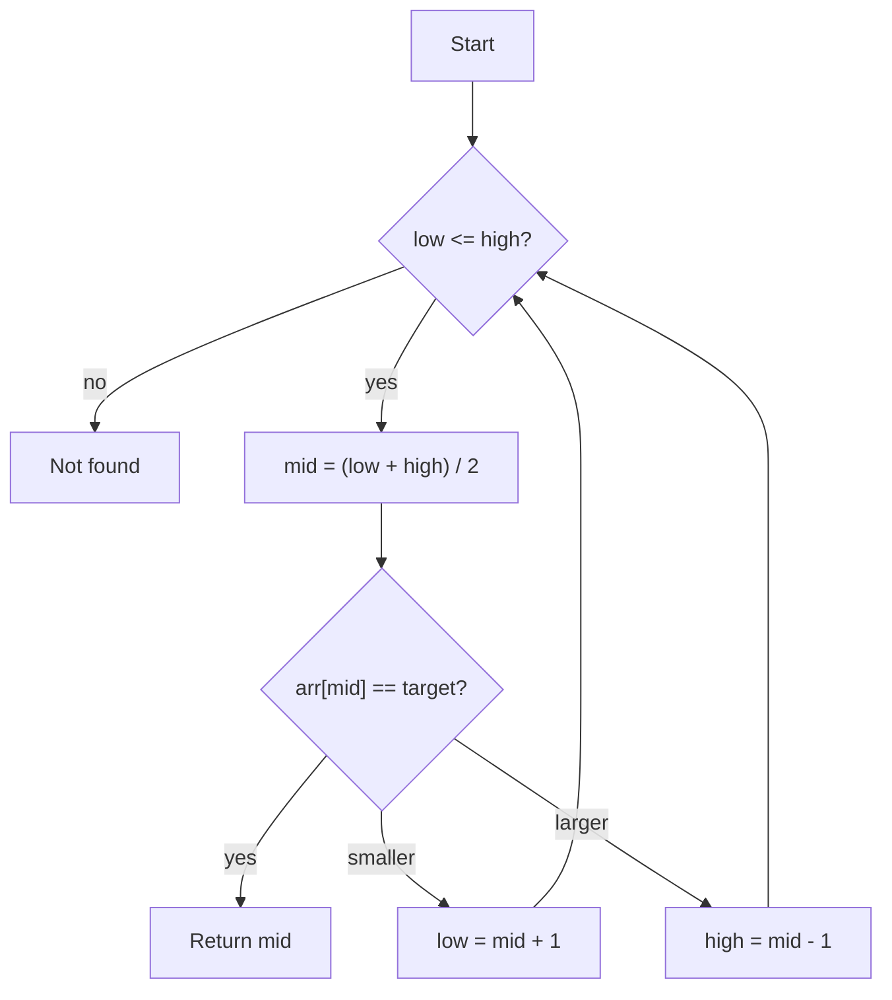

import Tabs from '@theme/Tabs';
import TabItem from '@theme/TabItem';

# Writing Guide

This page shows every formatting feature available when writing a topic, and doubles as a smoke test for the site. Delete it once you are comfortable with the features.

## Math

Inline math sits in a sentence, such as $O(n \log n)$. Display math gets its own line:

$$
T(n) = 2\,T\!\left(\frac{n}{2}\right) + O(n) \;\Rightarrow\; T(n) = O(n \log n)
$$

## Diagrams

Diagrams are written as text with [Mermaid](https://mermaid.js.org/):



## Code in several languages

The selected language is remembered and kept in sync across every code block on the site.

<Tabs groupId="language">
  <TabItem value="python" label="Python" default>

```python title="binary_search.py"
def binary_search(arr, target):
    low, high = 0, len(arr) - 1
    while low <= high:
        mid = (low + high) // 2
        if arr[mid] == target:
            return mid
        if arr[mid] < target:
            low = mid + 1
        else:
            high = mid - 1
    return -1
```

  </TabItem>
  <TabItem value="cpp" label="C++">

```cpp title="binary_search.cpp"
int binarySearch(const std::vector<int>& arr, int target) {
    int low = 0, high = static_cast<int>(arr.size()) - 1;
    while (low <= high) {
        int mid = low + (high - low) / 2;
        if (arr[mid] == target) return mid;
        if (arr[mid] < target) low = mid + 1;
        else high = mid - 1;
    }
    return -1;
}
```

  </TabItem>
  <TabItem value="java" label="Java">

```java title="BinarySearch.java"
static int binarySearch(int[] arr, int target) {
    int low = 0, high = arr.length - 1;
    while (low <= high) {
        int mid = low + (high - low) / 2;
        if (arr[mid] == target) return mid;
        if (arr[mid] < target) low = mid + 1;
        else high = mid - 1;
    }
    return -1;
}
```

  </TabItem>
</Tabs>

Highlight lines with a comment:

```python
def add(a, b):
    # highlight-next-line
    return a + b
```

## Callouts

:::tip
Use a tip for a shortcut or a good habit.
:::

:::warning
Use a warning for a common mistake, such as an off-by-one error.
:::

:::danger
Use danger for something that breaks the algorithm.
:::

## Page template

Copy this skeleton for a new topic:

````md
---
title: Binary Search
description: Find an element in a sorted array in O(log n).
---

## Idea
## How it works
## Code
## Complexity
## When to use it
````
