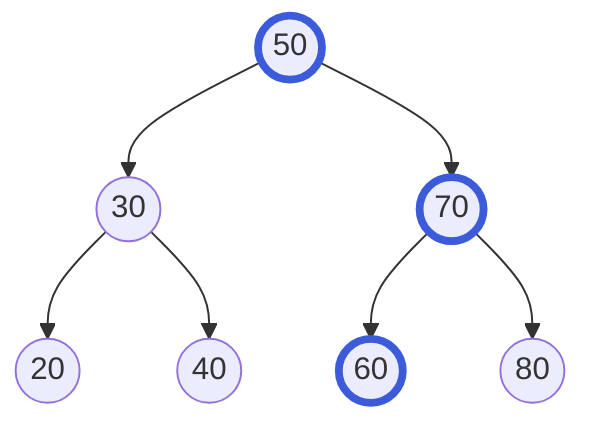

import Tabs from '@theme/Tabs';
import TabItem from '@theme/TabItem';

# Cây tìm kiếm nhị phân (Binary Search Tree)

**Cây tìm kiếm nhị phân** (BST) là một [cây nhị phân](./tree.mdx) giữ các giá trị của nó theo thứ tự, để bạn tìm được bất kỳ giá trị nào bằng cách hỏi đi hỏi lại "nhỏ hơn hay lớn hơn?".

## Ý tưởng

Hãy nhớ lại trò chơi đoán số "cao hơn hay thấp hơn". Một người bạn nghĩ ra một số từ 1 đến 100. Bạn đoán 50. Họ nói "cao hơn". Giờ bạn biết số đó lớn hơn 50, nên bạn không bao giờ đoán dưới mức đó nữa. Bạn đoán 75, họ nói "thấp hơn", và cứ thế. Mỗi câu trả lời loại bỏ một phần lớn các khả năng.

Cây tìm kiếm nhị phân là trò chơi đó được viết ra thành một cái cây. Mỗi nút chứa một giá trị, và tuân theo một quy tắc:

> Mọi thứ trong cây con **trái** của một nút đều **nhỏ hơn** nút đó. Mọi thứ trong cây con **phải** của nó đều **lớn hơn**.



Để tìm `60`, hãy bắt đầu từ gốc. `60` lớn hơn `50`, nên đi phải. `60` nhỏ hơn `70`, nên đi trái. Bạn đã đến `60`. Tìm thấy, sau 3 bước (đường được tô đậm), mà không phải nhìn 4 giá trị còn lại.

Hãy để ý rằng quy tắc nói về **toàn bộ cây con**, không chỉ các con trực tiếp. Mọi giá trị ở phía `30` của cây đều nhỏ hơn `50`, và mọi thứ ở phía `70` đều lớn hơn `50`.

## Cách hoạt động

### Tìm kiếm: đi trái hoặc phải

Bắt đầu từ gốc và so sánh:

- Nếu giá trị bạn cần bằng giá trị của nút, bạn đã tìm thấy.
- Nếu nó nhỏ hơn, đi sang con trái.
- Nếu nó lớn hơn, đi sang con phải.
- Nếu không còn con nào để đi, giá trị đó không có trong cây.

Mỗi bước đi xuống một tầng, nên bạn đi nhiều nhất là bằng chiều cao của cây.

### Chèn: tìm chỗ trống

Để thêm `65`, hãy tìm nó đúng như trên. Bạn đi phải ở `50`, trái ở `70`, phải ở `60`, và ở đó không có gì. Chỗ trống đó chính xác là nơi `65` thuộc về, nên bạn gắn một nút mới vào đó. Giá trị mới luôn trở thành lá mới, và không có gì khác trong cây phải di chuyển.

### Xóa: ba trường hợp

Việc xóa một nút tùy thuộc vào số con của nó:

1. **Không có con (một lá).** Chỉ cần bỏ nó đi.
2. **Một con.** Con đó lên thế chỗ nút bị xóa.
3. **Hai con.** Bạn không thể giao cả hai con cho cha, nên dùng một mẹo: tìm **nút kế nhiệm** (successor) của nó, tức giá trị lớn hơn kế tiếp, chính là giá trị nhỏ nhất trong cây con phải của nó (đi phải một lần, rồi đi trái đến cùng). Chép giá trị đó vào nút, rồi xóa nút kế nhiệm khỏi cây con phải. Nút kế nhiệm không bao giờ có con trái, nên việc xóa này rơi vào trường hợp 1 hoặc 2 dễ dàng.

Ví dụ, xóa `50` khỏi cây ở trên: nút kế nhiệm của nó là `60` (đi phải tới `70`, rồi đi trái tới `60`). Đặt `60` vào chỗ của `50`, và xóa nút `60` cũ. Thứ tự của các giá trị vẫn đúng.

### Thứ tự đã sắp xếp, có sẵn

Hãy duyệt cây theo in-order (cây con trái, nút, cây con phải, xem trang [Cây](./tree.mdx)) và bạn nhận được các giá trị từ nhỏ nhất đến lớn nhất: `20 30 40 50 60 70 80`. Tìm giá trị nhỏ nhất nghĩa là đi trái đến khi hết đường, và giá trị lớn nhất nghĩa là đi phải đến khi hết đường.

### Hình dạng rất quan trọng

BST chỉ nhanh nếu nó **cân bằng**: số nút bên trái và bên phải xấp xỉ nhau. Khi đó mỗi bước loại bỏ khoảng một nửa số còn lại, như trò chơi đoán số.

Nhưng hình dạng phụ thuộc vào **thứ tự** các giá trị được chèn vào. Nếu các giá trị đến đã được sắp xếp sẵn, như `10, 20, 30, 40`, mỗi giá trị mới đều đi vào bên phải của giá trị trước:


Đây là một [danh sách liên kết](./linked-list.mdx) cải trang, và tìm `40` tốn 4 bước, mỗi giá trị một bước. Với một triệu giá trị đã sắp xếp, nó tốn một triệu bước.

Cách khắc phục là một cây tìm kiếm nhị phân **tự cân bằng** (self-balancing), như cây AVL hoặc cây đỏ-đen (red-black). Sau mỗi lần chèn hoặc xóa, nó sắp xếp lại vài nút để cây không bị lệch, nên nó luôn nhanh dù các giá trị đến theo thứ tự nào. Chúng khó viết, và bạn hiếm khi cần tự viết: `std::set` và `std::map` của C++ thường được dựng từ cây đỏ-đen, và `TreeSet` cùng `TreeMap` của Java là cây đỏ-đen.

## Code

Ví dụ đầu tiên dựng một BST thường bằng tay, với ba thao tác ở trên. Nó không giữ giá trị trùng, và không tự cân bằng. Nó cũng cho thấy vấn đề của dữ liệu đã sắp xếp ở cuối. Để code ngắn, bản C và C++ không kiểm tra việc cấp phát bộ nhớ có thành công hay không.

Ví dụ thứ hai dùng các tập hợp có thứ tự có sẵn của từng ngôn ngữ.

### Dựng một cây tìm kiếm nhị phân

<Tabs groupId="language">
  <TabItem value="c" label="C" default>

```c title="basics.c"
#include <stdio.h>
#include <stdlib.h>

typedef struct Node {
    int key;
    struct Node *left;
    struct Node *right;
} Node;

// Thêm key (không trùng). Trả về gốc của cây đã thay đổi.
Node *insert(Node *root, int key) {
    if (root == NULL) {  // chỗ trống: lá mới được đặt ở đây
        Node *node = malloc(sizeof(Node));
        node->key = key;
        node->left = NULL;
        node->right = NULL;
        return node;
    }
    if (key < root->key) root->left = insert(root->left, key);
    else if (key > root->key) root->right = insert(root->right, key);
    return root;  // đã có key bằng nó: không làm gì
}

int contains(const Node *root, int key) {
    while (root != NULL) {
        if (key == root->key) return 1;  // tìm thấy
        // đi trái hoặc phải
        root = key < root->key ? root->left : root->right;
    }
    return 0;  // ra khỏi cây: không có
}

Node *smallest(Node *root) {  // cứ đi trái
    while (root->left != NULL) root = root->left;
    return root;
}

// Xóa key. Trả về gốc của cây đã thay đổi.
Node *remove_key(Node *root, int key) {
    if (root == NULL) return NULL;  // không thấy: bỏ qua
    if (key < root->key) {
        root->left = remove_key(root->left, key);
    } else if (key > root->key) {
        root->right = remove_key(root->right, key);
    } else if (root->left == NULL || root->right == NULL) {
        // 0 hoặc 1 con: con (hoặc NULL) thế chỗ
        Node *child = root->left != NULL ? root->left : root->right;
        free(root);
        return child;
    } else {
        // hai con: chép nút kế nhiệm vào đây, rồi xóa nó
        Node *next = smallest(root->right);
        root->key = next->key;
        root->right = remove_key(root->right, next->key);
    }
    return root;
}

int height(const Node *n) {
    if (n == NULL) return -1;  // cây rỗng
    int left = height(n->left);
    int right = height(n->right);
    return 1 + (left > right ? left : right);
}

void print_inorder(const Node *n) {  // trái, nút, phải
    if (n == NULL) return;
    print_inorder(n->left);
    printf(" %d", n->key);
    print_inorder(n->right);
}

void free_tree(Node *n) {
    if (n == NULL) return;
    free_tree(n->left);
    free_tree(n->right);
    free(n);
}

int main(void) {
    Node *root = NULL;
    int keys[] = {50, 30, 70, 20, 40, 60, 80};
    for (int i = 0; i < 7; i++) root = insert(root, keys[i]);

    printf("inorder:"); print_inorder(root); printf("\n");
    printf("has 60: %s\n", contains(root, 60) ? "yes" : "no");
    printf("has 65: %s\n", contains(root, 65) ? "yes" : "no");
    printf("height: %d\n", height(root));  // height: 2

    root = remove_key(root, 50);  // một nút có hai con
    printf("inorder:"); print_inorder(root); printf("\n");

    Node *chain = NULL;
    for (int key = 10; key <= 40; key += 10) {  // key đã sắp xếp sẵn
        chain = insert(chain, key);
    }
    printf("chain height: %d\n", height(chain));  // chain height: 3

    free_tree(root);
    free_tree(chain);
    return 0;
}
```

  </TabItem>
  <TabItem value="cpp" label="C++">

```cpp title="basics.cpp"
#include <algorithm>
#include <iostream>

struct Node {
    int key;
    Node *left = nullptr;
    Node *right = nullptr;
};

// Thêm key (không trùng). Trả về gốc của cây đã thay đổi.
Node *insert(Node *root, int key) {
    if (root == nullptr) return new Node{key};  // lá mới được đặt ở đây
    if (key < root->key) root->left = insert(root->left, key);
    else if (key > root->key) root->right = insert(root->right, key);
    return root;  // đã có key bằng nó: không làm gì
}

bool contains(const Node *root, int key) {
    while (root != nullptr) {
        if (key == root->key) return true;  // tìm thấy
        // đi trái hoặc phải
        root = key < root->key ? root->left : root->right;
    }
    return false;  // ra khỏi cây: không có
}

Node *smallest(Node *root) {  // cứ đi trái
    while (root->left != nullptr) root = root->left;
    return root;
}

// Xóa key. Trả về gốc của cây đã thay đổi.
Node *remove_key(Node *root, int key) {
    if (root == nullptr) return nullptr;  // không thấy: bỏ qua
    if (key < root->key) {
        root->left = remove_key(root->left, key);
    } else if (key > root->key) {
        root->right = remove_key(root->right, key);
    } else if (root->left == nullptr || root->right == nullptr) {
        // 0 hoặc 1 con: con (hoặc nullptr) thế chỗ
        Node *child = root->left != nullptr ? root->left : root->right;
        delete root;
        return child;
    } else {
        // hai con: chép nút kế nhiệm vào đây, rồi xóa nó
        Node *next = smallest(root->right);
        root->key = next->key;
        root->right = remove_key(root->right, next->key);
    }
    return root;
}

int height(const Node *n) {
    if (n == nullptr) return -1;  // cây rỗng
    return 1 + std::max(height(n->left), height(n->right));
}

void print_inorder(const Node *n) {  // trái, nút, phải
    if (n == nullptr) return;
    print_inorder(n->left);
    std::cout << " " << n->key;
    print_inorder(n->right);
}

void free_tree(Node *n) {
    if (n == nullptr) return;
    free_tree(n->left);
    free_tree(n->right);
    delete n;
}

const char *yn(bool b) { return b ? "yes" : "no"; }

int main() {
    Node *root = nullptr;
    for (int key : {50, 30, 70, 20, 40, 60, 80}) {
        root = insert(root, key);
    }

    std::cout << "inorder:"; print_inorder(root); std::cout << "\n";
    std::cout << "has 60: " << yn(contains(root, 60)) << "\n";
    std::cout << "has 65: " << yn(contains(root, 65)) << "\n";
    std::cout << "height: " << height(root) << "\n";  // height: 2

    root = remove_key(root, 50);  // một nút có hai con
    std::cout << "inorder:"; print_inorder(root); std::cout << "\n";

    Node *chain = nullptr;
    for (int key : {10, 20, 30, 40}) {  // key đã sắp xếp sẵn
        chain = insert(chain, key);
    }
    std::cout << "chain height: " << height(chain) << "\n";  // 3

    free_tree(root);
    free_tree(chain);
}
```

  </TabItem>
  <TabItem value="python" label="Python">

```python title="basics.py"
class Node:
    def __init__(self, key):
        self.key = key
        self.left = None
        self.right = None


def insert(root, key):
    """Thêm key (không trùng). Trả về gốc mới."""
    if root is None:  # chỗ trống: lá mới được đặt ở đây
        return Node(key)
    if key < root.key:
        root.left = insert(root.left, key)
    elif key > root.key:
        root.right = insert(root.right, key)
    return root  # đã có key bằng nó: không làm gì


def contains(root, key):
    while root is not None:
        if key == root.key:
            return True  # tìm thấy
        # đi trái hoặc phải
        root = root.left if key < root.key else root.right
    return False  # ra khỏi cây: không có


def smallest(root):  # cứ đi trái
    while root.left is not None:
        root = root.left
    return root


def remove(root, key):
    """Xóa key. Trả về gốc mới."""
    if root is None:
        return None  # không thấy: bỏ qua
    if key < root.key:
        root.left = remove(root.left, key)
    elif key > root.key:
        root.right = remove(root.right, key)
    elif root.left is None or root.right is None:
        # 0 hoặc 1 con: con (hoặc None) thế chỗ
        return root.left or root.right
    else:
        # hai con: chép nút kế nhiệm vào đây, rồi xóa nó
        nxt = smallest(root.right)
        root.key = nxt.key
        root.right = remove(root.right, nxt.key)
    return root


def height(n):
    if n is None:
        return -1  # cây rỗng
    return 1 + max(height(n.left), height(n.right))


def inorder(n):  # trái, nút, phải
    if n is None:
        return []
    return inorder(n.left) + [n.key] + inorder(n.right)


root = None
for key in [50, 30, 70, 20, 40, 60, 80]:
    root = insert(root, key)

print("inorder:", *inorder(root))
print("has 60:", "yes" if contains(root, 60) else "no")
print("has 65:", "yes" if contains(root, 65) else "no")
print("height:", height(root))  # height: 2

root = remove(root, 50)  # một nút có hai con
print("inorder:", *inorder(root))

chain = None
for key in [10, 20, 30, 40]:  # key đã sắp xếp sẵn
    chain = insert(chain, key)
print("chain height:", height(chain))  # chain height: 3
```

  </TabItem>
  <TabItem value="java" label="Java">

```java title="Basics.java"
public class Basics {
    static class Node {
        int key;
        Node left;
        Node right;

        Node(int key) {
            this.key = key;
        }
    }

    // Thêm key (không trùng). Trả về gốc của cây đã thay đổi.
    static Node insert(Node root, int key) {
        if (root == null) return new Node(key);  // chỗ trống
        if (key < root.key) root.left = insert(root.left, key);
        else if (key > root.key) root.right = insert(root.right, key);
        return root;  // đã có key bằng nó: không làm gì
    }

    static boolean contains(Node root, int key) {
        while (root != null) {
            if (key == root.key) return true;  // tìm thấy
            // đi trái hoặc phải
            root = key < root.key ? root.left : root.right;
        }
        return false;  // ra khỏi cây: không có
    }

    static Node smallest(Node root) {  // cứ đi trái
        while (root.left != null) root = root.left;
        return root;
    }

    // Xóa key. Trả về gốc của cây đã thay đổi.
    static Node remove(Node root, int key) {
        if (root == null) return null;  // không thấy: bỏ qua
        if (key < root.key) {
            root.left = remove(root.left, key);
        } else if (key > root.key) {
            root.right = remove(root.right, key);
        } else if (root.left == null || root.right == null) {
            // 0 hoặc 1 con: con (hoặc null) thế chỗ
            return root.left != null ? root.left : root.right;
        } else {
            // hai con: chép nút kế nhiệm vào đây, rồi xóa nó
            Node next = smallest(root.right);
            root.key = next.key;
            root.right = remove(root.right, next.key);
        }
        return root;
    }

    static int height(Node n) {
        if (n == null) return -1;  // cây rỗng
        return 1 + Math.max(height(n.left), height(n.right));
    }

    static void printInorder(Node n) {  // trái, nút, phải
        if (n == null) return;
        printInorder(n.left);
        System.out.print(" " + n.key);
        printInorder(n.right);
    }

    static void show(Node root) {
        System.out.print("inorder:");
        printInorder(root);
        System.out.println();
    }

    static String yn(boolean b) {
        return b ? "yes" : "no";
    }

    public static void main(String[] args) {
        Node root = null;
        for (int key : new int[] {50, 30, 70, 20, 40, 60, 80}) {
            root = insert(root, key);
        }

        show(root);
        System.out.println("has 60: " + yn(contains(root, 60)));
        System.out.println("has 65: " + yn(contains(root, 65)));
        System.out.println("height: " + height(root));  // height: 2

        root = remove(root, 50);  // một nút có hai con
        show(root);

        Node chain = null;
        for (int key = 10; key <= 40; key += 10) {  // đã được sắp xếp
            chain = insert(chain, key);
        }
        System.out.println("chain height: " + height(chain));  // 3
    }
}
```

  </TabItem>
</Tabs>

### Dùng một tập hợp có thứ tự có sẵn

<Tabs groupId="language">
  <TabItem value="c" label="C" default>

Thư viện chuẩn của C không có cây tìm kiếm. Hãy tự dựng, như ở trên, hoặc dùng một thư viện.

  </TabItem>
  <TabItem value="cpp" label="C++">

```cpp title="ready_made.cpp"
#include <iostream>
#include <set>

int main() {
    std::set<int> keys = {50, 30, 70, 20, 40, 60, 80};  // có thứ tự

    std::cout << "sorted:";
    for (int key : keys) std::cout << " " << key;  // 20 30 ... 80
    std::cout << "\n";

    std::cout << "has 60: " << (keys.count(60) ? "yes" : "no") << "\n";
    std::cout << "has 65: " << (keys.count(65) ? "yes" : "no") << "\n";

    // key nhỏ nhất mà bằng hoặc lớn hơn 65
    std::cout << "next: " << *keys.lower_bound(65) << "\n";  // next: 70
}
```

  </TabItem>
  <TabItem value="python" label="Python">

Thư viện chuẩn của Python không có cây tìm kiếm. Một cách thay thế phổ biến là một list bạn giữ cho luôn được sắp xếp bằng module `bisect`. Một gói của bên thứ ba có thể cho bạn một container có thứ tự thực thụ.

  </TabItem>
  <TabItem value="java" label="Java">

```java title="ReadyMade.java"
import java.util.List;
import java.util.TreeSet;

public class ReadyMade {
    static String yn(boolean b) {
        return b ? "yes" : "no";
    }

    public static void main(String[] args) {
        // TreeSet luôn giữ các giá trị có thứ tự
        TreeSet<Integer> keys =
            new TreeSet<>(List.of(50, 30, 70, 20, 40, 60, 80));

        StringBuilder line = new StringBuilder("sorted:");
        for (int key : keys) line.append(" ").append(key);
        System.out.println(line);  // sorted: 20 30 ... 80

        System.out.println("has 60: " + yn(keys.contains(60)));
        System.out.println("has 65: " + yn(keys.contains(65)));

        // key nhỏ nhất mà bằng hoặc lớn hơn 65
        System.out.println("next: " + keys.ceiling(65));  // next: 70
    }
}
```

  </TabItem>
</Tabs>

## Độ phức tạp

Nếu O(1) và O(n) còn mới với bạn, hãy xem trang [Mảng](./array.mdx). Ở đây $n$ là số giá trị và $h$ là chiều cao của cây.

| Thao tác                     | Cây cân bằng  | Trường hợp xấu nhất (một chuỗi) | Nói bằng lời                                                  |
| ---------------------------- | ------------- | ------------------------------- | ------------------------------------------------------------- |
| Tìm kiếm                     | $O(\log n)$   | $O(n)$                          | Mỗi tầng một bước. Cây cân bằng có ít tầng.                   |
| Chèn                         | $O(\log n)$   | $O(n)$                          | Tìm chỗ, rồi gắn một lá.                                      |
| Xóa                          | $O(\log n)$   | $O(n)$                          | Tìm nút, rồi sửa thêm nhiều nhất một đường nữa.               |
| Giá trị nhỏ nhất hoặc lớn nhất | $O(\log n)$ | $O(n)$                          | Cứ đi trái (hoặc phải).                                       |
| Mọi giá trị theo thứ tự      | $O(n)$        | $O(n)$                          | Một lần duyệt in-order.                                       |
| Bộ nhớ sử dụng               | $O(n)$        | $O(n)$                          | Mỗi giá trị một nút, với hai liên kết.                        |

Cả ba thao tác chính đều tốn thời gian tỷ lệ với **chiều cao** $h$. Cây cân bằng có $h \approx \log_2 n$, còn một chuỗi có $h = n - 1$. Một cây tự cân bằng (đỏ-đen, AVL) giữ cây cân bằng giúp bạn, nên bạn luôn có cột đầu tiên. `TreeMap` của Java đảm bảo $O(\log n)$ cho các thao tác chính của nó.

## Khi nào nên dùng

Cây tìm kiếm nhị phân rất phù hợp khi bạn cần giữ các giá trị **có thứ tự** trong lúc thêm và xóa chúng:

- Bạn cần các giá trị theo thứ tự bất cứ lúc nào, hoặc giá trị nhỏ nhất và lớn nhất.
- Bạn cần "giá trị lớn hơn 65 kế tiếp" hoặc "mọi giá trị nằm giữa 30 và 60". [Bảng băm](./hash-table.mdx) không làm được việc đó.
- Các giá trị đến và đi liên tục. Một [mảng](./array.mdx) đã sắp xếp tìm giá trị nhanh, nhưng chèn vào giữa nghĩa là phải dịch mọi thứ.

Hãy xem xét cấu trúc khác khi:

- Bạn chỉ tra cứu giá trị theo khóa chính xác. Bảng băm nhanh hơn khi tính trung bình.
- Bạn chỉ cần giá trị nhỏ nhất (hoặc lớn nhất). [Heap](./heap.mdx) đơn giản và rẻ hơn.
- Dữ liệu của bạn không bao giờ đổi sau khi nạp. Một mảng đã sắp xếp với tìm kiếm nhị phân nhỏ gọn và đơn giản hơn.

Trong thực tế bạn hầu như luôn dùng tập hợp hoặc map có thứ tự có sẵn của ngôn ngữ (loại tự cân bằng) thay vì tự viết một BST thường.

:::warning[Lỗi thường gặp]
- **Chỉ kiểm tra các con.** Một cái cây mà con phải của `30` là `60` dưới một gốc `50` trông ổn khi xét từng nút, nhưng nó **không** phải BST, vì `60` lớn hơn `50` mà lại nằm ở phía trái của `50`. Quy tắc áp dụng cho toàn bộ cây con.
- **Chèn dữ liệu đã sắp xếp vào một BST thường.** Cây thành một chuỗi và mọi thao tác trở nên chậm. Hãy dùng cây tự cân bằng, hoặc xáo trộn dữ liệu trước.
- **Xử lý sai nút có hai con.** Bạn phải thay nó bằng nút kế nhiệm (hoặc nút tiền nhiệm), chứ không chỉ bỏ nó đi.
- **Quên cây rỗng.** Mọi hàm đệ quy đều cần kiểm tra `null` trước.
- **Đổi một giá trị đang nằm trong cây.** Cây không còn biết tìm nó ở đâu. Hãy xóa nó rồi chèn giá trị mới.
:::

## Nguồn tham khảo

Các thông tin trên trang này được đối chiếu với:

- [Binary search tree, Wikipedia](https://en.wikipedia.org/wiki/Binary_search_tree)
- [TreeMap, Java SE 21 API](https://docs.oracle.com/en/java/javase/21/docs/api/java.base/java/util/TreeMap.html)
- [std::set, cppreference](https://en.cppreference.com/w/cpp/container/set)
