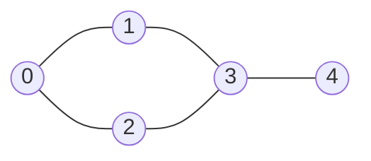
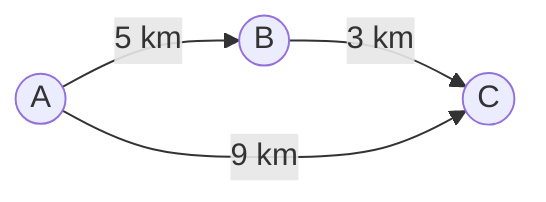

import Tabs from '@theme/Tabs';
import TabItem from '@theme/TabItem';
import ChainDiagram from '@site/src/components/ChainDiagram';

# Đồ thị (Graph)

**Đồ thị** là một tập hợp các chấm được nối với nhau bằng các đường. Nó mô tả mọi thứ có liên kết với những thứ khác, như các thành phố và những con đường giữa chúng, hay con người và tình bạn của họ.

## Ý tưởng

Hãy mở sơ đồ một hệ thống tàu điện ngầm. Bạn thấy các ga (những chấm) và các đường ray nối giữa chúng (những đường). Không quan trọng mỗi ga được vẽ chính xác ở đâu. Điều quan trọng là **ga nào nối với ga nào**. Đó là một đồ thị.

Những từ bạn cần biết:

- **Đỉnh** (vertex, còn gọi là **nút**, node) là một chấm. Một ga tàu, một thành phố, một con người.
- **Cạnh** (edge) là một đường nối giữa hai đỉnh. Một đường ray, một con đường, một tình bạn.
- Hai đỉnh được nối bởi một cạnh là **láng giềng** (neighbor, hay **kề nhau**, adjacent).

Đây là đồ thị được dùng cho phần còn lại của trang này, với 5 đỉnh và 5 cạnh:



Đồ thị có vài loại:

- **Vô hướng** (undirected): một cạnh đi được cả hai chiều, như một tình bạn hay một con đường hai chiều. Đồ thị ở trên là vô hướng.
- **Có hướng** (directed): một cạnh có chiều, như một con đường một chiều, hay "theo dõi" trên mạng xã hội. Nó được vẽ thành mũi tên.
- **Có trọng số** (weighted): mỗi cạnh có một con số, như khoảng cách, giá tiền hay thời gian di chuyển.



Đồ thị này vừa có hướng vừa có trọng số. Bạn đi được từ `A` đến `B`, nhưng không đi ngược lại được.

[Cây](./tree.mdx) là một đồ thị đặc biệt: một đồ thị không có vòng lặp, nơi mọi đỉnh trừ gốc đều có đúng một cha. Đồ thị tổng quát không có những giới hạn đó. Một đỉnh có thể có bất kỳ số láng giềng nào, và bạn có thể đi vòng tròn (gọi là **chu trình**, cycle).

## Cách hoạt động

### Hai cách lưu một đồ thị

Bạn phải lưu lại đỉnh nào nối với đỉnh nào. Có hai cách kinh điển. Giả sử các đỉnh được đánh số 0, 1, 2, ... để bạn dùng chúng làm chỉ số.

**Danh sách kề** (adjacency list). Mỗi đỉnh giữ một danh sách các láng giềng của nó. Giống như mỗi ga có một tấm biển nhỏ liệt kê các ga nó nối tới. Đây là đồ thị ở trên:

<ChainDiagram emptyText="không có láng giềng" rows={[
  {label: 0, items: [1, 2]},
  {label: 1, items: [0, 3]},
  {label: 2, items: [0, 3]},
  {label: 3, items: [1, 2, 4]},
  {label: 4, items: [3]},
]} />

**Ma trận kề** (adjacency matrix). Một bảng vuông có một hàng và một cột cho mỗi đỉnh. Số `1` ở hàng `a` và cột `b` nghĩa là "có một cạnh từ `a` đến `b`":

| từ \ đến | 0 | 1 | 2 | 3 | 4 |
| -------- | - | - | - | - | - |
| **0**    | 0 | 1 | 1 | 0 | 0 |
| **1**    | 1 | 0 | 0 | 1 | 0 |
| **2**    | 1 | 0 | 0 | 1 | 0 |
| **3**    | 0 | 1 | 1 | 0 | 1 |
| **4**    | 0 | 0 | 0 | 1 | 0 |

Một đồ thị vô hướng cho ra một ma trận đối xứng qua đường chéo, vì mỗi cạnh đi được cả hai chiều.

Bạn nên dùng cách nào? Ma trận trả lời "có cạnh nào giữa `a` và `b` không?" ngay lập tức, nhưng nó luôn dùng một bảng $V \times V$ ô, với $V$ là số đỉnh, kể cả khi chỉ có rất ít cạnh. Danh sách chỉ lưu những cạnh đang có. Hầu hết đồ thị thực tế có ít cạnh so với số cạnh có thể có (một người có vài trăm bạn, không phải vài tỷ bạn), nên **danh sách kề là lựa chọn thông thường**. Ma trận tốt hơn cho các đồ thị nhỏ mà gần như mọi cặp đỉnh đều được nối.

### Đi qua một đồ thị

Nhiều câu hỏi về đồ thị bắt đầu bằng "hãy thăm mọi đỉnh mà tôi tới được từ đây". Có hai cách kinh điển để làm việc này. Cả hai đều cần nhớ đỉnh nào **đã được thăm**. Một đồ thị có thể chứa chu trình, và nếu không có trí nhớ đó bạn sẽ đi vòng quanh cùng một vòng mãi mãi.

**Tìm kiếm theo chiều rộng** (breadth-first search, BFS) thăm các đỉnh theo từng vòng: đầu tiên là điểm xuất phát, rồi mọi láng giềng của nó, rồi mọi láng giềng của những láng giềng đó, và cứ thế. Nó dùng một [hàng đợi](./queue.mdx) để nhớ ai đang chờ được thăm. Từ đỉnh 0:

```text
thăm 0   đang chờ: 1 2
thăm 1   đang chờ: 2 3
thăm 2   đang chờ: 3
thăm 3   đang chờ: 4
thăm 4   đang chờ: (không ai)
```

Thứ tự thăm là `0 1 2 3 4`. Đỉnh 3 chỉ được thêm một lần, dù cả 1 và 2 đều là láng giềng của nó, vì nó được đánh dấu đã thấy ngay lần đầu được tìm ra.

Một phần thưởng tiện lợi: BFS thăm các đỉnh theo thứ tự số cạnh tính từ điểm xuất phát. Vì vậy lần đầu nó tới một đỉnh, nó đi bằng một đường có **ít cạnh nhất**. Với đồ thị không có trọng số, đó là đường đi ngắn nhất. Từ đỉnh 0, các khoảng cách là `0 1 1 2 3`.

**Tìm kiếm theo chiều sâu** (depth-first search, DFS) đi sâu hết mức có thể theo một đường, và chỉ lùi lại khi gặp ngõ cụt. Nó dùng một [ngăn xếp](./stack.mdx), thường là call stack thông qua đệ quy. Từ đỉnh 0, thăm các láng giềng theo thứ tự trong các danh sách ở trên:

```text
0 -> 1 -> 3 -> 2   (láng giềng 0 và 3 của 2 đã được thăm, nên lùi lại)
          3 -> 4   (quay lại 3, láng giềng chưa thăm kế tiếp là 4)
```

Thứ tự thăm là `0 1 3 2 4`. DFS nói chung không tìm ra đường đi ngắn nhất, nhưng nó giỏi việc khám phá mọi thứ: tìm các phần liên thông của một đồ thị, giải một mê cung, hoặc xếp các công việc theo một thứ tự hợp lệ.

Thứ tự thăm phụ thuộc vào thứ tự các láng giềng được liệt kê. Một thứ tự danh sách khác cho ra một phép duyệt khác (nhưng vẫn hợp lệ như nhau).

## Code

Ví dụ lưu đồ thị ở trên dưới dạng danh sách kề, rồi chạy BFS và DFS từ đỉnh 0. BFS còn ghi lại khoảng cách từ điểm xuất phát đến mọi đỉnh. Trong C, các danh sách được lưu trong một bảng đơn giản: `adj[v]` chứa các láng giềng của `v`, và `degree[v]` cho biết có bao nhiêu láng giềng. Để code ngắn, bản C không kiểm tra việc có quá nhiều đỉnh hay láng giềng.

### Dựng một đồ thị và đi qua nó

<Tabs groupId="language">
  <TabItem value="c" label="C" default>

```c title="basics.c"
#include <stdio.h>

#define MAX 8  // tối đa 8 đỉnh, mỗi đỉnh tối đa 8 láng giềng

int adj[MAX][MAX];  // adj[v] liệt kê các láng giềng của v...
int degree[MAX];    // ...và degree[v] cho biết có bao nhiêu

void add_edge(int a, int b) {  // cạnh vô hướng đi cả hai chiều
    adj[a][degree[a]++] = b;
    adj[b][degree[b]++] = a;
}

void bfs(int start, int n) {
    int visited[MAX] = {0};
    int dist[MAX] = {0};
    int queue[MAX], head = 0, tail = 0;

    visited[start] = 1;  // đánh dấu khi nó vào hàng đợi
    queue[tail++] = start;
    printf("bfs:");
    while (head < tail) {
        int v = queue[head++];  // đỉnh kế tiếp trong hàng
        printf(" %d", v);
        for (int i = 0; i < degree[v]; i++) {
            int next = adj[v][i];
            if (!visited[next]) {  // chưa thấy
                visited[next] = 1;
                dist[next] = dist[v] + 1;  // thêm một cạnh từ điểm đầu
                queue[tail++] = next;
            }
        }
    }
    printf("\ndistance from %d:", start);
    for (int v = 0; v < n; v++) printf(" %d", dist[v]);
    printf("\n");
}

void dfs(int v, int visited[]) {
    visited[v] = 1;
    printf(" %d", v);
    for (int i = 0; i < degree[v]; i++) {
        int next = adj[v][i];
        if (!visited[next]) dfs(next, visited);  // đi sâu
    }
}

int main(void) {
    add_edge(0, 1);
    add_edge(0, 2);
    add_edge(1, 3);
    add_edge(2, 3);
    add_edge(3, 4);

    printf("neighbors of 3:");
    for (int i = 0; i < degree[3]; i++) printf(" %d", adj[3][i]);
    printf("\n");

    bfs(0, 5);

    int visited[MAX] = {0};
    printf("dfs:");
    dfs(0, visited);
    printf("\n");
    return 0;
}
```

  </TabItem>
  <TabItem value="cpp" label="C++">

```cpp title="basics.cpp"
#include <iostream>
#include <queue>
#include <vector>

// adj[v] liệt kê các láng giềng của v
std::vector<std::vector<int>> adj(5);

void add_edge(int a, int b) {  // cạnh vô hướng đi cả hai chiều
    adj[a].push_back(b);
    adj[b].push_back(a);
}

void bfs(int start) {
    std::vector<bool> visited(adj.size(), false);
    std::vector<int> dist(adj.size(), 0);
    std::queue<int> line;

    visited[start] = true;  // đánh dấu khi nó vào hàng đợi
    line.push(start);
    std::cout << "bfs:";
    while (!line.empty()) {
        int v = line.front();  // đỉnh kế tiếp trong hàng
        line.pop();
        std::cout << " " << v;
        for (int next : adj[v]) {
            if (!visited[next]) {  // chưa thấy
                visited[next] = true;
                dist[next] = dist[v] + 1;  // thêm một cạnh từ điểm đầu
                line.push(next);
            }
        }
    }
    std::cout << "\ndistance from " << start << ":";
    for (int d : dist) std::cout << " " << d;
    std::cout << "\n";
}

void dfs(int v, std::vector<bool> &visited) {
    visited[v] = true;
    std::cout << " " << v;
    for (int next : adj[v]) {
        if (!visited[next]) dfs(next, visited);  // đi sâu
    }
}

int main() {
    add_edge(0, 1);
    add_edge(0, 2);
    add_edge(1, 3);
    add_edge(2, 3);
    add_edge(3, 4);

    std::cout << "neighbors of 3:";
    for (int next : adj[3]) std::cout << " " << next;
    std::cout << "\n";

    bfs(0);

    std::vector<bool> visited(adj.size(), false);
    std::cout << "dfs:";
    dfs(0, visited);
    std::cout << "\n";
}
```

  </TabItem>
  <TabItem value="python" label="Python">

```python title="basics.py"
from collections import deque

n = 5
adj = [[] for _ in range(n)]  # adj[v] liệt kê các láng giềng của v


def add_edge(a, b):  # cạnh vô hướng đi cả hai chiều
    adj[a].append(b)
    adj[b].append(a)


def bfs(start):
    visited = {start}  # đánh dấu khi nó vào hàng đợi
    dist = {start: 0}
    line = deque([start])
    order = []
    while line:
        v = line.popleft()  # đỉnh kế tiếp trong hàng
        order.append(v)
        for nxt in adj[v]:
            if nxt not in visited:  # chưa thấy
                visited.add(nxt)
                dist[nxt] = dist[v] + 1  # thêm một cạnh từ điểm đầu
                line.append(nxt)
    print("bfs:", *order)
    print(f"distance from {start}:", *[dist[v] for v in range(n)])


def dfs(v, visited, order):
    visited.add(v)
    order.append(v)
    for nxt in adj[v]:
        if nxt not in visited:
            dfs(nxt, visited, order)  # đi sâu


add_edge(0, 1)
add_edge(0, 2)
add_edge(1, 3)
add_edge(2, 3)
add_edge(3, 4)

print("neighbors of 3:", *adj[3])

bfs(0)

order = []
dfs(0, set(), order)
print("dfs:", *order)
```

  </TabItem>
  <TabItem value="java" label="Java">

```java title="Basics.java"
import java.util.ArrayDeque;
import java.util.ArrayList;
import java.util.List;
import java.util.Queue;

public class Basics {
    // adj.get(v) liệt kê các láng giềng của v
    static List<List<Integer>> adj = new ArrayList<>();

    static void addEdge(int a, int b) {  // cả hai chiều
        adj.get(a).add(b);
        adj.get(b).add(a);
    }

    static void bfs(int start) {
        int n = adj.size();
        boolean[] visited = new boolean[n];
        int[] dist = new int[n];
        Queue<Integer> line = new ArrayDeque<>();
        StringBuilder order = new StringBuilder("bfs:");

        visited[start] = true;  // đánh dấu khi nó vào hàng đợi
        line.offer(start);
        while (!line.isEmpty()) {
            int v = line.poll();  // đỉnh kế tiếp trong hàng
            order.append(" ").append(v);
            for (int next : adj.get(v)) {
                if (!visited[next]) {  // chưa thấy
                    visited[next] = true;
                    dist[next] = dist[v] + 1;  // thêm một cạnh
                    line.offer(next);
                }
            }
        }
        System.out.println(order);
        StringBuilder far = new StringBuilder("distance from ");
        far.append(start).append(":");
        for (int d : dist) far.append(" ").append(d);
        System.out.println(far);
    }

    static void dfs(int v, boolean[] visited, StringBuilder order) {
        visited[v] = true;
        order.append(" ").append(v);
        for (int next : adj.get(v)) {
            if (!visited[next]) dfs(next, visited, order);  // đi sâu
        }
    }

    public static void main(String[] args) {
        for (int i = 0; i < 5; i++) adj.add(new ArrayList<>());
        addEdge(0, 1);
        addEdge(0, 2);
        addEdge(1, 3);
        addEdge(2, 3);
        addEdge(3, 4);

        StringBuilder near = new StringBuilder("neighbors of 3:");
        for (int next : adj.get(3)) near.append(" ").append(next);
        System.out.println(near);

        bfs(0);

        StringBuilder order = new StringBuilder("dfs:");
        dfs(0, new boolean[5], order);
        System.out.println(order);
    }
}
```

  </TabItem>
</Tabs>

## Độ phức tạp

Nếu O(1) và O(n) còn mới với bạn, hãy xem trang [Mảng](./array.mdx). Ở đây $V$ là số đỉnh và $E$ là số cạnh.

| Thao tác                                   | Danh sách kề        | Ma trận kề       | Nói bằng lời                                                          |
| ------------------------------------------ | ------------------- | ---------------- | --------------------------------------------------------------------- |
| Bộ nhớ sử dụng                             | $O(V + E)$          | $O(V^2)$         | Danh sách chỉ lưu các cạnh đang có. Ma trận lưu mọi cặp.              |
| Thêm một cạnh                              | $O(1)$              | $O(1)$           | Thêm vào một danh sách, hoặc đặt một ô.                               |
| Có cạnh giữa `a` và `b` không?             | $O(\deg a)$        | $O(1)$           | Danh sách phải quét các láng giềng của `a`. Ma trận nhìn một ô.       |
| Liệt kê mọi láng giềng của một đỉnh        | $O(\deg a)$        | $O(V)$           | Danh sách có sẵn. Ma trận quét cả một hàng.                           |
| BFS hoặc DFS trên toàn đồ thị              | $O(V + E)$          | $O(V^2)$         | Mỗi đỉnh và mỗi cạnh được nhìn một số lần không đổi.                  |

Ở đây $\deg a$ là số láng giềng của đỉnh `a`.

## Khi nào nên dùng

Đồ thị rất phù hợp khi **các kết nối** quan trọng ngang với chính các phần tử:

- **Bản đồ và lộ trình.** Các thành phố và đường đi, các ga tàu và đường ray. Tìm một lộ trình là một bài toán đồ thị.
- **Mạng xã hội.** Con người là các đỉnh, tình bạn hay "theo dõi" là các cạnh.
- **Web.** Các trang là đỉnh và các liên kết là cạnh có hướng.
- **Sự phụ thuộc.** Việc B không thể bắt đầu cho đến khi việc A xong. Chúng tạo thành một đồ thị có hướng.

Chọn cách lưu:

- **Danh sách kề** cho hầu hết đồ thị, nhất là các đồ thị lớn với tương đối ít cạnh.
- **Ma trận kề** cho các đồ thị nhỏ có nhiều cạnh, hoặc khi bạn liên tục hỏi "hai đỉnh này có nối với nhau không?".

Hãy xem xét cấu trúc khác khi:

- Dữ liệu của bạn là một thứ bậc đơn thuần, mỗi phần tử có một cha. [Cây](./tree.mdx) đơn giản hơn.
- Dữ liệu của bạn đơn giản là một hàng các phần tử. [Mảng](./array.mdx) hoặc [danh sách liên kết](./linked-list.mdx) là đủ.

:::warning[Lỗi thường gặp]
- **Quên đánh dấu các đỉnh đã thăm.** Trong một đồ thị có chu trình, việc tìm kiếm sẽ đi vòng quanh cái vòng đó mãi mãi.
- **Đánh dấu quá muộn trong BFS.** Hãy đánh dấu một đỉnh khi bạn cho nó vào hàng đợi, không phải khi lấy nó ra. Nếu không, cùng một đỉnh có thể bị thêm nhiều lần.
- **Quên rằng cạnh vô hướng đi được cả hai chiều.** Hãy thêm nó vào cả hai danh sách (hoặc đặt cả hai ô của ma trận).
- **Mong BFS tìm ra đường đi rẻ nhất trong đồ thị có trọng số.** BFS tìm đường có ít **cạnh** nhất, không phải tổng trọng số thấp nhất. Đồ thị có trọng số cần các thuật toán khác, như Dijkstra, vốn dùng một [heap](./heap.mdx).
- **Mong DFS tìm ra đường đi ngắn nhất.** Nói chung nó không làm vậy.
- **Chỉ bắt đầu từ một đỉnh.** Nếu đồ thị gồm nhiều mảnh tách rời, một lần tìm kiếm chỉ tới được mảnh chứa điểm xuất phát. Hãy bắt đầu lại từ bất kỳ đỉnh nào chưa được thăm.
:::

## Nguồn tham khảo

Các thông tin trên trang này được đối chiếu với:

- [Graph (abstract data type), Wikipedia](https://en.wikipedia.org/wiki/Graph_%28abstract_data_type%29)
- [Breadth-first search, Wikipedia](https://en.wikipedia.org/wiki/Breadth-first_search)
- [Depth-first search, Wikipedia](https://en.wikipedia.org/wiki/Depth-first_search)
