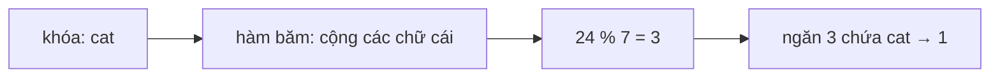

import Tabs from '@theme/Tabs';
import TabItem from '@theme/TabItem';
import ChainDiagram from '@site/src/components/ChainDiagram';

# Bảng băm (Hash Table)

**Bảng băm** lưu các cặp gồm một **khóa** (key) và một **giá trị** (value), và tìm được giá trị của bất kỳ khóa nào gần như tức thì, mà không phải lục qua mọi thứ.

## Ý tưởng

Hãy hình dung dãy hộp thư trong một tòa chung cư. Mỗi hộp có một con số. Người phát thư xếp từng lá thư bằng cách biến tên người nhận thành số hộp, theo cùng một công thức cố định mỗi lần. Để tìm thư của "cat", người đó không lục qua tất cả các hộp. Họ áp dụng công thức cho "cat", ra một con số, và đi thẳng tới hộp đó.

Bảng băm hoạt động y như vậy:

- **Khóa** là tên ghi trên thư, như `"cat"`.
- **Giá trị** là thứ bạn muốn lưu kèm theo, như `1`.
- **Hàm băm** (hash function) là công thức. Nó biến một khóa thành một con số.
- **Các ngăn** (bucket) là những hộp thư. Chúng là các ghế của một [mảng](./array.mdx), nên bạn nhảy thẳng được tới bất kỳ ngăn nào.

Đây là một ví dụ về công thức: cộng các chữ cái lại (a=1, b=2, c=3, ...), rồi lấy phần dư sau khi chia cho số ngăn. Với 7 ngăn, `cat` là 3 + 1 + 20 = 24, và 24 chia 7 được 3 dư 3. Trong code, phép lấy phần dư là `%`, nên đây là `24 % 7`.



Cất một thứ vào và lấy nó ra đều bắt đầu bằng cùng một bước: tính số ngăn từ khóa. Việc đó tốn công sức nhỏ như nhau, dù bảng chứa 10 cặp hay 10 triệu cặp.

Công thức cộng chữ cái này chỉ để dạy học. Nó là một công thức yếu, như bạn sẽ thấy ngay sau đây. Các hàm băm thật rải khóa đều hơn nhiều.

## Cách hoạt động

### Put và get

- **Put** (lưu một cặp): băm khóa để tìm ngăn, rồi đặt cặp đó vào ngăn.
- **Get** (tra một khóa): băm khóa để tìm đúng ngăn đó, rồi lấy giá trị từ nó.
- **Remove** (xóa): tìm ngăn theo cùng cách, rồi lấy cặp đó ra.

### Va chạm: hai khóa, một ngăn

Chỉ có 7 ngăn, mà số khóa có thể có thì rất nhiều. Sớm muộn gì hai khóa khác nhau cũng rơi vào cùng một ngăn. Điều này gọi là **va chạm** (collision). Ví dụ, `act` có cùng các chữ cái với `cat`, nên nó cũng cộng ra 24, và cũng rơi vào ngăn 3.

Một bảng băm phải xử lý việc này. Có hai cách phổ biến:

- **Nối chuỗi** (chaining). Mỗi ngăn giữ một chuỗi nhỏ các cặp (thường là một [danh sách liên kết](./linked-list.mdx)). Cặp mới được nối vào chuỗi. Để tra một khóa, bạn đi tới ngăn của nó và kiểm tra từng cặp trong chuỗi.
- **Địa chỉ mở** (open addressing). Mỗi ngăn chỉ giữ một cặp. Nếu ngăn của một cặp đã bị chiếm, bạn thử ngăn kế tiếp, rồi ngăn kế nữa, cho đến khi gặp ngăn trống. Để tra một khóa, bạn đi theo cùng đường đó.

Trang này dùng nối chuỗi. Đây là bảng sau khi lưu `cat`, `dog`, `cow`, `act` và `hen`:

<ChainDiagram emptyText="trống" rows={[
  {label: 0, items: []},
  {label: 1, items: []},
  {label: 2, items: []},
  {label: 3, items: ['act', 'cat']},
  {label: 4, items: []},
  {label: 5, items: ['dog']},
  {label: 6, items: ['hen', 'cow']},
]} />

Hai ngăn chứa hai khóa mỗi ngăn. Tra `cat` nghĩa là đi tới ngăn 3 và kiểm tra `act`, rồi `cat`. Các chuỗi ngắn nên vẫn nhanh.

### Khi bảng trở nên chật

Càng nhiều cặp dùng chung ngăn thì chuỗi càng dài, và việc tra cứu càng chậm. Một bảng đo độ chật của nó bằng **hệ số tải** (load factor): số cặp chia cho số ngăn. Khi hệ số tải quá cao (giới hạn mặc định của `HashMap` trong Java là 0,75), bảng dựng một mảng mới có số ngăn gấp khoảng hai lần và xếp lại mọi cặp từ đầu. Việc này gọi là **băm lại** (rehashing). Nó chậm, nhưng hiếm khi xảy ra, giống như một mảng tự mở rộng, nên tính trung bình việc thêm một cặp vẫn nhanh.

### Thứ tự không được bảo đảm

Các ngăn được lấp theo mã băm, không theo thứ tự bạn thêm vào. `unordered_map` của C++ và `HashMap` của Java không hứa hẹn thứ tự nào khi bạn duyệt qua chúng. `dict` của Python thì khác: từ Python 3.7 nó nhớ thứ tự các khóa được thêm vào. Đừng dựa vào một thứ tự nào trừ khi ngôn ngữ của bạn hứa hẹn.

### Những khóa nào được phép

Một khóa phải cho ra **cùng** một mã băm mỗi lần, nên nó không được thay đổi khi đang nằm trong bảng. Đó là lý do Python chỉ nhận các khóa "hashable", như chuỗi và số, và từ chối list: một list có thể thay đổi, nên mã băm của nó cũng có thể thay đổi.

## Code

C không có bảng băm trong thư viện chuẩn, nên ví dụ đầu tiên dựng một cái bằng tay, với nối chuỗi. Nó dùng công thức dạy học ở trên và 7 ngăn. Để code ngắn, nó không mở rộng bảng, không kiểm tra `malloc` có thành công không, và khóa trong C bị giới hạn 15 chữ cái. Ví dụ thứ hai dùng các bảng băm có sẵn của từng ngôn ngữ.

### Dựng một bảng băm nhỏ

<Tabs groupId="language">
  <TabItem value="c" label="C" default>

```c title="basics.c"
#include <stdio.h>
#include <stdlib.h>
#include <string.h>

#define BUCKETS 7

typedef struct Entry {
    char key[16];
    int value;
    struct Entry *next;  // cặp kế tiếp trong cùng ngăn
} Entry;

Entry *table[BUCKETS];  // mọi ngăn đều rỗng lúc đầu (NULL)

// Cộng các chữ cái (a=1, b=2, ...) để ra số ngăn.
int hash_of(const char *key) {
    int sum = 0;
    for (const char *c = key; *c != '\0'; c++) sum += *c - 'a' + 1;
    return sum % BUCKETS;
}

void put(const char *key, int value) {
    int b = hash_of(key);
    for (Entry *e = table[b]; e != NULL; e = e->next) {
        if (strcmp(e->key, key) == 0) {  // khóa đã có sẵn
            e->value = value;            // nên chỉ thay giá trị
            return;
        }
    }
    Entry *e = malloc(sizeof(Entry));
    snprintf(e->key, sizeof(e->key), "%s", key);
    e->value = value;
    e->next = table[b];  // nối vào đầu chuỗi
    table[b] = e;
}

int get(const char *key, int missing) {
    for (Entry *e = table[hash_of(key)]; e != NULL; e = e->next) {
        if (strcmp(e->key, key) == 0) return e->value;
    }
    return missing;  // khóa không có trong bảng
}

int main(void) {
    put("cat", 1);
    put("dog", 2);
    put("cow", 3);
    put("act", 4);  // cùng ngăn với "cat"
    put("hen", 5);  // cùng ngăn với "cow"

    printf("cat %d\n", get("cat", -1));  // cat 1
    printf("act %d\n", get("act", -1));  // act 4
    printf("pig %d\n", get("pig", -1));  // pig -1

    for (int b = 0; b < BUCKETS; b++) {  // in từng ngăn
        printf("%d:", b);
        for (Entry *e = table[b]; e != NULL; e = e->next) {
            printf(" %s", e->key);
        }
        printf("\n");
    }

    for (int b = 0; b < BUCKETS; b++) {  // trả lại bộ nhớ
        while (table[b] != NULL) {
            Entry *next = table[b]->next;
            free(table[b]);
            table[b] = next;
        }
    }
    return 0;
}
```

  </TabItem>
  <TabItem value="cpp" label="C++">

```cpp title="basics.cpp"
#include <iostream>
#include <list>
#include <string>
#include <utility>
#include <vector>

const int BUCKETS = 7;

// Cộng các chữ cái (a=1, b=2, ...) để ra số ngăn.
int hash_of(const std::string &key) {
    int sum = 0;
    for (char c : key) sum += c - 'a' + 1;
    return sum % BUCKETS;
}

using Chain = std::list<std::pair<std::string, int>>;  // một ngăn

struct HashTable {
    std::vector<Chain> buckets = std::vector<Chain>(BUCKETS);

    void put(const std::string &key, int value) {
        Chain &chain = buckets[hash_of(key)];
        for (auto &entry : chain) {
            if (entry.first == key) {  // khóa đã có sẵn
                entry.second = value;  // nên chỉ thay giá trị
                return;
            }
        }
        chain.push_front({key, value});  // nối vào đầu chuỗi
    }

    int get(const std::string &key, int missing) const {
        for (const auto &entry : buckets[hash_of(key)]) {
            if (entry.first == key) return entry.second;
        }
        return missing;  // khóa không có trong bảng
    }
};

int main() {
    HashTable table;
    table.put("cat", 1);
    table.put("dog", 2);
    table.put("cow", 3);
    table.put("act", 4);  // cùng ngăn với "cat"
    table.put("hen", 5);  // cùng ngăn với "cow"

    std::cout << "cat " << table.get("cat", -1) << "\n";  // cat 1
    std::cout << "act " << table.get("act", -1) << "\n";  // act 4
    std::cout << "pig " << table.get("pig", -1) << "\n";  // pig -1

    for (int b = 0; b < BUCKETS; b++) {  // in từng ngăn
        std::cout << b << ":";
        for (const auto &entry : table.buckets[b]) {
            std::cout << " " << entry.first;
        }
        std::cout << "\n";
    }
}
```

  </TabItem>
  <TabItem value="python" label="Python">

```python title="basics.py"
BUCKETS = 7


def hash_of(key):
    """Cộng các chữ cái (a=1, b=2, ...) để ra số ngăn."""
    return sum(ord(c) - ord("a") + 1 for c in key) % BUCKETS


class HashTable:
    def __init__(self):
        # mỗi ngăn là một list
        self.buckets = [[] for _ in range(BUCKETS)]

    def put(self, key, value):
        bucket = self.buckets[hash_of(key)]
        for i, (k, _) in enumerate(bucket):
            if k == key:  # khóa đã có sẵn
                bucket[i] = (key, value)  # nên chỉ thay giá trị
                return
        bucket.insert(0, (key, value))  # nối vào đầu chuỗi

    def get(self, key, missing=None):
        for k, v in self.buckets[hash_of(key)]:
            if k == key:
                return v
        return missing  # khóa không có trong bảng


table = HashTable()
table.put("cat", 1)
table.put("dog", 2)
table.put("cow", 3)
table.put("act", 4)  # cùng ngăn với "cat"
table.put("hen", 5)  # cùng ngăn với "cow"

print("cat", table.get("cat", -1))  # cat 1
print("act", table.get("act", -1))  # act 4
print("pig", table.get("pig", -1))  # pig -1

for b, bucket in enumerate(table.buckets):  # in từng ngăn
    print(f"{b}:", *[k for k, _ in bucket])
```

  </TabItem>
  <TabItem value="java" label="Java">

```java title="Basics.java"
import java.util.ArrayList;
import java.util.LinkedList;
import java.util.List;

public class Basics {
    static final int BUCKETS = 7;

    static class Entry {
        final String key;
        int value;

        Entry(String key, int value) {
            this.key = key;
            this.value = value;
        }
    }

    // Cộng các chữ cái (a=1, b=2, ...) để ra số ngăn.
    static int hashOf(String key) {
        int sum = 0;
        for (char c : key.toCharArray()) sum += c - 'a' + 1;
        return sum % BUCKETS;
    }

    static class HashTable {
        final List<LinkedList<Entry>> buckets = new ArrayList<>();

        HashTable() {
            for (int i = 0; i < BUCKETS; i++) {
                buckets.add(new LinkedList<>());
            }
        }

        void put(String key, int value) {
            LinkedList<Entry> chain = buckets.get(hashOf(key));
            for (Entry e : chain) {
                if (e.key.equals(key)) {  // khóa đã có sẵn
                    e.value = value;      // nên chỉ thay giá trị
                    return;
                }
            }
            chain.addFirst(new Entry(key, value));  // nối vào đầu
        }

        int get(String key, int missing) {
            for (Entry e : buckets.get(hashOf(key))) {
                if (e.key.equals(key)) return e.value;
            }
            return missing;  // khóa không có trong bảng
        }
    }

    public static void main(String[] args) {
        HashTable table = new HashTable();
        table.put("cat", 1);
        table.put("dog", 2);
        table.put("cow", 3);
        table.put("act", 4);  // cùng ngăn với "cat"
        table.put("hen", 5);  // cùng ngăn với "cow"

        System.out.println("cat " + table.get("cat", -1));  // cat 1
        System.out.println("act " + table.get("act", -1));  // act 4
        System.out.println("pig " + table.get("pig", -1));  // pig -1

        for (int b = 0; b < BUCKETS; b++) {  // in từng ngăn
            StringBuilder line = new StringBuilder(b + ":");
            for (Entry e : table.buckets.get(b)) {
                line.append(" ").append(e.key);
            }
            System.out.println(line);
        }
    }
}
```

  </TabItem>
</Tabs>

### Dùng bảng băm có sẵn: đếm từ

<Tabs groupId="language">
  <TabItem value="c" label="C" default>

Thư viện chuẩn của C không có bảng băm. Hãy dùng cái ở trên, hoặc một thư viện.

  </TabItem>
  <TabItem value="cpp" label="C++">

```cpp title="builtin.cpp"
#include <iostream>
#include <string>
#include <unordered_map>
#include <vector>

int main() {
    std::vector<std::string> words =
        {"cat", "dog", "cat", "cow", "cat"};

    std::unordered_map<std::string, int> counts;  // từ -> số lần
    for (const std::string &word : words) {
        counts[word]++;  // khóa chưa có thì bắt đầu từ 0, rồi tăng 1
    }

    std::cout << "cat " << counts["cat"] << "\n";  // cat 3
    std::cout << "dog " << counts["dog"] << "\n";  // dog 1

    auto found = counts.find("pig");  // find() không thêm gì cả
    int pigs = (found == counts.end()) ? 0 : found->second;
    std::cout << "pig " << pigs << "\n";  // pig 0
    std::cout << "size " << counts.size() << "\n";  // size 3
}
```

  </TabItem>
  <TabItem value="python" label="Python">

```python title="builtin.py"
words = ["cat", "dog", "cat", "cow", "cat"]

counts = {}  # từ -> số lần
for word in words:
    counts[word] = counts.get(word, 0) + 1  # khóa chưa có tính là 0

print("cat", counts["cat"])          # cat 3
print("dog", counts["dog"])          # dog 1
print("pig", counts.get("pig", 0))   # pig 0
print("size", len(counts))           # size 3
```

  </TabItem>
  <TabItem value="java" label="Java">

```java title="BuiltIn.java"
import java.util.HashMap;
import java.util.List;
import java.util.Map;

public class BuiltIn {
    public static void main(String[] args) {
        List<String> words = List.of("cat", "dog", "cat", "cow", "cat");

        Map<String, Integer> counts = new HashMap<>();  // từ -> số lần
        for (String word : words) {
            counts.merge(word, 1, Integer::sum);  // cộng thêm 1
        }

        System.out.println("cat " + counts.get("cat"));  // cat 3
        System.out.println("dog " + counts.get("dog"));  // dog 1
        System.out.println("pig " + counts.getOrDefault("pig", 0));
        System.out.println("size " + counts.size());  // size 3
    }
}
```

  </TabItem>
</Tabs>

## Độ phức tạp

Nếu O(1) và O(n) còn mới với bạn, hãy xem trang [Mảng](./array.mdx).

| Thao tác                            | Chi phí                | Nói bằng lời                                                              |
| ----------------------------------- | ---------------------- | ------------------------------------------------------------------------- |
| Put, get hoặc remove theo khóa      | $O(1)$ trung bình      | Tính ra ngăn và đi tới đó. Chuỗi ngắn gần như không tốn gì.               |
| Put, get hoặc remove, trường hợp xấu nhất | $O(n)$           | Nếu mọi khóa rơi vào cùng một ngăn, bảng chỉ là một chuỗi dài.            |
| Tìm một **giá trị** (không phải khóa) | $O(n)$               | Bảng được tổ chức theo khóa. Tìm một giá trị nghĩa là kiểm tra mọi cặp.   |
| Duyệt qua mọi thứ                   | $O(n)$                 | Theo thứ tự bất kỳ ở hầu hết các ngôn ngữ.                                |
| Bộ nhớ sử dụng                      | $O(n)$                 | Mỗi cặp một chỗ, cộng thêm một số ngăn trống để dự phòng.                 |

Trường hợp xấu nhất rất khó xảy ra nếu có một hàm băm tốt và một bảng biết mở rộng khi chật, đó là lý do ta nói bảng băm là "O(1) trung bình".

## Khi nào nên dùng

Bảng băm rất phù hợp khi bạn tra cứu mọi thứ **theo khóa**:

- **Đếm.** Mỗi từ xuất hiện bao nhiêu lần? Khóa: từ đó. Giá trị: số lần.
- **Kiểm tra sự tồn tại.** Mình đã thấy giá trị này trước đó chưa? Một tập hợp (set) là một bảng băm chỉ có khóa.
- **Hồ sơ theo ID.** Tìm ngay người dùng có ID 4821.
- **Lưu đệm (caching).** Nhớ câu trả lời của một câu hỏi bạn đã tính xong.

Hãy xem xét cấu trúc khác khi:

- Bạn cần các khóa **theo thứ tự đã sắp xếp**, hoặc "khóa lớn hơn kế tiếp". Bảng băm cố tình rải khóa ra. Một cấu trúc có thứ tự như [cây tìm kiếm nhị phân](./binary-search-tree.mdx) giữ chúng theo thứ tự.
- Bạn tra cứu theo **vị trí**, như "phần tử thứ ba". [Mảng](./array.mdx) đơn giản hơn và tốn ít bộ nhớ hơn.
- Bạn cần một bảo đảm chắc chắn cho từng lần tra cứu. Bảng băm nhanh khi tính trung bình, nhưng một lần tra xui xẻo có thể chậm.

:::warning[Lỗi thường gặp]
- **Mong có thứ tự.** `unordered_map` của C++ và `HashMap` của Java không bảo đảm thứ tự, và thứ tự có thể đổi khi bảng lớn lên.
- **Vô tình đọc một khóa chưa có trong C++.** `counts["pig"]` không chỉ nhìn. Nếu `pig` chưa có, nó **thêm** `pig` với giá trị 0. Hãy dùng `find()` hoặc `count()` để kiểm tra mà không thêm.
- **Khóa chưa có trong Python.** `d["pig"]` báo `KeyError` nếu khóa chưa có. Hãy dùng `d.get("pig", 0)` để có giá trị mặc định.
- **Dùng khóa có thể thay đổi.** Một list không thể làm khóa của dict trong Python. Nếu một khóa có thể đổi khi đang nằm trong bảng, bảng sẽ không còn tìm được nó nữa.
- **Hàm băm yếu.** Nếu nhiều khóa rơi vào cùng một ngăn, bảng chậm đi thành một danh sách thường. Hãy dùng các hàm băm mà ngôn ngữ của bạn cung cấp.
:::

## Nguồn tham khảo

Các thông tin trên trang này được đối chiếu với:

- [Hash table, Wikipedia](https://en.wikipedia.org/wiki/Hash_table)
- [TimeComplexity, Python Wiki](https://wiki.python.org/moin/TimeComplexity)
- [Mapping types: dict, The Python Standard Library](https://docs.python.org/3/library/stdtypes.html#dict)
- [hashable, Python glossary](https://docs.python.org/3/glossary.html#term-hashable)
- [HashMap, Java SE 21 API](https://docs.oracle.com/en/java/javase/21/docs/api/java.base/java/util/HashMap.html)
- [std::unordered_map, cppreference](https://en.cppreference.com/w/cpp/container/unordered_map)
