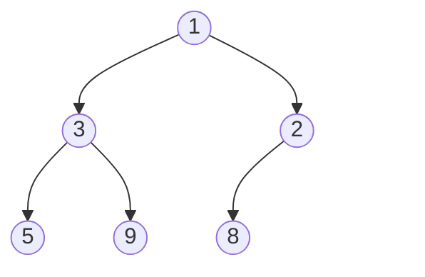

import Tabs from '@theme/Tabs';
import TabItem from '@theme/TabItem';
import ArrayDiagram from '@site/src/components/ArrayDiagram';

# Heap (Đống)

**Heap** là một cấu trúc hình cây luôn giữ phần tử **nhỏ nhất** (hoặc lớn nhất, tùy bạn muốn) ngay trên cùng, sẵn sàng để lấy.

## Ý tưởng

Hãy hình dung phòng cấp cứu của một bệnh viện. Bệnh nhân không được khám theo thứ tự họ đến. Bệnh nhân khẩn cấp nhất được khám trước, kể cả khi họ đến sau cùng. [Hàng đợi](./queue.mdx) phục vụ người đến sớm nhất trước. Hàng này phục vụ người **quan trọng nhất** trước. Nó gọi là **hàng đợi ưu tiên** (priority queue), và **heap** là cách thường dùng để dựng nó.

Heap là một [cây nhị phân](./tree.mdx) với hai quy tắc:

1. **Quy tắc thứ tự.** Mỗi nút cha nhỏ hơn hoặc bằng các con của nó. (Loại này gọi là **min-heap**. Trong **max-heap** quy tắc bị đảo ngược: mỗi nút cha lớn hơn hoặc bằng các con của nó.) Trang này dùng min-heap.
2. **Quy tắc hình dạng.** Cây được lấp đầy từng tầng một, từ trái sang phải, không có khoảng trống.



Vì mỗi nút cha không lớn hơn các con của nó, giá trị nhỏ nhất của cả heap luôn nằm ở trên cùng: ở đây là `1`.

**Heap không phải là một danh sách đã sắp xếp.** Chỉ có phần tử trên cùng là được bảo đảm. Hãy nhìn tầng thứ hai: `3` nằm bên trái `2`, dù `2` nhỏ hơn. Quy tắc chỉ so sánh một nút cha với các con của chính nó, không bao giờ so sánh anh em với nhau.

## Cách hoạt động

### Lưu trong một mảng

Quy tắc hình dạng không để lại khoảng trống nào, nên toàn bộ cây nằm gọn trong một mảng, từng tầng một, bắt đầu với phần tử trên cùng ở chỉ số 0:

<ArrayDiagram name="heap" indexLabel="chỉ số" items={[1, 3, 2, 5, 9, 8]} />

Bạn tìm được bất kỳ người thân nào của một phần tử bằng phép tính đơn giản, nên không cần liên kết:

- Các con của phần tử ở chỉ số `i` nằm ở `2i + 1` và `2i + 2`.
- Cha của phần tử ở chỉ số `i` nằm ở `(i - 1) / 2`, làm tròn xuống.

Ví dụ, `3` nằm ở chỉ số 1. Các con của nó ở chỉ số 3 và 4 (`5` và `9`), và cha của nó ở chỉ số 0 (`1`). (Một số sách bắt đầu đếm từ 1 và dùng các công thức hơi khác. Hãy kiểm tra xem sách của bạn dùng công thức nào.)

### Peek: tức thì

Phần tử nhỏ nhất luôn ở chỉ số 0, nên việc nhìn nó không tốn gì cả.

### Chèn: thêm vào cuối, rồi đổi chỗ lên trên

Để thêm một phần tử mới, hãy đặt nó vào chỗ trống đầu tiên ở cuối mảng. Làm vậy giữ nguyên quy tắc hình dạng. Nhưng phần tử mới có thể nhỏ hơn cha của nó, tức là phá quy tắc thứ tự, nên bạn **đổi chỗ nó lên trên**: chừng nào nó còn nhỏ hơn cha, hãy đổi chỗ hai phần tử. Ở đây `2` được thêm vào một heap:

<ArrayDiagram name="ban đầu" indexLabel="chỉ số" labelWidth="15rem" items={[1, 3, 8, 5, 9]} />

<ArrayDiagram name="thêm 2 vào cuối" labelWidth="15rem" items={[1, 3, 8, 5, 9, 2]} hideIndex highlight={[5]} />

<ArrayDiagram name="đổi chỗ với cha, 8" labelWidth="15rem" items={[1, 3, 2, 5, 9, 8]} hideIndex highlight={[2, 5]} />

Cha của chỉ số 5 nằm ở chỉ số 2, và nó chứa `8`. Vì `2` nhỏ hơn `8`, chúng đổi chỗ. Giờ `2` ở chỉ số 2, và cha của nó ở chỉ số 0, chứa `1`. `2` không nhỏ hơn `1`, nên nó ở yên đó. Xong.

### Lấy phần tử trên cùng ra: đưa phần tử cuối lên, rồi đổi chỗ xuống dưới

Phần tử trên cùng là thứ bạn muốn lấy ra. Bạn không thể để một lỗ trống ở chỉ số 0. Vì vậy bạn chuyển phần tử **cuối cùng** của mảng lên đỉnh. Làm vậy giữ nguyên quy tắc hình dạng. Nhưng nó nhiều khả năng quá lớn so với vị trí đó, nên bạn **đổi chỗ nó xuống dưới**: so sánh nó với hai con, và đổi chỗ với con **nhỏ hơn**. Lặp lại cho đến khi nó không lớn hơn các con của nó.

<ArrayDiagram name="ban đầu" indexLabel="chỉ số" labelWidth="15rem" items={[1, 3, 2, 5, 9, 8]} />

<ArrayDiagram name="phần tử cuối lên đỉnh" labelWidth="15rem" items={[8, 3, 2, 5, 9]} hideIndex highlight={[0]} />

<ArrayDiagram name="đổi chỗ với con nhỏ hơn" labelWidth="15rem" items={[2, 3, 8, 5, 9]} hideIndex highlight={[0, 2]} />

Phần tử `1` đã được lấy ra. `8` lên đỉnh, và các con của nó là `3` và `2`. Con nhỏ hơn là `2`, nên `8` đổi chỗ với nó. Giờ `8` ở chỉ số 2, nơi các con của nó sẽ ở chỉ số 5 và 6. Mảng không có phần tử nào như vậy, nên `8` là một chiếc lá, và nó ở yên.

### Vì sao việc này nhanh

Mỗi lần đổi chỗ đưa một phần tử lên hoặc xuống một tầng, và một cây có $n$ phần tử chỉ có khoảng $\log_2 n$ tầng. Vì vậy một lần chèn hoặc lấy ra đổi chỗ nhiều nhất là chừng đó lần. Một heap có một triệu phần tử có khoảng 20 tầng.

### Dựng heap từ một danh sách

Bạn có thể dựng heap bằng cách chèn từng phần tử một, tốn tổng cộng $O(n \log n)$. Có một cách thông minh hơn: đặt tất cả phần tử vào một mảng và sửa quy tắc thứ tự từ dưới lên, đổi chỗ từng phần tử xuống khi cần. Nó chỉ tốn $O(n)$. `heapify` của Python làm việc này.

### Heap sort

Nếu bạn lấy phần tử trên cùng ra hết lần này đến lần khác, các phần tử sẽ ra theo thứ tự, nhỏ nhất trước. Đó là ý tưởng của **heap sort** (sắp xếp vun đống).

## Code

Ví dụ đầu tiên dựng một min-heap trên một mảng bằng tay, với việc đổi chỗ như mô tả ở trên. Ví dụ thứ hai dùng các hàng đợi ưu tiên có sẵn của từng ngôn ngữ. Để code ngắn, heap tự dựng có chỗ cho 16 phần tử và không kiểm tra heap rỗng hay đầy. Code thực tế nên kiểm tra.

### Dựng một min-heap

<Tabs groupId="language">
  <TabItem value="c" label="C" default>

```c title="basics.c"
#include <stdio.h>

#define CAPACITY 16

typedef struct {
    int items[CAPACITY];
    int size;
} Heap;

void swap(int *a, int *b) {
    int tmp = *a;
    *a = *b;
    *b = tmp;
}

void push(Heap *h, int value) {
    int i = h->size++;
    h->items[i] = value;  // 1. thêm nó vào cuối
    // 2. đổi chỗ lên trên chừng nào còn nhỏ hơn cha
    while (i > 0) {
        int parent = (i - 1) / 2;
        if (h->items[parent] <= h->items[i]) break;
        swap(&h->items[parent], &h->items[i]);
        i = parent;
    }
}

int pop(Heap *h) {
    int top = h->items[0];
    // 1. phần tử cuối lên đỉnh
    h->items[0] = h->items[--h->size];
    int i = 0;
    while (2 * i + 1 < h->size) {  // 2. còn con thì đổi chỗ xuống
        int child = 2 * i + 1;  // con trái...
        if (child + 1 < h->size &&
            h->items[child + 1] < h->items[child]) {
            child++;  // ...hoặc con phải, nếu nó nhỏ hơn
        }
        if (h->items[i] <= h->items[child]) break;  // đúng chỗ: xong
        swap(&h->items[i], &h->items[child]);
        i = child;
    }
    return top;
}

int main(void) {
    Heap h = {.size = 0};
    int values[] = {5, 3, 8, 1, 9, 2};
    for (int i = 0; i < 6; i++) push(&h, values[i]);

    // mảng: chỉ phần tử trên cùng chắc chắn nhỏ nhất
    printf("heap:");
    for (int i = 0; i < h.size; i++) printf(" %d", h.items[i]);
    printf("\n");  // heap: 1 3 2 5 9 8

    printf("pop order:");
    while (h.size > 0) printf(" %d", pop(&h));
    printf("\n");  // pop order: 1 2 3 5 8 9
    return 0;
}
```

  </TabItem>
  <TabItem value="cpp" label="C++">

```cpp title="basics.cpp"
#include <iostream>
#include <utility>
#include <vector>

struct Heap {
    std::vector<int> items;

    void push(int value) {
        items.push_back(value);  // 1. thêm nó vào cuối
        size_t i = items.size() - 1;
        // 2. đổi chỗ lên trên chừng nào còn nhỏ hơn cha
        while (i > 0) {
            size_t parent = (i - 1) / 2;
            if (items[parent] <= items[i]) break;
            std::swap(items[parent], items[i]);
            i = parent;
        }
    }

    int pop() {
        int top = items[0];
        items[0] = items.back();  // 1. phần tử cuối lên đỉnh
        items.pop_back();
        size_t i = 0;
        // 2. còn con thì đổi chỗ xuống
        while (2 * i + 1 < items.size()) {
            size_t child = 2 * i + 1;  // con trái...
            if (child + 1 < items.size() &&
                items[child + 1] < items[child]) {
                child++;  // ...hoặc con phải, nếu nó nhỏ hơn
            }
            if (items[i] <= items[child]) break;  // đúng chỗ: xong
            std::swap(items[i], items[child]);
            i = child;
        }
        return top;
    }
};

int main() {
    Heap h;
    for (int value : {5, 3, 8, 1, 9, 2}) h.push(value);

    // mảng: chỉ phần tử trên cùng chắc chắn nhỏ nhất
    std::cout << "heap:";
    for (int item : h.items) std::cout << " " << item;
    std::cout << "\n";  // heap: 1 3 2 5 9 8

    std::cout << "pop order:";
    while (!h.items.empty()) std::cout << " " << h.pop();
    std::cout << "\n";  // pop order: 1 2 3 5 8 9
}
```

  </TabItem>
  <TabItem value="python" label="Python">

```python title="basics.py"
class Heap:
    def __init__(self):
        self.items = []

    def swap(self, a, b):
        self.items[a], self.items[b] = self.items[b], self.items[a]

    def push(self, value):
        self.items.append(value)  # 1. thêm nó vào cuối
        i = len(self.items) - 1
        while i > 0:  # 2. đổi chỗ lên trên chừng nào còn nhỏ hơn cha
            parent = (i - 1) // 2
            if self.items[parent] <= self.items[i]:
                break
            self.swap(parent, i)
            i = parent

    def pop(self):
        top = self.items[0]
        last = self.items.pop()
        if self.items:
            self.items[0] = last  # 1. phần tử cuối lên đỉnh
        i = 0
        while 2 * i + 1 < len(self.items):  # 2. chừng nào còn con...
            child = 2 * i + 1  # con trái...
            if (child + 1 < len(self.items)
                    and self.items[child + 1] < self.items[child]):
                child += 1  # ...hoặc con phải, nếu nó nhỏ hơn
            if self.items[i] <= self.items[child]:
                break  # đúng chỗ: xong
            self.swap(i, child)
            i = child
        return top


h = Heap()
for value in [5, 3, 8, 1, 9, 2]:
    h.push(value)

print("heap:", *h.items)  # heap: 1 3 2 5 9 8
print("pop order:", *[h.pop() for _ in range(6)])  # 1 2 3 5 8 9
```

  </TabItem>
  <TabItem value="java" label="Java">

```java title="Basics.java"
public class Basics {
    static class Heap {
        int[] items = new int[16];
        int size = 0;

        void swap(int a, int b) {
            int tmp = items[a];
            items[a] = items[b];
            items[b] = tmp;
        }

        void push(int value) {
            int i = size++;
            items[i] = value;  // 1. thêm nó vào cuối
            // 2. đổi chỗ lên trên chừng nào còn nhỏ hơn cha
            while (i > 0) {
                int parent = (i - 1) / 2;
                if (items[parent] <= items[i]) break;
                swap(parent, i);
                i = parent;
            }
        }

        int pop() {
            int top = items[0];
            // 1. phần tử cuối lên đỉnh
            items[0] = items[--size];
            int i = 0;
            while (2 * i + 1 < size) {  // 2. chừng nào còn con...
                int child = 2 * i + 1;  // con trái...
                if (child + 1 < size
                        && items[child + 1] < items[child]) {
                    child++;  // ...hoặc con phải, nếu nó nhỏ hơn
                }
                if (items[i] <= items[child]) break;  // đúng chỗ: xong
                swap(i, child);
                i = child;
            }
            return top;
        }
    }

    public static void main(String[] args) {
        Heap h = new Heap();
        for (int value : new int[] {5, 3, 8, 1, 9, 2}) h.push(value);

        StringBuilder line = new StringBuilder("heap:");
        for (int i = 0; i < h.size; i++) {
            line.append(" ").append(h.items[i]);
        }
        System.out.println(line);  // heap: 1 3 2 5 9 8

        line = new StringBuilder("pop order:");
        while (h.size > 0) line.append(" ").append(h.pop());
        System.out.println(line);  // pop order: 1 2 3 5 8 9
    }
}
```

  </TabItem>
</Tabs>

### Dùng hàng đợi ưu tiên có sẵn

`priority_queue` của C++ mặc định đặt phần tử **lớn nhất** lên đỉnh, và `std::greater` biến nó thành min-heap. `heapq` của Python và `PriorityQueue` của Java mặc định đặt phần tử **nhỏ nhất** lên đỉnh. Muốn có max-heap trong Python, một mẹo phổ biến là lưu các số âm (Python 3.14 cũng đã thêm `heappush_max` và các hàm tương tự).

<Tabs groupId="language">
  <TabItem value="c" label="C" default>

Thư viện chuẩn của C không có hàng đợi ưu tiên. Hãy tự dựng, như ở trên, hoặc dùng một thư viện.

  </TabItem>
  <TabItem value="cpp" label="C++">

```cpp title="ready_made.cpp"
#include <functional>
#include <iostream>
#include <queue>
#include <vector>

int main() {
    std::vector<int> values = {5, 3, 8, 1, 9, 2};

    // mặc định phần tử lớn nhất ở đỉnh (max-heap)
    std::priority_queue<int> biggest(values.begin(), values.end());

    // std::greater biến nó thành min-heap: nhỏ nhất ở đỉnh
    std::priority_queue<int, std::vector<int>, std::greater<int>>
        smallest(values.begin(), values.end());

    std::cout << "smallest first:";
    while (!smallest.empty()) {
        std::cout << " " << smallest.top();
        smallest.pop();
    }
    std::cout << "\n";  // smallest first: 1 2 3 5 8 9

    std::cout << "biggest first:";
    while (!biggest.empty()) {
        std::cout << " " << biggest.top();
        biggest.pop();
    }
    std::cout << "\n";  // biggest first: 9 8 5 3 2 1
}
```

  </TabItem>
  <TabItem value="python" label="Python">

```python title="ready_made.py"
import heapq

values = [5, 3, 8, 1, 9, 2]

smallest = list(values)
heapq.heapify(smallest)  # một min-heap, dựng trong O(n)
print("smallest first:", *[heapq.heappop(smallest) for _ in values])

# heapq là min-heap: lưu số âm để lấy lớn nhất trước
biggest = [-v for v in values]
heapq.heapify(biggest)
print("biggest first:", *[-heapq.heappop(biggest) for _ in values])
```

  </TabItem>
  <TabItem value="java" label="Java">

```java title="ReadyMade.java"
import java.util.Collections;
import java.util.List;
import java.util.PriorityQueue;

public class ReadyMade {
    static String drain(PriorityQueue<Integer> queue) {
        StringBuilder line = new StringBuilder();
        while (!queue.isEmpty()) line.append(" ").append(queue.poll());
        return line.toString();
    }

    public static void main(String[] args) {
        List<Integer> values = List.of(5, 3, 8, 1, 9, 2);

        // mặc định phần tử nhỏ nhất ở đỉnh (min-heap)
        PriorityQueue<Integer> smallest = new PriorityQueue<>(values);

        // thứ tự đảo ngược đặt phần tử lớn nhất lên đỉnh
        PriorityQueue<Integer> biggest =
            new PriorityQueue<>(Collections.reverseOrder());
        biggest.addAll(values);

        System.out.println("smallest first:" + drain(smallest));
        System.out.println("biggest first:" + drain(biggest));
    }
}
```

  </TabItem>
</Tabs>

## Độ phức tạp

Nếu O(1) và O(n) còn mới với bạn, hãy xem trang [Mảng](./array.mdx). Ở đây $n$ là số phần tử trong heap.

| Thao tác                         | Chi phí     | Nói bằng lời                                                           |
| -------------------------------- | ----------- | ---------------------------------------------------------------------- |
| Nhìn phần tử trên cùng (peek)    | $O(1)$      | Nó luôn ở chỉ số 0.                                                    |
| Chèn                             | $O(\log n)$ | Nhiều nhất một lần đổi chỗ cho mỗi tầng của cây.                       |
| Lấy phần tử trên cùng ra         | $O(\log n)$ | Nhiều nhất một lần đổi chỗ cho mỗi tầng của cây.                       |
| Dựng heap từ $n$ phần tử         | $O(n)$      | Rẻ hơn chèn từng phần tử một ($O(n \log n)$).                          |
| Tìm một giá trị bất kỳ           | $O(n)$      | Heap không được sắp xếp, nên bạn có thể phải kiểm tra mọi phần tử.     |
| Bộ nhớ sử dụng                   | $O(n)$      | Mỗi phần tử một ô trong mảng. Không cần liên kết.                      |

## Khi nào nên dùng

Heap rất phù hợp khi bạn liên tục cần phần tử **nhỏ nhất** hoặc **lớn nhất** (hoặc quan trọng nhất) kế tiếp, trong khi phần tử mới cứ tiếp tục đến:

- **Hàng đợi ưu tiên.** Việc khẩn cấp làm trước, bất kể chúng được thêm vào theo thứ tự nào.
- **Top K.** Chỉ giữ K phần tử lớn nhất đã thấy cho đến giờ, mà không cần sắp xếp mọi thứ.
- **Thuật toán đồ thị.** Thuật toán đường đi ngắn nhất Dijkstra và thuật toán cây khung nhỏ nhất Prim dùng heap để chọn đỉnh kế tiếp. (Xem trang [Đồ thị](./graph.mdx).)
- **Sắp xếp.** Heap sort lấy phần tử trên cùng ra hết lần này đến lần khác.

Hãy xem xét cấu trúc khác khi:

- Bạn cần các phần tử **được sắp xếp hoàn toàn** bất cứ lúc nào, hoặc "giá trị lớn hơn 65 kế tiếp". [Cây tìm kiếm nhị phân](./binary-search-tree.mdx) giữ mọi thứ theo thứ tự.
- Bạn cần tìm nhanh một giá trị cụ thể. [Bảng băm](./hash-table.mdx) làm việc đó.
- Bạn phục vụ các phần tử theo thứ tự chúng đến. Đó là một [hàng đợi](./queue.mdx) thường.

:::warning[Lỗi thường gặp]
- **Tưởng heap đã được sắp xếp.** Chỉ có phần tử trên cùng là được bảo đảm. Đọc mảng từ trái sang phải không cho ra thứ tự đã sắp xếp. Tài liệu của Java nói iterator của `PriorityQueue` không duyệt theo thứ tự nào cả.
- **Nhầm min với max.** `priority_queue` của C++ mặc định là max-heap, trong khi `heapq` của Python và `PriorityQueue` của Java là min-heap.
- **Lấy từ một heap rỗng.** `heappop` của Python báo lỗi, `poll()` của Java trả về `null`, và `top()` hay `pop()` của C++ trên hàng đợi rỗng là hành vi không xác định. Hãy kiểm tra trước.
- **Đổi giá trị của một phần tử bên trong heap.** Phần tử đó có thể giờ đã ở sai chỗ. Hãy xóa nó và chèn giá trị mới, hoặc dựng lại heap.
- **Lệch một đơn vị trong công thức chỉ số.** Khi phần tử trên cùng ở chỉ số 0, các con là `2i + 1` và `2i + 2`. Khi nó ở chỉ số 1, chúng là `2i` và `2i + 1`.
:::

## Nguồn tham khảo

Các thông tin trên trang này được đối chiếu với:

- [Binary heap, Wikipedia](https://en.wikipedia.org/wiki/Binary_heap)
- [Heap (data structure), Wikipedia](https://en.wikipedia.org/wiki/Heap_%28data_structure%29)
- [heapq, The Python Standard Library](https://docs.python.org/3/library/heapq.html)
- [PriorityQueue, Java SE 21 API](https://docs.oracle.com/en/java/javase/21/docs/api/java.base/java/util/PriorityQueue.html)
- [std::priority_queue, cppreference](https://en.cppreference.com/w/cpp/container/priority_queue)
