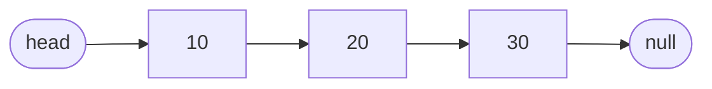
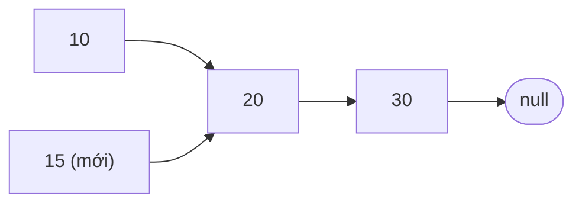
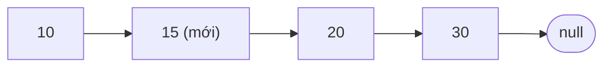
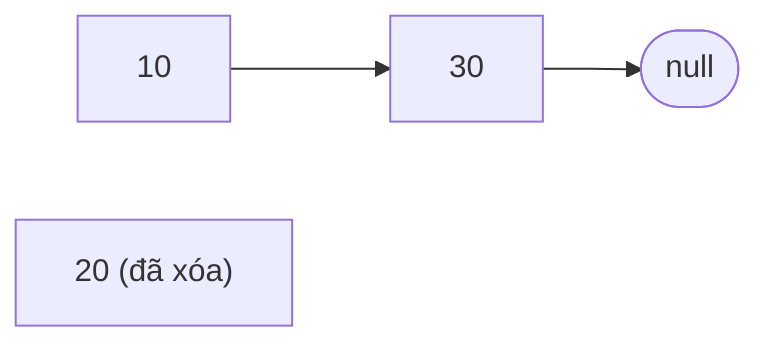
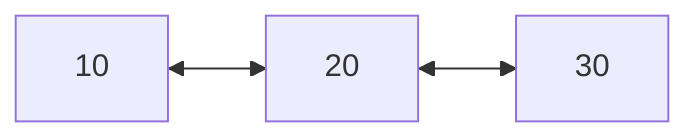

import Tabs from '@theme/Tabs';
import TabItem from '@theme/TabItem';

# Danh sách liên kết (Linked List)

**Danh sách liên kết** giữ các phần tử theo thứ tự giống như một trò chơi tìm kho báu: mỗi manh mối cho bạn biết tìm manh mối tiếp theo ở đâu.

## Ý tưởng

Hãy hình dung một trò chơi tìm kho báu. Bạn được phát manh mối đầu tiên. Nó có một phần thưởng nhỏ và ghi "manh mối tiếp theo nằm dưới băng ghế". Dưới băng ghế, bạn thấy manh mối thứ hai, có thêm một phần thưởng và chỉ chỗ của manh mối thứ ba. Manh mối cuối cùng ghi "hết rồi". Không ai đưa cho bạn bản đồ đầy đủ ngay từ đầu. Bạn chỉ luôn cầm trong tay manh mối đầu tiên.

Danh sách liên kết hoạt động y như vậy:

- Mỗi manh mối là một **nút** (node). Nó chứa một **giá trị** và một **liên kết** (link) tới nút kế tiếp (chính là địa chỉ nơi nút kế tiếp nằm trong bộ nhớ).
- Nút đầu tiên gọi là **đầu danh sách** (head). Đó là nút duy nhất bạn giữ trong tay.
- Nút cuối cùng không liên kết tới đâu cả. Điều này được viết là `null` (`NULL` trong C, `nullptr` trong C++, `None` trong Python).
- Các nút có thể nằm **ở bất kỳ đâu** trong bộ nhớ. Khác với các ghế của [mảng](./array.mdx), chúng không cần nằm sát nhau.



Hãy so sánh với mảng. Mảng cho phép nhảy thẳng đến bất kỳ ghế nào. Danh sách liên kết thì không: muốn đến nút thứ ba, bạn phải bắt đầu từ đầu và đi theo từng liên kết một. Đổi lại, việc thêm và xóa rất dễ. Bạn chỉ đổi một hai liên kết, và không ai phải dịch chỗ.

## Cách hoạt động

### Đọc: đi theo chuỗi liên kết

Để đọc phần tử ở chỉ số 2, hãy bắt đầu từ đầu và đi theo 2 liên kết. Danh sách càng dài thì quãng đường càng dài, nên đọc theo chỉ số tốn thời gian tăng theo số phần tử. Tìm một giá trị cũng vậy: kiểm tra từng nút một cho đến khi gặp, giống như mảng chưa sắp xếp.

### Chèn: đổi hai liên kết

Giả sử bạn muốn đặt `15` ngay sau `10`. Bạn làm việc này qua hai bước.

**Bước 1:** cho nút mới trỏ tới thứ đứng sau `10`, tức nút `20`. Lúc này nút mới chưa thuộc danh sách, vì chưa có gì trỏ tới nó.



**Bước 2:** cho `10` trỏ tới nút mới.



Sau bước 2, danh sách là `10 → 15 → 20 → 30`. Chỉ có hai liên kết thay đổi. Các nút `20` và `30` không hề di chuyển.

Thứ tự rất quan trọng. Nếu làm bước 2 trước, `10` sẽ không còn trỏ tới `20`, và không còn gì nhớ `20` cùng mọi thứ phía sau nằm ở đâu. Bạn sẽ mất phần còn lại của danh sách.

Chèn ở **đầu** còn đơn giản hơn: nút mới trỏ tới đầu cũ, và biến head giờ trỏ tới nút mới. Không cần đi bộ gì cả.

Tìm đúng chỗ vẫn tốn một quãng đi. Nếu bạn đã cầm sẵn nút muốn chèn phía sau (ví dụ bạn đang đi giữa chừng trong danh sách), việc chèn là tức thì. Nếu bạn chỉ biết "chèn ở chỉ số 7", bạn phải đi qua 7 liên kết trước.

### Xóa: bước qua nút đó

Để xóa `20`, cho nút đứng trước nó trỏ vượt qua, thẳng tới `30`:



Trong C và C++, bạn còn phải trả lại bộ nhớ của nút bị xóa (`free` hoặc `delete`). Python và Java tự dọn giúp bạn.

Có một điểm vướng: bạn cần nút **đứng trước** nút cần xóa, mà trong danh sách cơ bản các nút chỉ biết nút kế tiếp, không biết nút phía trước. Vì vậy bạn tìm nó trong lúc đi: vừa đi vừa nhớ nút đứng trước.

### Các biến thể

- **Danh sách liên kết đôi.** Mỗi nút có hai liên kết, một tới nút kế tiếp và một tới nút phía trước. Bạn đi được cả hai chiều, và xóa được một nút đang cầm trong tay mà không cần đi tìm nút đứng trước. Cái giá là mỗi nút tốn thêm bộ nhớ.
- **Con trỏ đuôi.** Giữ thêm một biến trỏ tới nút cuối. Khi đó thêm vào cuối là tức thì, thay vì phải đi hết chuỗi để tìm cái đuôi.
- **Danh sách vòng.** Nút cuối liên kết ngược về nút đầu. Phù hợp với những thứ đi vòng tròn, như các người chơi lần lượt đến lượt.



## Code

Trong C và C++, **con trỏ** (pointer) là một biến chứa địa chỉ của một thứ khác. `cur->value` nghĩa là "đi theo con trỏ `cur` đến nút của nó và đọc giá trị ở đó". Trong Python và Java, một biến chứa nút đã là một tham chiếu tới nút, nên code trông đơn giản hơn.

Để code ngắn gọn, bản C không kiểm tra `malloc` có thành công hay không. Code thực tế nên kiểm tra.

### Dựng danh sách và đi qua nó

<Tabs groupId="language">
  <TabItem value="c" label="C" default>

```c title="basics.c"
#include <stdio.h>
#include <stdlib.h>

typedef struct Node {
    int value;
    struct Node *next;  // liên kết tới nút kế tiếp
} Node;

// Tạo một nút và đặt ở đầu. Trả về đầu mới.
Node *push_front(Node *head, int value) {
    Node *node = malloc(sizeof(Node));
    node->value = value;
    node->next = head;  // nút mới trỏ tới nút đầu cũ
    return node;        // nút mới giờ là đầu
}

int main(void) {
    Node *head = NULL;  // danh sách rỗng
    head = push_front(head, 30);
    head = push_front(head, 20);
    head = push_front(head, 10);  // danh sách là 10 -> 20 -> 30

    for (Node *cur = head; cur != NULL; cur = cur->next) {
        printf("%d ", cur->value);  // 10 20 30
    }
    printf("\n");

    while (head != NULL) {  // trả lại từng nút
        Node *next = head->next;
        free(head);
        head = next;
    }
    return 0;
}
```

  </TabItem>
  <TabItem value="cpp" label="C++">

```cpp title="basics.cpp"
#include <iostream>

struct Node {
    int value;
    Node *next;  // liên kết tới nút kế tiếp
};

// Tạo một nút và đặt ở đầu. Trả về đầu mới.
Node *push_front(Node *head, int value) {
    return new Node{value, head};  // nút mới trỏ tới đầu cũ
}

int main() {
    Node *head = nullptr;  // danh sách rỗng
    head = push_front(head, 30);
    head = push_front(head, 20);
    head = push_front(head, 10);  // danh sách là 10 -> 20 -> 30

    for (Node *cur = head; cur != nullptr; cur = cur->next) {
        std::cout << cur->value << " ";  // 10 20 30
    }
    std::cout << "\n";

    while (head != nullptr) {  // trả lại từng nút
        Node *next = head->next;
        delete head;
        head = next;
    }
}
```

  </TabItem>
  <TabItem value="python" label="Python">

```python title="basics.py"
class Node:
    def __init__(self, value, next_node=None):
        self.value = value
        self.next = next_node  # liên kết tới nút kế tiếp


def push_front(head, value):
    """Tạo một nút và đặt ở đầu. Trả về đầu mới."""
    return Node(value, head)  # nút mới trỏ tới đầu cũ


head = None  # danh sách rỗng
head = push_front(head, 30)
head = push_front(head, 20)
head = push_front(head, 10)  # danh sách là 10 -> 20 -> 30

cur = head
while cur is not None:
    print(cur.value, end=" ")  # 10 20 30
    cur = cur.next
print()
```

  </TabItem>
  <TabItem value="java" label="Java">

```java title="Basics.java"
public class Basics {
    static class Node {
        int value;
        Node next;  // liên kết tới nút kế tiếp

        Node(int value, Node next) {
            this.value = value;
            this.next = next;
        }
    }

    // Tạo một nút và đặt ở đầu. Trả về đầu mới.
    static Node pushFront(Node head, int value) {
        return new Node(value, head);  // trỏ tới đầu cũ
    }

    public static void main(String[] args) {
        Node head = null;  // danh sách rỗng
        head = pushFront(head, 30);
        head = pushFront(head, 20);
        head = pushFront(head, 10);  // danh sách là 10 -> 20 -> 30

        for (Node cur = head; cur != null; cur = cur.next) {
            System.out.print(cur.value + " ");  // 10 20 30
        }
        System.out.println();
    }
}
```

  </TabItem>
</Tabs>

### Chèn sau một nút, xóa một giá trị

`insert_after` thực hiện việc đổi hai liên kết như trong các hình ở trên. `remove_value` đi qua danh sách và nhớ nút đứng trước, rồi bước qua nút nó tìm được.

<Tabs groupId="language">
  <TabItem value="c" label="C" default>

```c title="insert_remove.c"
#include <stdio.h>
#include <stdlib.h>

typedef struct Node {
    int value;
    struct Node *next;
} Node;

Node *push_front(Node *head, int value) {
    Node *node = malloc(sizeof(Node));
    node->value = value;
    node->next = head;
    return node;
}

// Đặt một nút mới chứa `value` ngay sau `node`.
void insert_after(Node *node, int value) {
    Node *fresh = malloc(sizeof(Node));
    fresh->value = value;
    // 1. nút mới trỏ tới thứ đứng sau
    fresh->next = node->next;
    // 2. rồi nút cũ trỏ tới nút mới
    node->next = fresh;
}

// Xóa nút đầu tiên chứa `value`. Trả về đầu mới.
Node *remove_value(Node *head, int value) {
    Node *prev = NULL;
    Node *cur = head;
    while (cur != NULL && cur->value != value) {  // đi tới nút đó
        prev = cur;
        cur = cur->next;
    }
    if (cur == NULL) return head;  // không tìm thấy
    if (prev == NULL) head = cur->next;  // xóa chính nút đầu
    else prev->next = cur->next;         // bước qua nút đó
    free(cur);
    return head;
}

int main(void) {
    Node *head = NULL;
    head = push_front(head, 30);
    head = push_front(head, 20);
    head = push_front(head, 10);  // 10 -> 20 -> 30

    insert_after(head, 15);         // 10 -> 15 -> 20 -> 30
    head = remove_value(head, 20);  // 10 -> 15 -> 30
    head = remove_value(head, 10);  // 15 -> 30

    for (Node *cur = head; cur != NULL; cur = cur->next) {
        printf("%d ", cur->value);  // 15 30
    }
    printf("\n");

    while (head != NULL) {
        Node *next = head->next;
        free(head);
        head = next;
    }
    return 0;
}
```

  </TabItem>
  <TabItem value="cpp" label="C++">

```cpp title="insert_remove.cpp"
#include <iostream>

struct Node {
    int value;
    Node *next;
};

Node *push_front(Node *head, int value) {
    return new Node{value, head};
}

// Đặt một nút mới chứa `value` ngay sau `node`.
void insert_after(Node *node, int value) {
    // 1. nút mới trỏ tới thứ đứng sau
    // 2. rồi nút cũ trỏ tới nút mới
    node->next = new Node{value, node->next};
}

// Xóa nút đầu tiên chứa `value`. Trả về đầu mới.
Node *remove_value(Node *head, int value) {
    Node *prev = nullptr;
    Node *cur = head;
    while (cur != nullptr && cur->value != value) {  // đi tới nút đó
        prev = cur;
        cur = cur->next;
    }
    if (cur == nullptr) return head;  // không tìm thấy
    if (prev == nullptr) head = cur->next;  // xóa chính nút đầu
    else prev->next = cur->next;            // bước qua nút đó
    delete cur;
    return head;
}

int main() {
    Node *head = nullptr;
    head = push_front(head, 30);
    head = push_front(head, 20);
    head = push_front(head, 10);  // 10 -> 20 -> 30

    insert_after(head, 15);         // 10 -> 15 -> 20 -> 30
    head = remove_value(head, 20);  // 10 -> 15 -> 30
    head = remove_value(head, 10);  // 15 -> 30

    for (Node *cur = head; cur != nullptr; cur = cur->next) {
        std::cout << cur->value << " ";  // 15 30
    }
    std::cout << "\n";

    while (head != nullptr) {
        Node *next = head->next;
        delete head;
        head = next;
    }
}
```

  </TabItem>
  <TabItem value="python" label="Python">

```python title="insert_remove.py"
class Node:
    def __init__(self, value, next_node=None):
        self.value = value
        self.next = next_node


def push_front(head, value):
    return Node(value, head)


def insert_after(node, value):
    """Đặt một nút mới chứa value ngay sau node."""
    # 1. nút mới trỏ tới thứ đứng sau
    # 2. rồi nút cũ trỏ tới nút mới
    node.next = Node(value, node.next)


def remove_value(head, value):
    """Xóa nút đầu tiên chứa value. Trả về đầu mới."""
    prev, cur = None, head
    while cur is not None and cur.value != value:  # đi tới nút đó
        prev, cur = cur, cur.next
    if cur is None:
        return head  # không tìm thấy
    if prev is None:
        return cur.next  # xóa chính nút đầu
    prev.next = cur.next  # bước qua nút đó
    return head


head = None
head = push_front(head, 30)
head = push_front(head, 20)
head = push_front(head, 10)  # 10 -> 20 -> 30

insert_after(head, 15)         # 10 -> 15 -> 20 -> 30
head = remove_value(head, 20)  # 10 -> 15 -> 30
head = remove_value(head, 10)  # 15 -> 30

cur = head
while cur is not None:
    print(cur.value, end=" ")  # 15 30
    cur = cur.next
print()
```

  </TabItem>
  <TabItem value="java" label="Java">

```java title="InsertRemove.java"
public class InsertRemove {
    static class Node {
        int value;
        Node next;

        Node(int value, Node next) {
            this.value = value;
            this.next = next;
        }
    }

    static Node pushFront(Node head, int value) {
        return new Node(value, head);
    }

    // Đặt một nút mới chứa value ngay sau node.
    static void insertAfter(Node node, int value) {
        // 1. nút mới trỏ tới thứ đứng sau
        // 2. rồi nút cũ trỏ tới nút mới
        node.next = new Node(value, node.next);
    }

    // Xóa nút đầu tiên chứa value. Trả về đầu mới.
    static Node removeValue(Node head, int value) {
        Node prev = null;
        Node cur = head;
        while (cur != null && cur.value != value) {  // đi tới nút đó
            prev = cur;
            cur = cur.next;
        }
        if (cur == null) return head;  // không tìm thấy
        if (prev == null) return cur.next;  // xóa chính nút đầu
        prev.next = cur.next;  // bước qua nút đó
        return head;
    }

    public static void main(String[] args) {
        Node head = null;
        head = pushFront(head, 30);
        head = pushFront(head, 20);
        head = pushFront(head, 10);  // 10 -> 20 -> 30

        insertAfter(head, 15);         // 10 -> 15 -> 20 -> 30
        head = removeValue(head, 20);  // 10 -> 15 -> 30
        head = removeValue(head, 10);  // 15 -> 30

        for (Node cur = head; cur != null; cur = cur.next) {
            System.out.print(cur.value + " ");  // 15 30
        }
        System.out.println();
    }
}
```

  </TabItem>
</Tabs>

### Danh sách liên kết có sẵn

Một số ngôn ngữ có sẵn danh sách liên kết, nên bạn không phải tự viết các nút.

<Tabs groupId="language">
  <TabItem value="c" label="C" default>

Thư viện chuẩn của C không có danh sách liên kết. Hãy tự viết như trên, hoặc dùng một thư viện.

  </TabItem>
  <TabItem value="cpp" label="C++">

```cpp title="ready_made.cpp"
#include <iostream>
#include <list>

int main() {
    std::list<int> items = {10, 20, 30};  // danh sách liên kết đôi

    items.push_front(5);  // thêm vào đầu: nhanh
    items.push_back(40);  // thêm vào cuối: nhanh
    items.pop_front();    // xóa phần tử đầu: nhanh

    for (int item : items) std::cout << item << " ";  // 10 20 30 40
    std::cout << "\n";
}
```

`std::forward_list` là phiên bản liên kết đơn. Nó tốn ít bộ nhớ hơn cho mỗi nút.

  </TabItem>
  <TabItem value="python" label="Python">

Python không có kiểu danh sách liên kết dựng sẵn. Hãy tự viết như trên. Nếu bạn chỉ cần thêm và xóa nhanh ở cả hai đầu, `collections.deque` thường là thứ bạn cần.

  </TabItem>
  <TabItem value="java" label="Java">

```java title="ReadyMade.java"
import java.util.LinkedList;
import java.util.List;

public class ReadyMade {
    public static void main(String[] args) {
        LinkedList<Integer> items =
            new LinkedList<>(List.of(10, 20, 30));

        items.addFirst(5);   // thêm vào đầu: nhanh
        items.addLast(40);   // thêm vào cuối: nhanh
        items.removeFirst(); // xóa phần tử đầu: nhanh

        // in ra: 10 20 30 40
        for (int item : items) System.out.print(item + " ");
        System.out.println();
    }
}
```

`LinkedList` của Java là danh sách liên kết đôi.

  </TabItem>
</Tabs>

## Độ phức tạp

Nếu bạn chưa gặp O(1) và O(n), hãy xem trang [Mảng](./array.mdx): O(1) là tức thì, O(n) là công việc tăng theo số phần tử.

| Thao tác                                     | Chi phí                    | Nói bằng lời                                                   |
| -------------------------------------------- | -------------------------- | -------------------------------------------------------------- |
| Đọc phần tử ở một chỉ số                     | $O(n)$                     | Đi theo chuỗi liên kết từ đầu.                                 |
| Tìm một giá trị                              | $O(n)$                     | Kiểm tra từng nút.                                             |
| Chèn hoặc xóa ở đầu                          | $O(1)$                     | Đổi head. Không ai phải dịch chỗ.                              |
| Chèn hoặc xóa sau một nút đang cầm           | $O(1)$                     | Đổi một hai liên kết.                                          |
| Chèn hoặc xóa ở một chỉ số nào đó            | $O(n)$                     | Đi tới đó trước, rồi đổi liên kết.                             |
| Thêm vào cuối                                | $O(1)$ nếu có con trỏ đuôi | Không có con trỏ đuôi thì phải đi hết chuỗi: $O(n)$.           |
| Xóa nút cuối                                 | $O(n)$, hoặc $O(1)$ nếu là liên kết đôi có con trỏ đuôi | Cần nút đứng trước nó. |
| Bộ nhớ sử dụng                               | $O(n)$                     | Mỗi phần tử một nút, và mỗi nút còn lưu thêm một liên kết.     |

## Khi nào nên dùng

Danh sách liên kết rất phù hợp khi:

- Bạn thường xuyên thêm hoặc xóa ở **đầu**, hoặc ở những chỗ bạn đang cầm sẵn trong lúc đi qua danh sách.
- Bạn không đoán trước được số phần tử, và không muốn sao chép toàn bộ mỗi khi danh sách lớn lên.
- Bạn dùng nó làm nền để dựng thứ khác. Ngăn xếp, hàng đợi, các chuỗi bên trong [bảng băm](./hash-table.mdx), và danh sách láng giềng của [đồ thị](./graph.mdx) thường là danh sách liên kết.

Hãy xem xét cấu trúc khác khi:

- Bạn cần nhảy tới phần tử ở một chỉ số cho trước. [Mảng](./array.mdx) làm việc đó tức thì.
- Bạn chủ yếu đi qua tất cả phần tử. Mảng giữ các phần tử sát nhau trong bộ nhớ, thứ mà máy tính xử lý tốt hơn (gọi là cache locality tốt), nên mảng thường nhanh hơn trong thực tế, dù trên giấy danh sách liên kết trông cũng ngang ngửa.
- Bộ nhớ eo hẹp. Mỗi nút mang theo một liên kết, và với các phần tử nhỏ như số đơn lẻ hay ký tự, liên kết có thể chiếm nhiều chỗ hơn chính dữ liệu.

:::warning[Lỗi thường gặp]
- **Làm mất phần còn lại của danh sách.** Hãy đổi liên kết đúng thứ tự. Cho nút mới trỏ tới nút kế tiếp trước, rồi mới đổi liên kết của nút cũ.
- **Quên head.** Chèn hoặc xóa nút đầu làm thay đổi thứ mà `head` trỏ tới. Nếu quên cập nhật, danh sách sẽ trông như không đổi hoặc bị hỏng.
- **Đi quá cuối.** Liên kết cuối cùng là `null`. Đi theo nó (`cur->next->value` khi `cur->next` là null) sẽ làm chương trình crash.
- **Rò rỉ bộ nhớ và con trỏ treo trong C và C++.** Hãy giải phóng mọi nút bạn không dùng nữa, và đừng bao giờ đụng vào một nút sau khi đã giải phóng nó.
- **Vòng lặp vô tình.** Nếu một nút lỡ liên kết ngược về một nút phía trước, việc đi qua danh sách sẽ không bao giờ kết thúc.
:::

## Nguồn tham khảo

Các thông tin trên trang này được đối chiếu với:

- [Linked list, Wikipedia](https://en.wikipedia.org/wiki/Linked_list)
- [LinkedList, Java SE 21 API](https://docs.oracle.com/en/java/javase/21/docs/api/java.base/java/util/LinkedList.html)
- [std::list, cppreference](https://en.cppreference.com/w/cpp/container/list)
- [std::forward_list, cppreference](https://en.cppreference.com/w/cpp/container/forward_list)
