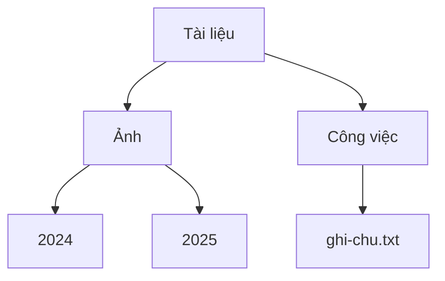
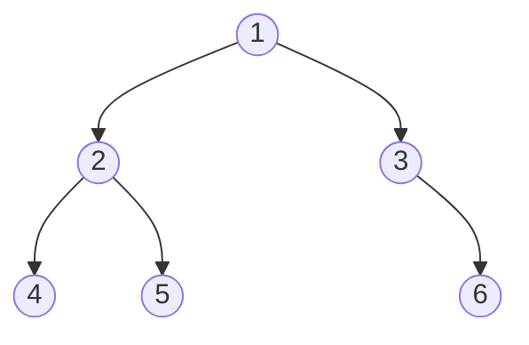

import Tabs from '@theme/Tabs';
import TabItem from '@theme/TabItem';

# Cây (Tree)

**Cây** giữ các phần tử theo thứ bậc: một phần tử ở trên cùng, mỗi phần tử lại có các phần tử nhỏ hơn treo bên dưới, như thư mục chứa thư mục.

## Ý tưởng

Hãy nghĩ đến các thư mục trên máy tính của bạn. Có một thư mục trên cùng. Bên trong nó là các tệp và các thư mục khác. Bên trong những thư mục đó lại có thêm tệp và thêm thư mục. Mỗi thư mục nằm trong đúng một thư mục khác, trừ thư mục trên cùng, vốn không nằm trong gì cả.

Cây chính là hình dạng đó:



Mỗi phần tử gọi là một **nút** (node), và mỗi đường nối giữa hai nút gọi là một **cạnh** (edge). Đây là các từ mọi người hay dùng:

- **Gốc** (root) là nút ở trên cùng: `Tài liệu`. Đó là nút duy nhất không có cha.
- **Cha** (parent) là nút nằm ngay phía trên một nút khác. `Ảnh` là cha của `2024` và `2025`.
- Các nút nằm ngay phía dưới một nút là **con** (child) của nó. Các con cùng một cha là **anh em** (sibling): `2024` và `2025` là anh em.
- **Lá** (leaf) là nút không có con: `2024`, `2025` và `ghi-chu.txt`.
- **Cây con** (subtree) là một nút cùng với mọi thứ bên dưới nó. `Ảnh`, `2024` và `2025` tạo thành một cây con.
- **Độ sâu** (depth) của một nút là số bước đi xuống từ gốc để đến nó. Gốc có độ sâu 0, `Ảnh` có độ sâu 1, và `2024` có độ sâu 2.
- **Chiều cao** (height) của một nút là số bước của con đường dài nhất đi xuống từ nó đến một lá. Chiều cao của cả cây là chiều cao của gốc, ở đây là 2.

Hai quy tắc làm nên một cái cây: mọi nút trừ gốc đều có **đúng một cha**, và bạn không bao giờ đi xuống rồi quay lại chỗ xuất phát (**không có vòng lặp**).

Một cái cây được tạo nên từ những cái cây nhỏ hơn: mỗi con là gốc của cây con của riêng nó. Đó là lý do nhiều bài toán về cây giải được bằng một ý tưởng đơn giản: "làm một việc cho nút này, rồi làm đúng việc đó cho từng con."

## Cách hoạt động

### Cây nhị phân

**Cây nhị phân** (binary tree) là một cái cây mà mỗi nút có **tối đa hai con**, gọi là **con trái** và **con phải**. Cây nhị phân là loại phổ biến nhất, và nhiều cấu trúc nổi tiếng được dựng từ nó, như [cây tìm kiếm nhị phân](./binary-search-tree.mdx) và [heap](./heap.mdx).

Đây là cây nhị phân được dùng cho phần còn lại của trang này:



Nút `3` không có con trái, chỉ có con phải (`6`). Trong code, mỗi nút lưu giá trị của nó và hai liên kết, `left` và `right`, bằng `null` khi không có con. Đó lại là ý tưởng của [danh sách liên kết](./linked-list.mdx), chỉ khác là có hai liên kết thay vì một.

### Đi qua một cái cây: các phép duyệt

Để ghé thăm mọi nút, bạn cần một quy tắc về thứ tự. Có bốn quy tắc kinh điển. Ba quy tắc đầu dùng ý tưởng "làm đúng việc đó cho từng con". Chúng chỉ khác nhau ở **thời điểm** ghé thăm chính nút đó:

- **Pre-order** (duyệt nút trước): nút trước, rồi cây con trái, rồi cây con phải.
- **In-order** (duyệt nút giữa): cây con trái trước, rồi nút, rồi cây con phải.
- **Post-order** (duyệt nút sau): cây con trái, rồi cây con phải, và nút ở cuối cùng.
- **Level-order** (duyệt theo tầng): từng tầng một, từ trên xuống, từ trái sang phải.

Với cây ở trên, chúng cho ra:

```text
pre-order:    1 2 4 5 3 6
in-order:     4 2 5 1 3 6
post-order:   4 5 2 6 3 1
level-order:  1 2 3 4 5 6
```

Pre-order, in-order và post-order đi **sâu** trước: chúng đi theo một nhánh đến tận đáy rồi mới quay lại. Chúng dễ viết bằng đệ quy, vì call stack của máy tính (xem trang [Ngăn xếp](./stack.mdx)) nhớ chỗ cần quay về. Level-order đi **rộng** trước, và dùng một [hàng đợi](./queue.mdx) để nhớ những nút đang chờ.

Mỗi thứ tự đều hữu ích cho một việc. Pre-order thăm cha trước các con, đó là cách danh sách thư mục thường được in ra. Post-order thăm các con trước cha, đúng thứ tự để xóa cả một cái cây. In-order hữu ích nhất cho [cây tìm kiếm nhị phân](./binary-search-tree.mdx), nơi nó cho ra các giá trị theo thứ tự đã sắp xếp.

### Cây cao bao nhiêu?

Chiều cao rất quan trọng, vì nhiều thao tác trên cây tốn thời gian tỷ lệ với chiều cao. Một cái cây có $n$ nút có thể thấp và sum suê, hoặc cao và mảnh:

- Cây nhị phân **hoàn hảo** (perfect, mọi tầng đều đầy) thấp nhất có thể. Chiều cao của nó khoảng $\log_2 n$. Ví dụ, một triệu nút nằm gọn trong khoảng 20 tầng.
- Cây **suy biến** (degenerate), nơi mỗi nút chỉ có một con, thực chất là một [danh sách liên kết](./linked-list.mdx) cải trang. Chiều cao của nó là $n - 1$.

<details>
<summary>Tùy chọn: phép tính đằng sau "khoảng 20 tầng"</summary>

Một cây nhị phân hoàn hảo có chiều cao $h$ có $1$ nút ở tầng 0, $2$ nút ở tầng 1, $4$ nút ở tầng 2, và cứ thế, nên tổng số nút của nó là:

$$
n = 1 + 2 + 4 + \dots + 2^h = 2^{h+1} - 1
$$

Với $h = 19$, con số này là $2^{20} - 1 = 1{,}048{,}575$ nút. Vậy một cái cây có khoảng một triệu nút chỉ cần 20 tầng nếu nó hoàn hảo.

</details>

### Các loại cây nhị phân khác

Bạn sẽ gặp các tên gọi này. Chúng mô tả hình dạng của một cây nhị phân:

- **Đầy** (full): mọi nút có 0 hoặc 2 con.
- **Hoàn chỉnh** (complete): mọi tầng đều đầy trừ tầng cuối, và tầng cuối được lấp từ bên trái. Heap dùng hình dạng này.
- **Hoàn hảo** (perfect): mọi tầng đều đầy hoàn toàn.
- **Cân bằng** (balanced): bên trái và bên phải của mọi nút có chiều cao xấp xỉ nhau.

## Code

Một nút chứa một giá trị và hai liên kết. Vì một cái cây được tạo nên từ những cái cây nhỏ hơn, các phép duyệt, chiều cao và số nút đều là các hàm đệ quy ngắn. Một hàm đệ quy nhận vào một cái cây rỗng (`null`) phải dừng ngay, nếu không nó sẽ crash. Việc kiểm tra đó là dòng đầu tiên của mọi hàm bên dưới.

Chiều cao ở đây tính bằng **số bước** (cạnh): một nút đơn lẻ có chiều cao 0, và cây rỗng có chiều cao -1. Một số sách tính theo số nút, khi đó một nút đơn lẻ có chiều cao 1. Hãy luôn kiểm tra xem sách hay bài thi bạn đang dùng theo quy ước nào.

Để code ngắn, bản C và C++ không kiểm tra việc cấp phát bộ nhớ có thành công hay không, và hàng đợi cho level-order chỉ có chỗ cho 16 nút.

### Dựng một cái cây và đi qua nó

<Tabs groupId="language">
  <TabItem value="c" label="C" default>

```c title="basics.c"
#include <stdio.h>
#include <stdlib.h>

typedef struct Node {
    int value;
    struct Node *left;   // con trái (NULL nếu không có)
    struct Node *right;  // con phải (NULL nếu không có)
} Node;

Node *new_node(int value, Node *left, Node *right) {
    Node *node = malloc(sizeof(Node));
    node->value = value;
    node->left = left;
    node->right = right;
    return node;
}

void preorder(const Node *n) {
    if (n == NULL) return;    // cây rỗng: không có gì để thăm
    printf("%d ", n->value);  // 1. chính nút này
    preorder(n->left);        // 2. rồi toàn bộ cây con trái
    preorder(n->right);       // 3. rồi toàn bộ cây con phải
}

void inorder(const Node *n) {
    if (n == NULL) return;
    inorder(n->left);         // 1. cây con trái
    printf("%d ", n->value);  // 2. chính nút này
    inorder(n->right);        // 3. cây con phải
}

void postorder(const Node *n) {
    if (n == NULL) return;
    postorder(n->left);       // 1. cây con trái
    postorder(n->right);      // 2. cây con phải
    printf("%d ", n->value);  // 3. chính nút này
}

void levelorder(Node *root) {
    Node *queue[16];  // các nút đang chờ được thăm
    int head = 0, tail = 0;
    queue[tail++] = root;
    while (head < tail) {
        Node *n = queue[head++];  // lấy nút kế tiếp trong hàng
        printf("%d ", n->value);
        if (n->left != NULL) queue[tail++] = n->left;
        if (n->right != NULL) queue[tail++] = n->right;
    }
}

int height(const Node *n) {
    if (n == NULL) return -1;  // cây rỗng
    int left = height(n->left);
    int right = height(n->right);
    return 1 + (left > right ? left : right);  // bên cao hơn + 1
}

int count(const Node *n) {
    if (n == NULL) return 0;
    return 1 + count(n->left) + count(n->right);
}

void free_tree(Node *n) {
    if (n == NULL) return;
    free_tree(n->left);   // các con trước...
    free_tree(n->right);
    free(n);              // ...rồi mới đến chính nút này
}

int main(void) {
    /*       1
     *     /   \
     *    2     3
     *   / \     \
     *  4   5     6
     */
    Node *root = new_node(1,
        new_node(2, new_node(4, NULL, NULL), new_node(5, NULL, NULL)),
        new_node(3, NULL, new_node(6, NULL, NULL)));

    printf("preorder: ");   preorder(root);    printf("\n");
    printf("inorder: ");    inorder(root);     printf("\n");
    printf("postorder: ");  postorder(root);   printf("\n");
    printf("levelorder: "); levelorder(root);  printf("\n");
    printf("height %d\n", height(root));  // height 2
    printf("count %d\n", count(root));    // count 6

    free_tree(root);
    return 0;
}
```

  </TabItem>
  <TabItem value="cpp" label="C++">

```cpp title="basics.cpp"
#include <algorithm>
#include <iostream>
#include <queue>

struct Node {
    int value;
    Node *left = nullptr;   // con trái (nullptr nếu không có)
    Node *right = nullptr;  // con phải (nullptr nếu không có)
};

Node *new_node(int value, Node *left, Node *right) {
    return new Node{value, left, right};
}

void preorder(const Node *n) {
    if (n == nullptr) return;       // cây rỗng: không có gì để thăm
    std::cout << n->value << " ";   // 1. chính nút này
    preorder(n->left);              // 2. rồi toàn bộ cây con trái
    preorder(n->right);             // 3. rồi toàn bộ cây con phải
}

void inorder(const Node *n) {
    if (n == nullptr) return;
    inorder(n->left);               // 1. cây con trái
    std::cout << n->value << " ";   // 2. chính nút này
    inorder(n->right);              // 3. cây con phải
}

void postorder(const Node *n) {
    if (n == nullptr) return;
    postorder(n->left);             // 1. cây con trái
    postorder(n->right);            // 2. cây con phải
    std::cout << n->value << " ";   // 3. chính nút này
}

void levelorder(Node *root) {
    std::queue<Node *> waiting;  // các nút đang chờ được thăm
    waiting.push(root);
    while (!waiting.empty()) {
        Node *n = waiting.front();  // lấy nút kế tiếp trong hàng
        waiting.pop();
        std::cout << n->value << " ";
        if (n->left != nullptr) waiting.push(n->left);
        if (n->right != nullptr) waiting.push(n->right);
    }
}

int height(const Node *n) {
    if (n == nullptr) return -1;  // cây rỗng
    // bên cao hơn + 1
    return 1 + std::max(height(n->left), height(n->right));
}

int count(const Node *n) {
    if (n == nullptr) return 0;
    return 1 + count(n->left) + count(n->right);
}

void free_tree(Node *n) {
    if (n == nullptr) return;
    free_tree(n->left);   // các con trước...
    free_tree(n->right);
    delete n;             // ...rồi mới đến chính nút này
}

int main() {
    /*       1
     *     /   \
     *    2     3
     *   / \     \
     *  4   5     6
     */
    Node *root = new_node(1,
        new_node(2, new_node(4, nullptr, nullptr),
                    new_node(5, nullptr, nullptr)),
        new_node(3, nullptr, new_node(6, nullptr, nullptr)));

    std::cout << "preorder: ";   preorder(root);    std::cout << "\n";
    std::cout << "inorder: ";    inorder(root);     std::cout << "\n";
    std::cout << "postorder: ";  postorder(root);   std::cout << "\n";
    std::cout << "levelorder: "; levelorder(root);  std::cout << "\n";
    std::cout << "height " << height(root) << "\n";  // height 2
    std::cout << "count " << count(root) << "\n";    // count 6

    free_tree(root);
}
```

  </TabItem>
  <TabItem value="python" label="Python">

```python title="basics.py"
from collections import deque


class Node:
    def __init__(self, value, left=None, right=None):
        self.value = value
        self.left = left    # con trái (None nếu không có)
        self.right = right  # con phải (None nếu không có)


def preorder(n):
    if n is None:  # cây rỗng: không có gì để thăm
        return
    print(n.value, end=" ")  # 1. chính nút này
    preorder(n.left)         # 2. rồi toàn bộ cây con trái
    preorder(n.right)        # 3. rồi toàn bộ cây con phải


def inorder(n):
    if n is None:
        return
    inorder(n.left)          # 1. cây con trái
    print(n.value, end=" ")  # 2. chính nút này
    inorder(n.right)         # 3. cây con phải


def postorder(n):
    if n is None:
        return
    postorder(n.left)        # 1. cây con trái
    postorder(n.right)       # 2. cây con phải
    print(n.value, end=" ")  # 3. chính nút này


def levelorder(root):
    waiting = deque([root])  # các nút đang chờ được thăm
    while waiting:
        n = waiting.popleft()  # lấy nút kế tiếp trong hàng
        print(n.value, end=" ")
        if n.left is not None:
            waiting.append(n.left)
        if n.right is not None:
            waiting.append(n.right)


def height(n):
    if n is None:
        return -1  # cây rỗng
    return 1 + max(height(n.left), height(n.right))  # bên cao hơn + 1


def count(n):
    if n is None:
        return 0
    return 1 + count(n.left) + count(n.right)


#       1
#     /   \
#    2     3
#   / \     \
#  4   5     6
root = Node(1, Node(2, Node(4), Node(5)), Node(3, None, Node(6)))

print("preorder:", end=" ");   preorder(root);    print()
print("inorder:", end=" ");    inorder(root);     print()
print("postorder:", end=" ");  postorder(root);   print()
print("levelorder:", end=" "); levelorder(root);  print()
print("height", height(root))  # height 2
print("count", count(root))    # count 6
```

  </TabItem>
  <TabItem value="java" label="Java">

```java title="Basics.java"
import java.util.ArrayDeque;
import java.util.Queue;

public class Basics {
    static class Node {
        int value;
        Node left;   // con trái (null nếu không có)
        Node right;  // con phải (null nếu không có)

        Node(int value, Node left, Node right) {
            this.value = value;
            this.left = left;
            this.right = right;
        }
    }

    static void preorder(Node n) {
        if (n == null) return;  // cây rỗng: không có gì để thăm
        System.out.print(n.value + " ");  // 1. chính nút này
        preorder(n.left);                 // 2. rồi cây con trái
        preorder(n.right);                // 3. rồi cây con phải
    }

    static void inorder(Node n) {
        if (n == null) return;
        inorder(n.left);                  // 1. cây con trái
        System.out.print(n.value + " ");  // 2. chính nút này
        inorder(n.right);                 // 3. cây con phải
    }

    static void postorder(Node n) {
        if (n == null) return;
        postorder(n.left);                // 1. cây con trái
        postorder(n.right);               // 2. cây con phải
        System.out.print(n.value + " ");  // 3. chính nút này
    }

    static void levelorder(Node root) {
        Queue<Node> waiting = new ArrayDeque<>();  // đang chờ được thăm
        waiting.offer(root);
        while (!waiting.isEmpty()) {
            Node n = waiting.poll();  // lấy nút kế tiếp trong hàng
            System.out.print(n.value + " ");
            if (n.left != null) waiting.offer(n.left);
            if (n.right != null) waiting.offer(n.right);
        }
    }

    static int height(Node n) {
        if (n == null) return -1;  // cây rỗng
        // bên cao hơn + 1
        return 1 + Math.max(height(n.left), height(n.right));
    }

    static int count(Node n) {
        if (n == null) return 0;
        return 1 + count(n.left) + count(n.right);
    }

    static void label(String name) {
        System.out.print(name + ": ");
    }

    public static void main(String[] args) {
        //       1
        //     /   \
        //    2     3
        //   / \     \
        //  4   5     6
        Node left = new Node(2, new Node(4, null, null),
                                new Node(5, null, null));
        Node right = new Node(3, null, new Node(6, null, null));
        Node root = new Node(1, left, right);

        label("preorder");   preorder(root);    System.out.println();
        label("inorder");    inorder(root);     System.out.println();
        label("postorder");  postorder(root);   System.out.println();
        label("levelorder"); levelorder(root);  System.out.println();
        System.out.println("height " + height(root));  // height 2
        System.out.println("count " + count(root));    // count 6
    }
}
```

  </TabItem>
</Tabs>

## Độ phức tạp

Nếu O(1) và O(n) còn mới với bạn, hãy xem trang [Mảng](./array.mdx). Ở đây $n$ là số nút và $h$ là chiều cao của cây.

| Thao tác                                    | Chi phí     | Nói bằng lời                                                            |
| ------------------------------------------- | ----------- | ----------------------------------------------------------------------- |
| Thăm mọi nút (bất kỳ phép duyệt nào)        | $O(n)$      | Mỗi nút được thăm một lần.                                              |
| Tìm một giá trị trong cây không có thứ tự   | $O(n)$      | Bạn có thể phải xem mọi nút.                                            |
| Chiều cao của cây cân bằng                  | $O(\log n)$ | Thấp và sum suê: một triệu nút cần khoảng 20 tầng.                      |
| Chiều cao của cây suy biến                  | $O(n)$      | Một chuỗi cao và mảnh, y như danh sách liên kết.                        |
| Bộ nhớ phụ cho phép duyệt đệ quy            | $O(h)$      | Call stack nhớ một bước cho mỗi tầng.                                   |
| Bộ nhớ cho chính cái cây                    | $O(n)$      | Mỗi phần tử một nút, cùng các liên kết của nó.                          |

Một cái cây thường không có thứ tự nào, nên tìm kiếm trong nó chậm. Những loại cây tìm kiếm nhanh ([cây tìm kiếm nhị phân](./binary-search-tree.mdx)) và nhanh cho việc "cho tôi phần tử lớn nhất" ([heap](./heap.mdx)) thêm các quy tắc lên trên hình dạng cơ bản này.

## Khi nào nên dùng

Cây rất phù hợp khi dữ liệu của bạn vốn có **thứ bậc**:

- **Thư mục và tệp.** Một hệ thống tệp là một cái cây.
- **Trang web.** HTML của một trang là một cái cây các phần tử nằm trong các phần tử.
- **Các lựa chọn lồng nhau.** Một trò chơi rẽ nhánh kiểu "nếu bạn làm thế này, thì thế kia" là một cái cây các khả năng.
- **Viên gạch xây dựng.** Cây tìm kiếm, heap và trie đều là các cái cây có thêm quy tắc.

Hãy xem xét cấu trúc khác khi:

- Các phần tử của bạn đơn giản nằm thành một hàng. [Mảng](./array.mdx) hoặc [danh sách liên kết](./linked-list.mdx) đơn giản hơn.
- Các phần tử có thể kết nối với **nhiều** phần tử khác, kể cả tạo vòng, như những con đường giữa các thành phố hay bạn bè trong mạng xã hội. Đó là [đồ thị](./graph.mdx). Cây là một đồ thị không có vòng, nơi mỗi nút có một cha.

:::warning[Lỗi thường gặp]
- **Quên trường hợp rỗng.** Mọi hàm đệ quy đều phải xử lý `null` trước. Không có phép kiểm tra đó, nó sẽ crash ngay khi chạm tới con còn thiếu của một chiếc lá.
- **Nhầm độ sâu với chiều cao.** Độ sâu đếm số bước **đi xuống từ gốc** đến một nút. Chiều cao đếm số bước **đi xuống từ một nút** đến chiếc lá sâu nhất của nó.
- **Nhầm tên các phép duyệt.** "Pre", "in" và "post" cho bạn biết **khi nào chính nút đó** được thăm: trước, giữa, hoặc sau hai cây con của nó.
- **Giải phóng một nút trước các con của nó trong C và C++.** Khi đó bạn không còn tới được các con, và bộ nhớ của chúng bị rò rỉ. Hãy giải phóng các con trước.
- **Cây quá sâu.** Đệ quy dùng một bước của call stack cho mỗi tầng. Một cây suy biến có một triệu nút có thể làm call stack bị tràn.
:::

## Nguồn tham khảo

Các thông tin trên trang này được đối chiếu với:

- [Tree (abstract data type), Wikipedia](https://en.wikipedia.org/wiki/Tree_%28abstract_data_type%29)
- [Binary tree, Wikipedia](https://en.wikipedia.org/wiki/Binary_tree)
- [Tree traversal, Wikipedia](https://en.wikipedia.org/wiki/Tree_traversal)
