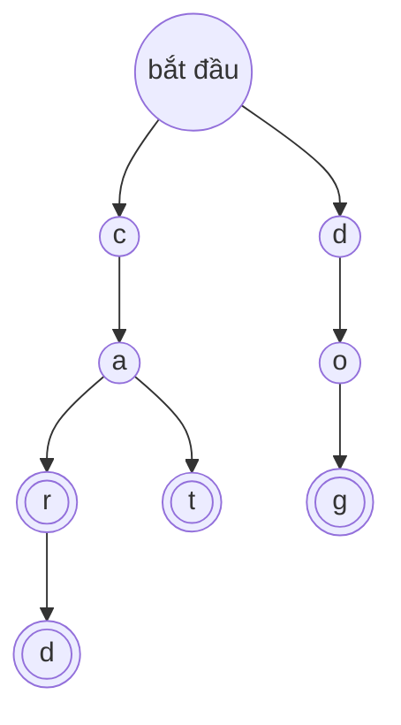

import Tabs from '@theme/Tabs';
import TabItem from '@theme/TabItem';

# Trie (Cây tiền tố)

**Trie** (đọc là "trai") là một [cây](./tree.mdx) để lưu các từ, mỗi bước một chữ cái. Nó là cấu trúc đứng sau tính năng gợi ý khi gõ (autocomplete): bạn gõ vài chữ cái và nó biết ngay những từ nào bắt đầu như vậy.

## Ý tưởng

Hãy nghĩ cách tính năng gợi ý hoạt động trên điện thoại của bạn. Bạn gõ `c`, và điện thoại thu hẹp về các từ bắt đầu bằng `c`. Bạn gõ `a`, và nó thu hẹp về các từ bắt đầu bằng `ca`. Mỗi chữ cái bạn gõ làm giảm bớt các lựa chọn.

Trie lưu các từ đúng theo cách đó. Hãy tưởng tượng một chuyến đi bộ mà ở mỗi ngã rẽ có các biển chỉ đường, mỗi biển cho một chữ cái có thể xuất hiện tiếp theo. Bạn bắt đầu từ lối vào. Để kiểm tra `cat` có được lưu hay không, bạn đi theo biển `c`, rồi biển `a`, rồi biển `t`. Mỗi ngã rẽ bạn đi qua là một **nút**, và con đường bạn đã đi viết ra các chữ cái cho đến lúc đó.

Còn một điều nữa: một từ có thể kết thúc tại một ngã rẽ vẫn còn đường đi tiếp. `car` là một từ, và `card` cũng vậy, và chúng dùng chung con đường cho `c`, `a` và `r`. Vì thế mỗi nút còn mang một cờ báo "có một từ kết thúc ở đây". Trong hình, những nút đó có vòng tròn đôi.



Trie này lưu bốn từ: `car`, `card`, `cat` và `dog`. Các từ `car`, `card` và `cat` dùng chung phần đầu của đường đi (`c`, rồi `a`), nên những nút đó chỉ được lưu một lần.

## Cách hoạt động

### Chèn một từ

Bắt đầu từ gốc. Với mỗi chữ cái của từ, đi theo con đường của chữ cái đó. Nếu con đường chưa tồn tại, hãy xây nó: tạo một nút mới. Sau chữ cái cuối cùng, bật cờ ở nút bạn dừng lại: có một từ kết thúc ở đây.

Để chèn `card` vào trie ở trên, bạn đi theo `c`, `a` và `r`, những nút này đã có sẵn, rồi xây một nút mới cho `d` và bật cờ của nó. Nếu bạn chèn `card` trước `car`, bạn sẽ phải xây cả bốn nút trước, và `car` chỉ cần bật cờ cho nút `r` đã có.

### Tìm kiếm một từ

Đi theo các chữ cái của từ, bắt đầu từ gốc. Nếu ở một chữ cái nào đó con đường không tồn tại, từ đó không được lưu. Nếu bạn đi tới cuối từ, hãy kiểm tra cờ. Cờ rất quan trọng: các chữ cái `ca` dẫn tới một nút, nhưng `ca` không phải là một từ được lưu, nên câu trả lời cho `ca` là không.

### Tìm kiếm một tiền tố

Đây là điểm làm trie đặc biệt. Để biết **có từ nào** đã lưu bắt đầu bằng một số chữ cái hay không, hãy đi theo các chữ cái đó. Nếu bạn đi trọn được con đường, câu trả lời là có. Bạn không nhìn vào cờ, vì tiền tố không cần bản thân nó là một từ. Để liệt kê mọi từ có tiền tố đó, hãy đi tới nút đó rồi thăm mọi nút bên dưới nó.

### Vì sao việc này nhanh

Mỗi bước tìm kiếm đi theo một chữ cái, nên số bước chính là **độ dài của từ**, dù trie chứa 10 từ hay 10 triệu từ. Trie không bao giờ phải so sánh nguyên cả từ này với từ kia.

Một trie cơ bản có thể dùng rất nhiều bộ nhớ, vì mỗi nút thường có chỗ cho mọi chữ cái có thể có, dù phần lớn chỗ đó vẫn để trống. Có những mẹo để tiết kiệm chỗ. Ví dụ, trie nén (còn gọi là **radix tree**) gộp một chuỗi các nút chỉ có một con thành một nút duy nhất.

## Code

Mỗi nút chứa các con của nó và cờ "có một từ kết thúc ở đây". Trong C, C++ và Java, các con được lưu trong một mảng có một ô cho mỗi chữ cái từ `a` đến `z`, và code giả định chỉ có chữ thường. Trong Python chúng được lưu trong một dictionary, cách này cũng dùng được cho mọi ký tự khác. Để code ngắn, bản C không kiểm tra `calloc` có thành công hay không.

### Dựng một trie

<Tabs groupId="language">
  <TabItem value="c" label="C" default>

```c title="basics.c"
#include <stdio.h>
#include <stdlib.h>

typedef struct Node {
    struct Node *children[26];  // một ô mỗi chữ cái, a-z
    int is_word;                // 1 nếu có từ kết thúc
} Node;

Node *new_node(void) {
    return calloc(1, sizeof(Node));  // mọi ô là NULL, is_word là 0
}

void insert(Node *root, const char *word) {
    Node *node = root;
    for (const char *c = word; *c != '\0'; c++) {
        int i = *c - 'a';
        if (node->children[i] == NULL) {  // chưa có đường cho chữ này
            node->children[i] = new_node();
        }
        node = node->children[i];  // đi theo chữ cái
    }
    node->is_word = 1;  // có một từ kết thúc ở đây
}

// Đi theo các chữ cái của text. Trả về nút tới được, hoặc NULL.
Node *walk(Node *root, const char *text) {
    Node *node = root;
    for (const char *c = text; *c != '\0'; c++) {
        node = node->children[*c - 'a'];
        if (node == NULL) return NULL;  // không có đường
    }
    return node;
}

int has(Node *root, const char *word) {
    Node *node = walk(root, word);
    return node != NULL && node->is_word;  // tới được, có từ
}

int starts(Node *root, const char *prefix) {
    return walk(root, prefix) != NULL;  // tới được cuối là đủ
}

void free_trie(Node *node) {
    if (node == NULL) return;
    for (int i = 0; i < 26; i++) free_trie(node->children[i]);
    free(node);
}

const char *yn(int b) { return b ? "yes" : "no"; }

int main(void) {
    Node *root = new_node();
    insert(root, "car");
    insert(root, "card");
    insert(root, "cat");
    insert(root, "dog");

    printf("has car: %s\n", yn(has(root, "car")));
    printf("has ca: %s\n", yn(has(root, "ca")));
    printf("has card: %s\n", yn(has(root, "card")));
    printf("has cow: %s\n", yn(has(root, "cow")));
    printf("starts ca: %s\n", yn(starts(root, "ca")));
    printf("starts do: %s\n", yn(starts(root, "do")));
    printf("starts cu: %s\n", yn(starts(root, "cu")));

    free_trie(root);
    return 0;
}
```

  </TabItem>
  <TabItem value="cpp" label="C++">

```cpp title="basics.cpp"
#include <iostream>
#include <memory>
#include <string>

struct Node {
    std::unique_ptr<Node> children[26];  // một ô mỗi chữ cái, a-z
    bool is_word = false;                // true nếu có từ kết thúc
};

void insert(Node &root, const std::string &word) {
    Node *node = &root;
    for (char c : word) {
        int i = c - 'a';
        if (!node->children[i]) {  // chưa có đường cho chữ này
            node->children[i] = std::make_unique<Node>();
        }
        node = node->children[i].get();  // đi theo chữ cái
    }
    node->is_word = true;  // có một từ kết thúc ở đây
}

// Đi theo các chữ cái của text. Trả về nút tới được, hoặc nullptr.
const Node *walk(const Node &root, const std::string &text) {
    const Node *node = &root;
    for (char c : text) {
        node = node->children[c - 'a'].get();
        if (node == nullptr) return nullptr;  // không có đường
    }
    return node;
}

bool has(const Node &root, const std::string &word) {
    const Node *node = walk(root, word);
    return node != nullptr && node->is_word;  // kiểm tra cờ
}

bool starts(const Node &root, const std::string &prefix) {
    return walk(root, prefix) != nullptr;  // tới được cuối là đủ
}

const char *yn(bool b) { return b ? "yes" : "no"; }

int main() {
    Node root;
    insert(root, "car");
    insert(root, "card");
    insert(root, "cat");
    insert(root, "dog");

    std::cout << "has car: " << yn(has(root, "car")) << "\n";
    std::cout << "has ca: " << yn(has(root, "ca")) << "\n";
    std::cout << "has card: " << yn(has(root, "card")) << "\n";
    std::cout << "has cow: " << yn(has(root, "cow")) << "\n";
    std::cout << "starts ca: " << yn(starts(root, "ca")) << "\n";
    std::cout << "starts do: " << yn(starts(root, "do")) << "\n";
    std::cout << "starts cu: " << yn(starts(root, "cu")) << "\n";
}
```

  </TabItem>
  <TabItem value="python" label="Python">

```python title="basics.py"
class Node:
    def __init__(self):
        self.children = {}  # chữ cái -> nút mà chữ cái đó dẫn tới
        self.is_word = False  # True nếu có từ kết thúc ở nút này


def insert(root, word):
    node = root
    for letter in word:
        if letter not in node.children:  # chưa có đường cho chữ này
            node.children[letter] = Node()
        node = node.children[letter]  # đi theo chữ cái
    node.is_word = True  # có một từ kết thúc ở đây


def walk(root, text):
    """Đi theo các chữ cái của text. Trả về nút tới được, hoặc None."""
    node = root
    for letter in text:
        node = node.children.get(letter)
        if node is None:
            return None  # không có đường
    return node


def has(root, word):
    node = walk(root, word)
    return node is not None and node.is_word  # tới được, có từ


def starts(root, prefix):
    return walk(root, prefix) is not None  # tới được cuối là đủ


def yn(flag):
    return "yes" if flag else "no"


root = Node()
for word in ["car", "card", "cat", "dog"]:
    insert(root, word)

print("has car:", yn(has(root, "car")))
print("has ca:", yn(has(root, "ca")))
print("has card:", yn(has(root, "card")))
print("has cow:", yn(has(root, "cow")))
print("starts ca:", yn(starts(root, "ca")))
print("starts do:", yn(starts(root, "do")))
print("starts cu:", yn(starts(root, "cu")))
```

  </TabItem>
  <TabItem value="java" label="Java">

```java title="Basics.java"
public class Basics {
    static class Node {
        Node[] children = new Node[26];  // một ô mỗi chữ cái, a-z
        boolean isWord;                  // true nếu có từ kết thúc
    }

    static void insert(Node root, String word) {
        Node node = root;
        for (char c : word.toCharArray()) {
            int i = c - 'a';
            if (node.children[i] == null) {  // chưa có đường
                node.children[i] = new Node();
            }
            node = node.children[i];  // đi theo chữ cái
        }
        node.isWord = true;  // có một từ kết thúc ở đây
    }

    // Đi theo các chữ cái của text. Trả về nút tới được, hoặc null.
    static Node walk(Node root, String text) {
        Node node = root;
        for (char c : text.toCharArray()) {
            node = node.children[c - 'a'];
            if (node == null) return null;  // không có đường
        }
        return node;
    }

    static boolean has(Node root, String word) {
        Node node = walk(root, word);
        return node != null && node.isWord;  // tới được, có từ
    }

    static boolean starts(Node root, String prefix) {
        return walk(root, prefix) != null;  // đã tới cuối
    }

    static String yn(boolean b) {
        return b ? "yes" : "no";
    }

    public static void main(String[] args) {
        Node root = new Node();
        for (String word : new String[] {"car", "card", "cat", "dog"}) {
            insert(root, word);
        }

        System.out.println("has car: " + yn(has(root, "car")));
        System.out.println("has ca: " + yn(has(root, "ca")));
        System.out.println("has card: " + yn(has(root, "card")));
        System.out.println("has cow: " + yn(has(root, "cow")));
        System.out.println("starts ca: " + yn(starts(root, "ca")));
        System.out.println("starts do: " + yn(starts(root, "do")));
        System.out.println("starts cu: " + yn(starts(root, "cu")));
    }
}
```

  </TabItem>
</Tabs>

## Độ phức tạp

Nếu O(1) và O(n) còn mới với bạn, hãy xem trang [Mảng](./array.mdx). Ở đây $L$ là **độ dài của từ** bạn đang chèn hoặc tra cứu (số chữ cái của nó), không phải số từ đã lưu.

| Thao tác                                   | Chi phí | Nói bằng lời                                                                |
| ------------------------------------------ | ------- | --------------------------------------------------------------------------- |
| Chèn một từ                                | $O(L)$  | Mỗi chữ cái một bước.                                                       |
| Tìm kiếm một từ                            | $O(L)$  | Mỗi chữ cái một bước, rồi nhìn cờ.                                          |
| Có từ nào bắt đầu bằng tiền tố này không?  | $O(L)$  | Đi theo tiền tố. Xong ngay khi tới cuối của nó.                             |
| Liệt kê mọi từ có một tiền tố              | $O(L + k)$ | Đi theo tiền tố, rồi thăm $k$ nút bên dưới nó.                           |
| Bộ nhớ sử dụng                             | nhiều nhất một nút cho mỗi chữ cái của mọi từ | Phần đầu dùng chung chỉ được lưu một lần. Tuy nhiên với 26 ô cho mỗi nút, nhiều chỗ vẫn để trống. |

Chi phí phụ thuộc vào độ dài của từ chứ không phụ thuộc vào số từ đã lưu. Một trie có một triệu từ vẫn tìm `cat` trong 3 bước.

## Khi nào nên dùng

Trie rất phù hợp khi bạn làm việc với **các từ hoặc các chuỗi khác**, và **phần đầu** của từ là quan trọng:

- **Gợi ý khi gõ.** Những từ đã lưu nào bắt đầu bằng thứ người dùng đã gõ?
- **Kiểm tra chính tả và trò chơi ghép chữ.** Đây có phải là một từ hợp lệ không? Bộ chữ cái này còn có thể trở thành một từ không?
- **So khớp tiền tố.** Các bộ định tuyến mạng so khớp một địa chỉ với các tiền tố địa chỉ đã lưu. (Bộ định tuyến thật dùng trie nén.)

Hãy xem xét cấu trúc khác khi:

- Bạn chỉ hỏi "từ chính xác này có được lưu không?". [Bảng băm](./hash-table.mdx) đơn giản hơn và thường dùng ít bộ nhớ hơn.
- Bạn cần xử lý số hoặc những thứ không được tạo từ một chuỗi các mảnh nhỏ. [Cây tìm kiếm nhị phân](./binary-search-tree.mdx) phù hợp hơn.
- Bộ nhớ eo hẹp và có ít từ. Mỗi chữ cái có thể tốn cả một nút.

:::warning[Lỗi thường gặp]
- **Quên cờ "có từ kết thúc ở đây".** Không có nó, bạn không thể biết `car` là một từ đã lưu hay chỉ là phần đầu của `card`.
- **Các ký tự ngoài a đến z.** Với mảng 26 ô, một chữ hoa, một dấu cách hay một chữ có dấu cho ra chỉ số nằm ngoài mảng và có thể làm chương trình crash trong C, C++ và Java. Hãy đổi văn bản sang chữ thường trước, hoặc lưu các con trong một dictionary hay hash map.
- **Hết bộ nhớ.** Một nút có 26 ô là rất lớn. Một trie có hàng triệu từ có thể cần nhiều bộ nhớ hơn hẳn chính các từ đó.
- **Rò rỉ nút trong C.** Hãy giải phóng cả trie khi bạn xong việc: các con trước, rồi mới đến nút.
- **Xóa một từ cẩu thả.** Xóa `car` không được xóa những nút mà `card` cần. Hãy tắt cờ trước, và chỉ xóa những nút không từ nào khác dùng.
:::

## Nguồn tham khảo

Các thông tin trên trang này được đối chiếu với:

- [Trie, Wikipedia](https://en.wikipedia.org/wiki/Trie)
