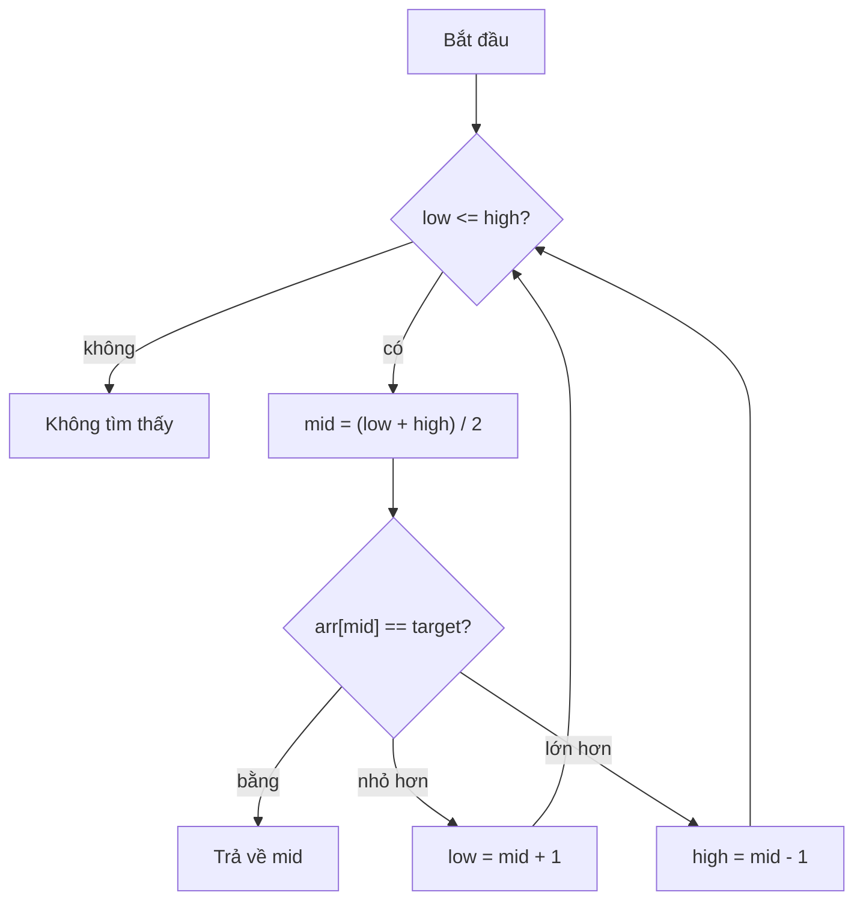

import Tabs from '@theme/Tabs';
import TabItem from '@theme/TabItem';

# Hướng dẫn viết bài

Trang này giới thiệu mọi tính năng định dạng có thể dùng khi viết một chủ đề, đồng thời là trang kiểm tra nhanh cho cả site. Hãy xóa trang này khi bạn đã quen với các tính năng.

## Công thức toán

Công thức nằm trong dòng văn bản, ví dụ $O(n \log n)$. Công thức hiển thị riêng một dòng:

$$
T(n) = 2\,T\!\left(\frac{n}{2}\right) + O(n) \;\Rightarrow\; T(n) = O(n \log n)
$$

## Sơ đồ

Sơ đồ được viết dưới dạng văn bản bằng [Mermaid](https://mermaid.js.org/):



## Code với nhiều ngôn ngữ

Ngôn ngữ đã chọn được ghi nhớ và đồng bộ trên mọi khối code của site.

<Tabs groupId="language">
  <TabItem value="python" label="Python" default>

```python title="binary_search.py"
def binary_search(arr, target):
    low, high = 0, len(arr) - 1
    while low <= high:
        mid = (low + high) // 2
        if arr[mid] == target:
            return mid
        if arr[mid] < target:
            low = mid + 1
        else:
            high = mid - 1
    return -1
```

  </TabItem>
  <TabItem value="cpp" label="C++">

```cpp title="binary_search.cpp"
int binarySearch(const std::vector<int>& arr, int target) {
    int low = 0, high = static_cast<int>(arr.size()) - 1;
    while (low <= high) {
        int mid = low + (high - low) / 2;
        if (arr[mid] == target) return mid;
        if (arr[mid] < target) low = mid + 1;
        else high = mid - 1;
    }
    return -1;
}
```

  </TabItem>
  <TabItem value="java" label="Java">

```java title="BinarySearch.java"
static int binarySearch(int[] arr, int target) {
    int low = 0, high = arr.length - 1;
    while (low <= high) {
        int mid = low + (high - low) / 2;
        if (arr[mid] == target) return mid;
        if (arr[mid] < target) low = mid + 1;
        else high = mid - 1;
    }
    return -1;
}
```

  </TabItem>
</Tabs>

Tô sáng một dòng bằng chú thích:

```python
def add(a, b):
    # highlight-next-line
    return a + b
```

## Khung nhắc

:::tip
Dùng mẹo cho một lối tắt hoặc một thói quen tốt.
:::

:::warning
Dùng cảnh báo cho lỗi thường gặp, chẳng hạn lỗi lệch một đơn vị (off-by-one).
:::

:::danger
Dùng khung nguy hiểm cho điều làm hỏng thuật toán.
:::

## Mẫu trang

Sao chép khung này cho một chủ đề mới:

````md
---
title: Binary Search
description: Tìm một phần tử trong mảng đã sắp xếp với độ phức tạp O(log n).
---

## Ý tưởng
## Cách hoạt động
## Code
## Độ phức tạp
## Khi nào nên dùng
````
